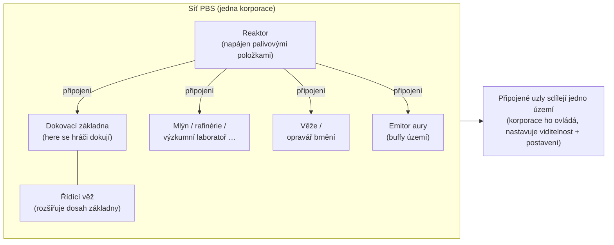
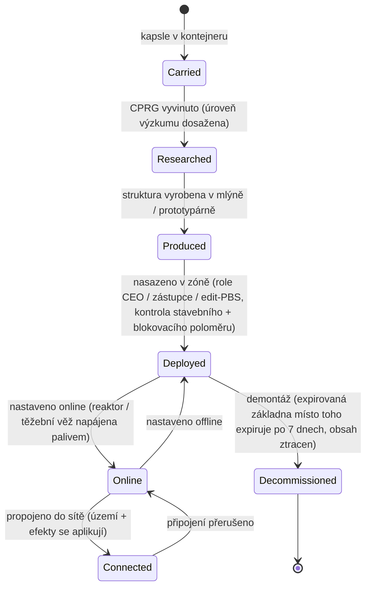

# Základní stanice napájení (PBS)

**PBS** (Power Base Station) je umísitelná struktura v zóně. Objekty PBS lze
**připojit** do **sítě**, která definuje **území** a umožňuje **efekty**.
Jedná se o korporátní/strukturní aktivitu — většina akcí vyžaduje příslušnou
korporátní roli.

> Umístění v UI sledujte v [přehledu uživatelského rozhraní klienta](/cs/features/ui/).
> Název „PBS" v klientu by měl být potvrzen. Mechaniky níže jsou ověřeny
> proti serveru.

## Co PBS dělá

- Je to **uzel** v síti **PBS**.
- Připojené uzly tvoří sdílené **území**, které ovládá vlastní korporace.
- Síť může do svého území promítat **efekty** (buffy/ovládání).
- Některé struktury PBS lze **napájet** položkami (palivem) pro provoz.

## Rodiny struktur

Každá struktura PBS se vyskytuje ve třech velikostních třídách: **malá / střední / velká**.
Nositel **kapsle**, vyvíjí položku (CPRG) a **nasadí** objekt — nasazení je
omezeno oprávněním (viz níže). Rodiny:

| Rodina | Struktury | Role |
|---|---|---|
| Napájení | reaktor, energetický studen, jádrová baterie, jádrový přenosník | generují, ukládají a distribuuji **jádrovou energii**, na které vše běží |
| Dokování | dokovací základna, expirovaná dokovací základna, řídící věž | místo, kde se hráči dokují; řídící věž rozšiřuje dosah základny |
| Produkce | mlýn, rafinérie, přepěrašovna, oprava, prototypář, výzkumní laboratoř, kalibrační (CPRG) kovárna, kovárna výzkumných sad, produkční upgrade | [produkční](/cs/features/production/) zařízení, v zóně místo na domovské základně |
| Obrana | věže (laser / rail / střela / elektronická válka), opravář brnění | automatická obrana území |
| Efekty | emitor aury, dodavatel efektu, maskertower, těžební věž | promítají bonusy efektů území; těžební věž automaticky těží rudu |
| Doprava | dálniční uzel | propojení s **dálnicí** zóny (linky rychlého cestování) |
| Stavba | stavební modul | stavitel, který umisťuje ostatní struktury |

### Efekty emitoru aury

Emitor aury je hlavní buff území. Každá třída promítá jeden ze tří
**úrovňově škálovaných základních bonusů**:

- **malá** — senzory úr.1 / inženýrství úr.1 / průmysl úr.1
- **střední** — stejné tři na úr.2
- **velká** — stejné tři na úr.3

Senzory prodlužují dosah skenování/reconu, inženýrství zrychluje stavbu, průmysl zrychluje
produkci.

### Expirovaná dokovací základna

Speciální základna PBS s pevnou **délkou trvání 7 dní** (168 h v obsahu). **Nelze
ji demontovat** — buď **expirová, nebo je zničena**. Zbývající doba trvání je
ohlášena herním oznamovatelem (téma kanálu základny, e-mail a MOTD); když vyprší,
základna je zničena a její obsah je ztracen. Toto je model „nájmu" pro PBS
dokování: neplatíte nájem, dostanete časový limit.

## Nasazení

- **Kontrola nasazení** — před umístěním ověřte, zda lze PBS nasadit na dané
  pozici (sklon, blokování a kontrola oprávnění). Vyžaduje korporátní roli
  (**CEO / zástupce / edit-PBS**).
- Nasazení používá **stavební poloměr** a **blokovací poloměr** struktury.

## Síť a připojení

- **Získat síť** — zobrazit síť PBS, jejíž součástí jste.
- **Informace o uzlu** — podrobnosti o uzlu PBS.
- **Přejmenovat uzel**.
- **Vytvořit připojení** — propojit dva uzly PBS. (Připojení do sítě, která již má
  dokovací základnu, spouští specifický případ přenosu vlastnictví.)
- **Přerušit připojení** — odpojit dva uzly.
- **Nastavit váhu připojení** — upravit sílu/prioritu připojení.

## Ovládání a stav

- **Nastavit online** — přepnout uzel online/offline.
- **Nastavit efekt** — nakonfigurovat efekt, který uzel promítá.
- **Nastavit demontáž základny** — označit základnu k demontáži.

## Území

- **Získat území** — vypsat území, která vaše síť ovládá.
- **Nastavit viditelnost území** — ovládat, zda je území viditelné pro ostatní.
- **Nastavit limit postavení** — omezit přístup podle postavení.
- **Nastavit offset posílení** — upravit chování posílení.

## Napájení

- **Informace o napájení** — co PBS potřebuje a jeho aktuální stav napájení.
- **Napájet položkami** — předat položky pro napájení/provoz PBS.

Napájitelné struktury jsou **reaktor** a **těžební věž**. Napájení převádí
položky s energetickou hodnotou (`corecalories` na kus) do jádrového energetického
bufferu uzlu, až po maximum — jakýkoli hráč v dosahu může uzel napájet. Co lze spálit:

| Palivo | Jádro na kus |
|---|---|
| Reaktorový booster třída C | 8 000 000 |
| Reaktorový booster třída B | 4 000 000 |
| Reaktorový booster třída A | 2 000 000 |
| Specimen SAP (intruze) | 600 000 (flux varianta: 28 000) |
| Gamma energetický blok | 2 000 |
| Jádrový booster náboj | 1 000 |
| Surová ruda (espitium) | 400 |
| Surová ruda (vitricyl / prilumium / chollonin) | 300 |
| Surová ruda (axicol) | 40 |

Boostery jsou efektivní palivo; surová ruda je levná záloha.

## Náhrazda

- **Získat / nastavit informace o náhradě** — nakonfigurovat náhradu nákladů souvisejících s PBS.

## Logy

- **Logy PBS** — prohledat aktivitu PBS (připojení, nasazení atd.).

## Praktické poznámky

- **Jedná se o důstojnickou aktivitu** — nasazení a většina ovládacích prvků vyžaduje korporátní roli.
- **Připojení definují území** — síť, kterou stavíte, je to, co ovládáte.
- **Nejprve zkontrolujte nasazení** — řekne vám, proč by umístění selhalo (sklon, blokování,
  oprávnění), než se zavážete.
- **Napájení udržuje provoz** — reaktory a těžební věže spalují palivové položky (boostery
  nebo surovou rudu), aby udržely svůj jádrový buffer.
- **Expirovaná základna je váš časový limit** — 7 dní, bez demontáže; plánujte na zničení.
- **Viditelnost území a postavení** vám umožňují otevřít nebo uzavřít vaši zónu pro ostatní.

## Obranné věže

Není ovladatelné hráčem — nasazují se jako obranné struktury PBS. Věže se sestavují z
dílů jako jakýkoli jiný robot, ale jsou uzamčeny na podložce PBS a nelze je pilotovat.

| Věž | Role |
|---|---|
| PBS Turret | Obecná obrana PBS |
| PBS EW Turret | Energetická válka (rušení štítu/brnění) |
| PBS Laser Turret | Obrana paprskovou zbraní |
| PBS Missile Turret | Obrana střelami |
| PBS Rail Turret | Obrana projektilovou (EM) zbraní |
| Police guard tower | Obrana zónového NPC policejního |

Podrobnosti na úrovni dílů viz [reference robotů](/content/robots/).

<!-- TODO: zbývá pouze název PBS v klientu a UI (seznam struktur, editor sítě,
     obrazovka napájení).
     Potvrzeno: 416 definic def_pbs_*, třídy S/M/L s variantami capsule/cprg/pr/object;
     emitor aury #effect=N93..101 = pbs senzory/inženýrství/průmysl úr.1-3
     (EffectType enum); napájitelné = reaktor + těžební věž (IPBSFeedable), palivo =
     definitionconfig.corecalories (boostery A/B/C 2/4/8M, SAP 600k/28k, gamma blok
     2k, ruda espitium 400 / vitricyl+prilumium+chollonin 300 / axicol 40);
     ExpiringPBSDockingBase: doba trvání 168 h z definitionconfig.lifetime, bez
     demontáže, oznamovatel kanálové téma + e-mail, zničení při expiraci. -->
     Poznámky vývojáře: Zone/PBS/PBSCheckDeployment.cs (stavební/blokovací poloměr,
     role CEO/zástupce/editPBS), PBSMakeConnection.cs / PBSBreakConnection.cs,
     PBSSetConnectionWeight.cs, PBSSetOnline.cs, PBSSetEffect.cs, PBSSetBaseDeconstruct.cs,
     PBSGetNetwork.cs, PBSNodeInfo.cs, PBSRenameNode.cs, PBSGetTerritories.cs,
     PBSSetTerritoryVisibility.cs, PBSSetStandingLimit.cs, PBSSetReinforceOffset.cs,
     PBSFeedableInfo.cs / PBSFeedItemsHander.cs, PBSGetReimburseInfo.cs /
     PBSSetReimburseInfo.cs, PbsGetLog.cs; Zones/PBS/* (IPBSObject, ConnectionHandler). -->