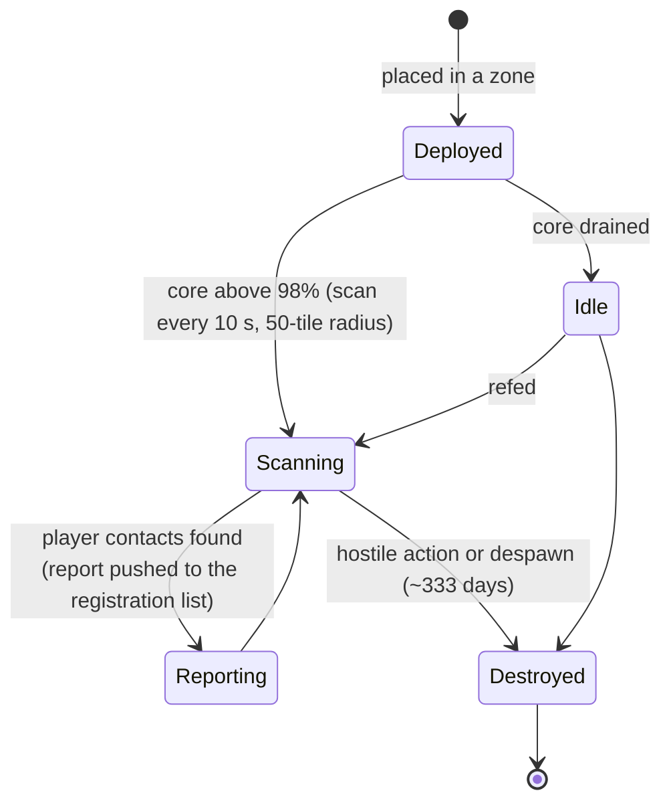

# Blízkostní sondy

Sondy se dělí do dvou kategorií:

- **Sondy viditelnosti (blízkostní sondy)** — malá zařízení, která rozmístíte v zóně, aby **dozorovala oblast**. Zatímco jsou napájená, skenují hráčské jednotky v jejich okolí a odesílají hlášení postavičkám, které jste registrovali. Jedná se o dohledovací/recon nástroj.
- **Těžební sondy** — **modul** nainstalovaný ve vašem robotovi (úrovně od *noob* přes *standard*, *industrial*, *named*, *elite* až po *artifact*) plus **munice sond pro každou rudu** (varianty dlaždice / směru / oblasti pro každou rudu). Výstřel vygeneruje výsledek skenu pro danou rudu v oblasti, uložený pro každou postavičku (viz [sběr → skenování](/cs/features/gathering/)).

> Umístění v UI sledujte v [přehledu UI klienta](/cs/features/ui/). Mechaniky níže jsou potvrzeny proti serveru.

## Správa vašich sond

- **Seznam** vašich sond — zobrazí sondy, které máte.
- **Informace o registraci** — stav a informace o registraci sondy.
- **Nastavení registrace** — přiřazení postaviček k seznamu hlášení sondy.
- **Nastavení jména** — přiřazení popisku sondě.
- **Odebrání** registrace sondy (v zóně) — zastavení dohledu / vyčištění.

### Jak funguje sonda viditelnosti

- Je **napájená jádrem**: skenuje pouze tehdy, když je její jádro téměř plné (nad 98 % `core_max`); prázdná sonda zůstává nečinná.
- Během aktivního provozu skenuje **každých 10 sekund** hráčské roboty v dosahu **detekčního poloměru (50 dlaždic)** a odesílá hlášení (ID postavičky a pozice každého kontaktu) všem na seznamu registrace.
- **Registrace** je korporátní aktivita: můžete registrovat pouze **členy vlastní korporace** a **CEO a náměstek jsou vždy automaticky na seznamu**. Seznam má maximální velikost.
- **Životnost**: rozmístěná sonda zmizí po uplynutí `despawn_time` definovaného v obsahu (sonda viditelnosti je nastavena na ~333 dní) nebo je zničena.

## Události životního cyklu

Server hlásí události životního cyklu sond, jak se dějí:
- **created**, **updated**, **dead** — sonda je rozmístěna, hlásí nebo je zničena.

Tyto události přicházejí jako push; neposíláte je vy, reagujete na ně.

## Praktické poznámky

- **Nejprve registrujte, pak čtěte** — sonda hlásí pouze registrovaným postavičkám.
- **Sondy mohou zemřít** — nepřátelská akce nebo vypršení platnosti může sondu zničit; sledujte události životního cyklu.
- **Pojmenujte je** — s více sondami v terénu vám popisky pomohou zůstat při smyslech.
- **Recon, ne boj** — sondy shromažďují informace; nebojují.

<!-- TODO: zbývá pouze UI (seznam sond, výběr registrace).
     Potvrzeno: sonda viditelnosti (def_visibility_probe): core_max 50, aktivní pouze při
     core>98%, interval skenu 10 s (ProximityDevice.cs _probingInterval), detekce přes
     blob_emission 10 / blob_emission_radius 50, hlášení = characterID + x/y pro každý kontakt
     odeslané registrovaným postavičkám (ProximityProbe.OnUnitsFound); registrace =
     pouze členové vlastní korporace, CEO+Náměstek vždy zahrnuti, maximální počet
     (ProximityProbeRegisterSet.cs); despawn_time 28,800,000 s (~333 d) na kapsli;
     stealth_strength 275 / detection_strength 45. Těžební sondy: modulové úrovně
     (noob/standard/industrial1-2/named1-3/elite t2-t4/artifact) + munice sond pro každou
     rudu dlaždice/směr/oblast (79 def_*probe* definic).
     Poznámky vývojářů: ProximityProbeList.cs / ProximityProbeGetRegistrationInfo.cs /
     ProximityProbeRegisterSet.cs / ProximityProbeSetName.cs; Zone/ProximityProbeRemove.cs;
     Zones/ProximityProbes/ProximityProbe.cs + ProximityProbeDeployer.cs +
     ProximityDevice.cs; Zones/Blobs/* (blob emission/stealth); události životního cyklu přes
     příkazy ProximityProbeCreated/Update/Dead/Info. -->
     Poznámky vývojářů: ProximityProbeList.cs / ProximityProbeGetRegistrationInfo.cs /
     ProximityProbeRegisterSet.cs / ProximityProbeSetName.cs; Zone/ProximityProbeRemove.cs;
     Zones/ProximityProbes/ProximityProbe.cs + ProximityProbeDeployer.cs; události
     životního cyklu přes příkazy ProximityProbeCreated/Update/Dead/Info. -->