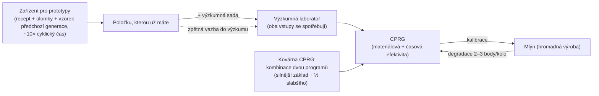

# Výroba

Výroba je způsob, jak přeměnit surové zdroje a komponenty na použitelné položky. Probíhá na
**výrobním zařízení** („mlýn") ve vaší přistavené základně. Všechno zde je **pouze pro přistavení**.

> Umístění v UI odpovídá [přehledu uživatelského rozhraní klienta](/cs/features/ui/) (kategorie **Rafinace / Recyklace / Oprava /
> Pojištění** na horní liště). Mechanismy níže jsou potvrzeny na serveru.

## Výrobní linky

**Výrobní linka** je uložený recept: definuje, co vyrábíte a z čeho.
Úplný seznam komponent pro všechny vyráběitelné položky (s úrovněmi výzkumu) je generován v
[Recepty](/content/recipes/). Linku spustíte na určitý počet **kol**.

- **Seznam linek** — zobrazí vaše dostupné linky.
- **Spustit linku** — spustí ji v zařízení na zvolený počet kol (minimum 1).
  - Můžete platit z **osobní peněženky** nebo **korporátní peněženky**.
  - Zdrojové komponenty lze vyhledat z vašeho **inventáře** nebo z vašich **robotů**.
- **Kalibrovat linku** — nastavit parametry linky.
- **Nastavit kola** — zvolit, kolik kol se má spustit.
- **Dotaz na další kolo** — náhled toho, co další kolo spotřebuje/vyrobí.
- **Zrušit** — zastavit běžící výrobu.
- **Smazat linku** — odstranit uloženou linku.

Běh linky spotřebovává komponenty (a kredity) a během kol vyrábí cílovou položku.

## Jednorázové operace

Jedná se o jednorázové akce, nikoliv vícekolové linky. Každá má variantu **Dotaz**,
která předem zobrazí náklad/výstup, než se rozhodnete.

- **Rafinace** — suroviny → komodita, pomocí receptu položky (viz [Recepty](/content/recipes/)).
  Zvolíte, kolik cílové položky chcete vyrobit; nominální vstupy receptu jsou škálovány
  materiálovým multiplikátorem `1 + 50/(bonus + 100)`, kde *bonus* je vaše dovednost rafinace
  (rozšíření + body zařízení + body postavení). Bez bonusu spotřebujete **150 %**
  nominálního receptu; s maximálním bonusem klesá směrem k **100 %**.
- **Recyklace / zpracování zpět** — rozloží položku zpět na její receptové komponenty (obrácený
  recept). Výnos je `nominální × (1 − 75/(bonus + 100)) × poměr zdraví položky` —
  bez bonusu dovednosti je to základních **25 %**, zlepšující se směrem k 100 %, a **poškozená položka
  vydá úměrně méně** (nejdřív ji opravte, pokud je cenná). Recykluje se pouze celá „šarže"
  (úplné výchozí množství); zbytek zůstává. Misijní položky se mažou,
  nerecykluje se.
- **Oprava** — obnoví poškozenou položku/robota na plné zdraví. Cena je
  `(chybějící % zdraví) × materiálová hodnota položky × 75/(bonus + 100)`. „Materiálová
  hodnota" se počítá rekurzivně: recept položky se rozloží na suroviny a
  oceňuje podle **průměrů světového trhu**, takže cena opravy plave s trhem.
  Multiplikátor dovednosti začíná na **75 %** bez bonusu a směřuje k 0 s maximálním bonusem.
- **Výzkumné komponenty** — výroba výzkumných komponent (dotaz + spuštění).

## Životní cyklus položky (kruhový proces)

Vytváření položek je smyčka tří propojených zařízení:

1. **Výzkum (reverzní inženýrství)** — do výzkumné laboratoře vložíte položku,
   kterou chcete vyrábět, plus **výzkumnou sadu**, jejíž úroveň odpovídá výzkumné úrovni
   položky (sady jsou úrovně 0–10). Oba vstupy se **spotřebují**,
   a úkol vydá jedno **CPRG** pro danou položku. Efektivity výsledného programu
   začínají od základní hodnoty položky (většina položek 50, munice vyšší,
   věže až 90) a zvyšují se o *úroveň sady nad požadovanou úroveň × 5*
   plus váš bonus dovednosti výzkumu (až +50 navíc). Takže sada o pár úrovní
   nad položkou — a slušná výrobní rozšíření — je to, co promění čerstvý
   program 50/50 v konkurenceschopný. Tímto způsobem vstupují nové položky
   do vašeho výrobního repertoáru.
2. **Mlýn (hromadná výroba)** — hromadná výroba z programu. Každé kolo
   **degraduje** efektivity linky (2–3 body za kolo, za kategorii položky;
   viz [CPRG](#cprg-kalibracni-programy)) — když se plýtvání stane příliš vysokým, nakaľibrujte
   čerstvý program na linku. Prototypové položky také vyžadují **vzorek
   předchozí generace** jako komponentu (jeden standardní modul pro výrobu T2
   prototypu, jeden T2 pro výrobu T3), který se v procesu spotřebuje.
3. **Zařízení pro prototypy** — přímo vyrobit **prototyp** položky:
   materiály receptu plus robotí úlomky *a* vzorek předchozí generace,
   přibližně **10× cyklický čas mlýna** (plus obvyklý časový
   multiplikátor). Prototypovat můžete pouze položky odemčené ve vašem stromu technologií.
   Prototypy stojí dramaticky více než jejich standardní ekvivalenty; jejich hlavním
   účelem je být **převýzkoumeny na kvalitní programy** (výzkum
   prototypové položky odemkne další úroveň) — nebo použity na robotovi, když
   je položka příliš vzácná na drop a příliš drahá na trhu.

## Postupování úrovní

Většina modulů a robotů se dělí do **úrovní T1 → T4** (značka úrovně v klientovi;
řádky definic `standard → named1 → named2 → named3`, pak speciální řádky
`elitet4`/
`artifact`). Pravidla:

- **Každá úroveň je samostatná položka se svým uzlem ve stromu technologií.** Odemčení
  uzlu stojí výzkumné body (získané z jader) a vyžaduje
  **rodičovský uzel** — úrovně tedy musí být odemčeny po sobě. Můžete
  **prototypovat** (nebo hromadně vyrábět) pouze položku, jejíž uzel je již odemčen:
  neexistuje způsob, jak vyrobit vyšší úroveň bez výzkumu.
- **Každá vyšší úroveň spotřebuje jeden vzorek předchozí úrovně** jako
  komponentu (plus materiály a robotí úlomky). Položka T1 tedy nikdy nemůže
  být „předána" za T3 — prototyp T3 vyžaduje položku **T2** a
  vzorek se **spotřebuje**, nepřemění se: výstupem je zcela nová položka.
- Každá stránka položky zobrazuje její **řádek úrovní** — celý řetězec `T1 → T2 → T3 → T4`
  jako odkazy — a [stránky uzlů stromu technologií](/content/techtree/) zobrazují
  rodičovský/další uzel každé úrovně a ceny bodů.

Příklad, řádek malého důlního modulu: [standardní malý důlní modul (T1)](/content/items/standard-small-driller/) →
[Biroter 5050 malý důlní modul (T2)](/content/items/named1-small-driller/) →
[Sublimator Low-D malý důlní modul (T3)](/content/items/named2-small-driller/) →
[Scraper-990 malý důlní modul (T4)](/content/items/named3-small-driller/) —
a stejný vzor pro každou rodinu modulů/robotů.

## Prototypy a výzkumné sady

- **Prototyp** — výroba prototypové položky (spuštění + dotaz). Jeden prototyp na
  slot; více paralelních prototypových úkolů pochází z výrobních rozšíření.
- **Sloučení výzkumných sad** — kombinace více výzkumných sad do vyšší
  (spuštění + dotaz). Vyšší sada zkracuje čas výzkumu a zvyšuje
  efektivity výsledného programu.

## CPRG (kalibrační programy)

**CPRG** (kalibrační program) je to, na co běží výrobní linka — program pro každou položku
s body **materiálové efektivity** a **časové efektivity** (0–100 každý). Získáte ho
**výzkumem položky** ve výzkumné laboratoři (výzkumná úroveň určuje, které položky
můžete vůbec vyrábět), nebo aktivací **kalibrační kapsle**.

- Čerstvě výzkoumené CPRG začíná na **50/50** bodech.
- **Kování CPRG** v kovárně kalibračních programů: kombinace dvou CPRG pro stejnou položku;
  výsledek si ponechá body silnějšího programu jako základ a přidá třetinu
  slabšího. Kování trvá čas a stojí kredity (čas × cena zařízení za
  sekundu).
- **Kalibrace linky** CPRG pro nastavení jejích efektivit. Každé výrobní kolo
  **degraduje** efektivitu linky (hodnota dekalibrace pro každou položku), takže linky se
  s časem vrací dolů — přepočítejte před dlouhými běhy.

Efektivity vstupují do vzorců mlýna (za výrobní cyklus):

- **Spotřebované materiály** = recept × `1 + 50/(body materiálu + dovednost + 100 + bonusMlýn)`
  — nové CPRG s 50 body bez dovednosti a bez bonusu hromadné výroby ve stromu technologií spotřebuje
  ≈ **133 %** nominálního receptu.
- **Čas výroby** = základní čas zařízení (3 600 s za cyklus pro mlýn) ×
  `1 + 100/(body času + dovednost + 100)` × modifikátor doby trvání položky — nové CPRG bez
  dovednosti trvá ≈ **1 hodina 40 minut** za položku.
- **Cena** = čas výroby × cena zařízení za sekundu (7 kreditů/s pro PBS
  mlýn, 3 pro velké/střední PBS výzkumné laboratoře) × modifikátor ceny položky (1–10).
- Misijní CPRG jsou zdarma a fixní na 10 sekund.

## Pojištění

Zařízení pro pojištění pojistí **vaše roboty**, nikoliv váš výrobní výstup:

- **Koupit** pojištění pro robota (musí být nepoškozený, neschráněný a není začátečnický bot),
  **seznam** vašich pojištění, **dotaz** na pojištění, **smazat** pojištění.
- Krytí trvá **15 dní** (+ bonusové dny prodloužení); můžete držet pojištění na
  1 + (bonus prodloužení) robotech.
- Každý robot má definovaný **poplatek** a **výplatu** (tabulka `insuranceprices`,
  67 definic robotů); poplatek je slevován bonusem prodloužení poplatku a lze ho zaplatit
  z korporátní peněženky.
- Pokud je pojištěný robot zničen, **výplata se vyplácí v kreditách** (robot
  je stále ztracen) — viz [boj](/cs/features/combat/).

## Zařízení a stav

- **Informace o zařízení / popis** — co výrobní zařízení nabízí.
- **Probíhá (moje / korporace)** — co se právě vyrábí.
- **Historie výroby** — vaše minulá výroba.
- **Seznam komponent** — dostupné výrobní komponenty.
- **Informace o serveru** — stav výrobního serveru.

## Praktické poznámky

- **Musíte být přistaveni na základně s výrobním zařízením.**
- **Dotazujte se před spuštěním** — varianty dotazu zobrazí náklad a výstup, abyste nespálili
  komponenty na chybě.
- **Korporátní peněženka** — můžete utratit korporátní prostředky pro výrobu, pokud je to povoleno.
- **Komponenty pocházejí i z robotů** — linka může čerpat zdrojové komponenty z vašich
  osazených robotů, ne jen z inventáře.
- **Recyklujte při plném zdraví** — poškozená položka vydá méně; drahé položky opravte před
  jejich zpracováním zpět.
- **Multiplikátory dovedností jsou skutečné ekonomické páky** — bonusy rafinace/recyklace/opravy/mlýna
  se všechny škálují stejně; investice do výrobních rozšíření se vyplatí
  úsporou materiálů při každém běhu.
- **Pojištění je bezpečnostní síť pro roboty** — kupte ho pro drahé sestavy před PvP ve hlubokém vesmíru.
- **Výzkumné sady jsou branou** — výzkumná úroveň položky (1–9) určuje, které
  sady ji mohou dekódovat, a spuštění sady o několik úrovní nad položkou je
  nejlevnější způsob, jak zvýšit efektivity výsledného programu.

<!--
Poznámky pro vývojáře: přepsáno 2026 z backendových zdrojů; žádný text z komunitní wiki nebyl použit.
Ověřeno proti:
- refine = 1 výstup na jednotku, vstup = nominální × (1+50/(bonus+100)) (Refinery.cs);
- recycle = obrácený recept × (1-75/(bonus+100)) × healthRatio, pouze celé šarže,
  misijní položky se mažou (ReprocessSessionMember.cs);
- repair price = (1-healthRatio) × hodnota světového trhu PriceCalculator ×
  75/(bonus+100) (Repair.cs + PriceCalculator.cs);
- ResearchLab.cs (StartResearch/EndResearch: zdrojová položka + výzkumná sada se
  obě spotřebují; úroveň sady musí být >= itemresearchlevels.researchlevel (1-9);
  efektivita = základní hodnota položky + levelDifference*5 + (1-100/(100+skill))*50);
- itemresearchlevels (1101 řádků, úrovně 1-9), výzkumné sady def_research_kit_0..10
  (#level option), RandomResearchKit (misijní sady, falešné 100/100);
- calibrationdefaults (základní efektivity CPRG 50-90; výchozí fallback 50/50;
  CalibrationProgram.OnInsertToDb nastaví 50/50);
- PBSFacilities.cs CalculateResultingPoints (kování = lepší základ + weak/3 +
  (1-100/(100+skill))*25);
- productiondecalibration (2-3 body úbytku za kolo za kategorii,
  distorsion 0.5-1%);
- Prototyper.cs (StartPrototype: komponenty zahrnují vzorek předchozí generace přes
  tabulku komponent — např. T2 NEXUS spotřebuje 1× standardní modul, T3 spotřebuje 1× T2;
  čas = 10× cyklus × multiplikátor; kontrola odemčení ve stromu technologií v
  ProductionPrototypeStart.cs);
- tabulka prototypes (339 řádků, mapování standard->prototyp);
- Mill.cs (CalculateFinalMaterialMultiplier 1+50/(pts+skill+100+millBonus) s
  bonusem hromadné výroby ze stromu technologií; CalculateFinalTimeMultiplier;
  tabulka productionduration);
- Pojištění: InsuraceFacility.cs (15d + bonus prodloužení času, 1+slot prodloužení
  pojištění, noob bot vyloučen, musí být single+unpacked), InsuranceDescription.cs
  (výplata v kreditách přes centrální banku), insuranceprices (67 definic robotů,
  výplata = 80× poplatek kromě noob/arkhe2 na 4×).
- Možnosti zařízení (entitydefaults): def_pbs_facility_mill #perSecondPrice=7
  #productionTime=3600; refinery #materialEfficiency=0.95;
  calibration_program_forge #perSecondPrice=7; def_production_public_factory
  #materialEfficiency=0.6 #manufactureTime=3600 #perSecondPrice=3.
Soubory vývojáře: Production/ProductionLineStart.cs (PrepareProductionForPublicContainer,
LineStartInMill, korporátní peněženka, vyhledávání v robotech, kola); Production/ProductionLine*.cs;
Production/ProductionRefine*.cs, ProductionReprocess*.cs, ProductionRepair*.cs,
ProductionResearch*.cs (páry dotaz+spuštění); Production/ProductionPrototype*.cs,
ProductionMergeResearchKitsMulti*.cs; Production/ProductionCPRG*.cs,
ProductionGetCPRGFromLine*.cs; Production/ProductionInsurance*.cs;
Production/ProductionFacility*.cs, ProductionInProgress*.cs, ProductionHistory.cs;
Services/ProductionEngine/Facilities/*.cs; Services/ProductionEngine/PBSFacilities.cs;
Services/ProductionEngine/ResearchKits/*.cs; Services/ProductionEngine/CalibrationPrograms/*;
Services/Insurance/InsuranceHelper.cs; Items/PriceCalculator.cs.
Korekce oproti importované stránce: neexistuje položka „decoder" (výzkumné sady jsou
úrovňově omezené vstupy); tvrzení „výzkoumeno na 100 %" je nesprávné (odemčení ve stromu technologií je
brána; výzkumné úrovně běží 1-9); čas prototypu je 10× cyklus mlýna; spotřeba vzorku
ověřena z tabulky komponent; výplata pojištění je 80× poplatek.
-->