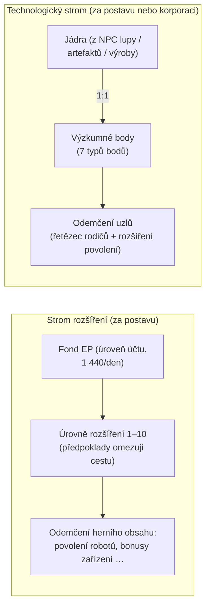

# Výzkum

Existují **dva samostatné systémy pokroku**. Oba jsou dostupné pouze v dokovacím bodě.

> Umístění v UI odpovídá [přehledu uživatelského rozhraní klienta](/cs/features/ui/) (Okno postavy → rozšíření;
> technologický strom má vlastní okno). Mechaniky níže jsou potvrzeny na serveru.

## Strom rozšíření (dovednosti postavy)

Rozšíření jsou úrovně dovedností za postavu, které odemykají herní obsah — nejdůležitější jsou
**rozšíření povolení**, která vám umožňují pilotovat třídu robotu (nutné pro odpojení a výběr
robotu, viz [pohyb](/cs/features/movement/) a [roboti](/cs/features/robots/)).

### Jak se učení funguje

- K učení musíte být **v dokovacím bodě**.
- Každé rozšíření lze zvýšit na **úrovně 1–10** (úroveň 10 je maximum).
- **Úroveň 1 stojí kredity** (cena rozšíření `price`), stravené z vaší peněženky.
- **Každá úroveň stojí body rozšíření (EP)** podle pevné tabulky třída × úroveň —
  pro úrovně 1–5 je náklad `60 × třída × úroveň`; úrovně 6–10 skáčí na
  `třída × (1440, 2520, 3840, 5400, 12000)`. Rozšíření třídy 1 stojí za deset úrovní
  60 → 6 000 EP, celkem 13 500; rozšíření třídy 10 stojí desetkrát více na každé úrovni.
- **Předpoklady** musí být již naučeny, než si můžete vzít rozšíření
  (seznam „prerequire").
- EP je **fond na úrovni účtu**: je sdílen mezi vašimi postavami a získává se
  v průběhu času (viz „Zdroje EP" níže).

### Správa rozšíření

- **Seznam kategorií / získat vše / seznam naučených / seznam předpokladů** — procházejte strom a co
  již máte.
- **Dostupné body** — zobrazí váš aktuální fond EP.
- **Odebrat jednu úroveň** — snížit jednu úroveň rozšíření.
- **Resetovat rozšíření postavy** — resetovat celý strom pro postavu.
- **Uvolnit uzamčené EP** — uvolnit EP, které je uzamčené (např. po odebrání úrovní).
- **Koupit boost EP** — placený akcelerátor, který zvyšuje získávání EP.
- **Denní log EP za aktivitu** — zkontrolujte, kolik EP jste získali z hraní.

### Zdroje EP

EP není měna, kterou kupujete — hromadí se v **denních dávkách**:

- Každý účet obdrží **1 440 EP denně** (uděleno jednou denně, mezi 08:00 a
  11:00 serverového času, procedurou `extensionPointsAdd`). Kód také definuje
  zdvojenou dávku **2 880 EP** pro účty s placenou předplatnou, ale aktuální procedura
  vyplácí základní dávku všem účtům.
- **Placené boosty** (nákupy boostu EP) se přičítají navíc.
- Vaše **dostupné EP** = všechny přijaté denní dávky − pokuty − EP utracené ve hře.
  (Log EP za aktivitu zobrazuje rozpad denních výdělků.)

**Úplný katalog** — každé rozšíření (třída, cena 1. úrovně, bonus, předpoklady) je v
[Rozšíření](/content/extensions/), a každý uzel technologického stromu (odemykaná položka, rozšíření
povolení, ceny bodů) je v [Technologický strom](/content/techtree/).

## Technologický strom (odemykání)

Technologický strom je graf **uzlů**, které odemykáte utracením **výzkumných bodů**. Na rozdíl
od EP (fond účtu), body technologického stromu se **získávají spotřebováním „jader"** — položek,
které vyvýzkumujete a poté předložíte.

### Jak to funguje

- **Výzkum jader** — předložte položky jader z kontejneru. Každé jádro se převádí
  **1:1** na výzkumné body daného **typu bodů**; jádra jsou spotřebována.
  Existuje sedm typů jader, jedno pro každý typ bodů: Theodica, Pelistal, Nüimqol,
  Industrial, Common, HiTech a NewTech.
- **Odemknout uzel** — utratěte požadované výzkumné body. Uzel lze odemknout pouze pokud:
  - všechny jeho **rodičovské uzly** jsou již odemčeny, a
  - máte na své postavě naučené **rozšíření povolení** uzlu.
- **Odemčení korporace** — s příslušnou rolí v korporaci lze uzel odemknout
  **pro korporaci** (sdílené). Odemčení korporace stojí více (platí násobník ceny
  korporace) a je placeno z bodů korporace.
- **Darovat** — darovat výzkumné body (např. vaší korporaci).
- **Informace / logy** — zobrazit detaily uzlů a vaši historii odemykání/výzkumu.

### Proč je to důležité

Odemknuté uzly technologického stromu omezují přístup k obsahu a funkcím vyšších úrovní. Zkontrolujte
předpoklady uzlu (řetězec rodičů + rozšíření povolení) před utracením bodů.

## Praktické poznámky

- **Rozšíření povolení omezují roboty** — nemůžete pilotovat třídu robotu, kterou jste
  nevyvýzkumovali (toto je stejná kontrola, která blokuje odpojení/výběr).
- **Úroveň 1 je jediná kreditová cena** ve stromu rozšíření; nad tím je to vše EP.
- **Technologický strom je nevratný** — body utracené za odemčení jsou pryč; naplánujte si cestu.
- **Technologický strom korporace je týmová práce** — používá sdílené body a násobník ceny.

<!-- TODO: zbývá pouze UI výzkumu (rozložení okna, zobrazení bodů).
     Potvrzeno: získávání EP = 1440/den plošně přes dbo.extensionPointsAdd (okno 08:00–11:00,
     jednou denně; konstanta 2880 pro bonus existuje v GiveExtensionPointsService pro placené
     předplatné, ale aktuální SP vyplácí základ všem); dostupné = dávky -
     pokuty - utraceno (fn extensionPointsAvailable); tabulka nákladů EP v
     Services/ExtensionService/ExtensionPoints.cs (60*třída*úroveň pro úrovně 1–5, pak
     třída*(1440,2520,3840,5400,12000)); jádra se převádí 1:1 (TechTreeResearch.cs), 7
     definic jader -> typy bodů n1..n7 (Theodica/Pelistal/Nuimqol/Industrial/
     Common/HiTech/NewTech).
     Poznámky vývojářů: Extensions/ExtensionBuyForPoints.cs (v dokovacím bodě, předpoklady, limit úrovně 10,
     kreditová cena 1. úrovně, EP podle třídy/úrovně, fond účtu, tréninková postava zdarma);
     Extensions/ExtensionGetAvailablePoints.cs; Extensions/ExtensionBuyEpBoost.cs,
     ExtensionFreeLockedEp.cs, ExtensionRemoveLevel.cs, ExtensionResetCharacter.cs;
     EpForActivityDailyLog.cs; TechTree/TechTreeResearch.cs (jádra → body);
     TechTree/TechTreeUnlock.cs (řetězec rodičů + rozšíření povolení, násobník korporace);
     TechTree/TechTreeDonate.cs; Services/ExtensionService/GiveExtensionPointsService.cs;
     Services/ExtensionService/ExtensionPoints.cs. -->
     Poznámky vývojářů: Extensions/ExtensionBuyForPoints.cs (v dokovacím bodě, předpoklady, limit úrovně 10,
     kreditová cena 1. úrovně, EP podle třídy/úrovně, fond účtu, tréninková postava zdarma);
     Extensions/ExtensionGetAvailablePoints.cs; Extensions/ExtensionBuyEpBoost.cs,
     ExtensionFreeLockedEp.cs, ExtensionRemoveLevel.cs, ExtensionResetCharacter.cs;
     EpForActivityDailyLog.cs; TechTree/TechTreeResearch.cs (jádra → body);
     TechTree/TechTreeUnlock.cs (řetězec rodičů + rozšíření povolení, násobník korporace);
     TechTree/TechTreeDonate.cs. -->