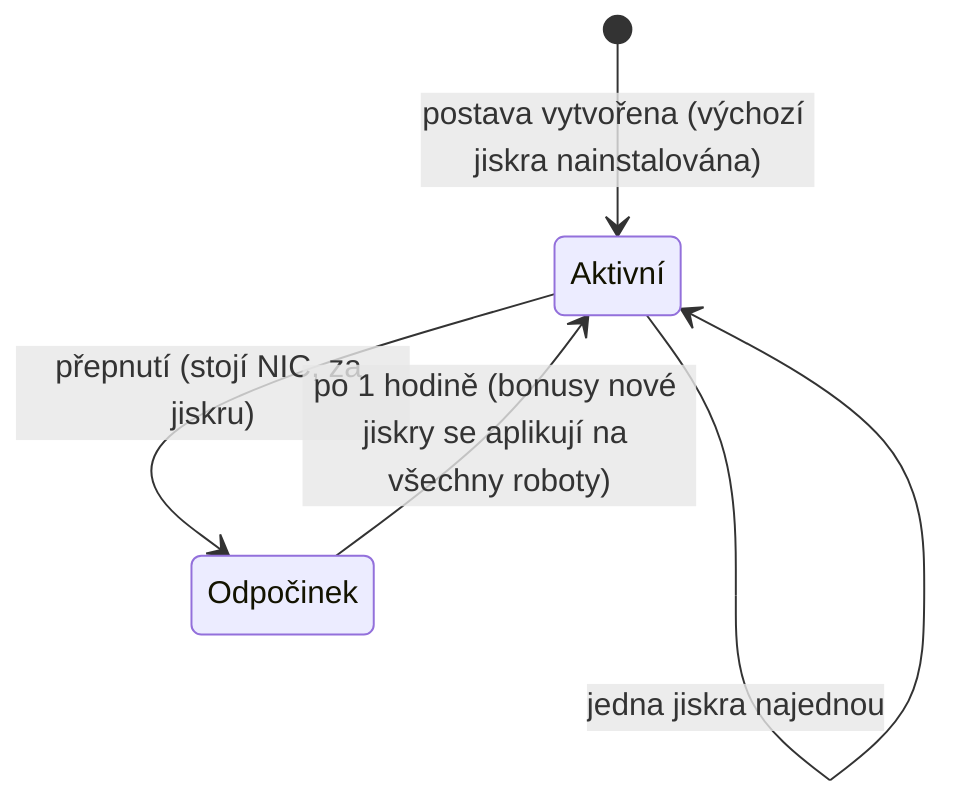

# Jiskry

**Jiskra** je nanobotická specializace nainstalovaná na vaši postavu. Pokud je aktivní, její bonusy se aplikují na každého robota, kterým pilotujete — jiskra pro bojovou linii frakce například zvyšuje poškození zbraní a šanci na kritické zásahy úrovně po úrovni, zatímco industriální linie zvyšuje kapacitu jádra a výnosy z těžby.

Každá postava má při vytvoření **výchozí jiskru**. Kromě toho jiskry existují v rodinách — základní výchozí linie, bojové/industriální/sociální linie pro jednotlivé frakce (tři úrovně každá), placené linie Syndikátu a speciální omezené linie — a přesné bonusy jiskry jsou pouze balíček pevně daných úrovní dovedností, které můžete vidět na [stránce rozšíření](/content/extensions/). [Přehled rodin níže](#rodiny-jisker) vás zavede přímo k jiskrám každé rodiny.

## Odemknutí (autorizace) jiskry

Nainstalování jiskry, kterou ještě nevlastníte, vyžaduje její předchozí **odemknutí** (pouze v dokovacím bodě). V závislosti na jiskře server kontroluje:

- **cenu** v NIC (placené linie — např. užitkové jiskry Syndikátu a omezené speciální jiskry),
- **postavení** s vývojářskou megakorporací (linie pro jednotlivé frakce vyžadují minimální postavení s megakorporací dané frakce, které se buduje plněním jejích [misí](/cs/features/missions/)),
- nebo **předmět** z vašeho inventáře (některé speciální jiskry se odemykají klíčovým předmětem).

Odemknutí je jednorázové: jednou odemčená jiskra zůstává ve vaší sbírce.

## Přepínání jisker

- Můžete mít najednou pouze **jednu aktivní jiskru**; nainstalování jiné ji nahradí.
- Každé přepnutí **stojí NIC** — částka se liší podle jiskry (běžné linie stojí 10k, placené speciální linie až milion).
- Mezi přepnutími je **jednohodinová doba odpočinku**: server sleduje, kdy byla vaše aktuální jiskra aktivována, a nové přepnutí odmítne, dokud minuta neuplyne.

Protože přepínání vždy stojí NIC a trvá hodinu, zvolte jiskru, která odpovídá aktivitě, které věnujete nejvíce času, a považujte přеспециalizaci za občasné rozhodnutí, nikoli rozhodnutí pro každou relaci.
<!-- sparkfamilies:generated -->

## Rodiny jisker

47 jisker v 6 rodinách na pohled: jeden rámeček pro každou rodinu (počet jisker, způsob odemknutí), v pořadí, v jakém byly linie přidány (zleva doprava, shora dolů). **Kliknutím na rámeček skočíte k jiskrám dané rodiny níže.** **Přejeďte kurzorem přes diagram pro přiblížení**, tažením posouvejte a tlačítkem ⟲ resetujte.

<button type="button" class="zoommap-reset" title="Resetovat přiblížení">⟲</button>
<svg class="zoommap" xmlns="http://www.w3.org/2000/svg" viewBox="0 0 1008 278" width="960" height="264" role="img" aria-label="Rodiny jisker: 6 rodin, 47 jisker; kliknutím na rodinu skočíte k jejím jiskrám níže">
  <rect x="0" y="0" width="1008" height="278" fill="#10151f" stroke="#39445a" stroke-width="1"/>
  <g><title>Události a speciální: 9 jisker, odemknutí zdarma</title><a href="#family-special"><rect x="24" y="40" width="300" height="84" rx="10" fill="#10151f" stroke="#c8d2e0" stroke-width="1.5"/><text x="174" y="68" text-anchor="middle" fill="#e8eefc" font-size="15" font-weight="700">Události a speciální</text><text x="174" y="92" text-anchor="middle" fill="#c8d2e0" font-size="12">9 jisker · zdarma</text></a></g>
  <g><title>TM (Truhold-Markson): 9 jisker, odemknutí postavením TM</title><a href="#family-tm"><rect x="354" y="40" width="300" height="84" rx="10" fill="#10151f" stroke="#41d3ff" stroke-width="1.5"/><text x="504" y="68" text-anchor="middle" fill="#e8eefc" font-size="15" font-weight="700">TM (Truhold-Markson)</text><text x="504" y="92" text-anchor="middle" fill="#41d3ff" font-size="12">9 jisker · postavení TM</text></a></g>
  <g><title>ICS: 9 jisker, odemknutí postavením ICS</title><a href="#family-ics"><rect x="684" y="40" width="300" height="84" rx="10" fill="#10151f" stroke="#6ee7a0" stroke-width="1.5"/><text x="834" y="68" text-anchor="middle" fill="#e8eefc" font-size="15" font-weight="700">ICS</text><text x="834" y="92" text-anchor="middle" fill="#6ee7a0" font-size="12">9 jisker · postavení ICS</text></a></g>
  <g><title>ASI: 9 jisker, odemknutí postavením ASI</title><a href="#family-asi"><rect x="24" y="154" width="300" height="84" rx="10" fill="#10151f" stroke="#f5a05a" stroke-width="1.5"/><text x="174" y="182" text-anchor="middle" fill="#e8eefc" font-size="15" font-weight="700">ASI</text><text x="174" y="206" text-anchor="middle" fill="#f5a05a" font-size="12">9 jisker · postavení ASI</text></a></g>
  <g><title>Syndikát (NIC): 5 jisker, odemknutí cenou NIC</title><a href="#family-syndicate"><rect x="354" y="154" width="300" height="84" rx="10" fill="#10151f" stroke="#a78bfa" stroke-width="1.5"/><text x="504" y="182" text-anchor="middle" fill="#e8eefc" font-size="15" font-weight="700">Syndikát (NIC)</text><text x="504" y="206" text-anchor="middle" fill="#a78bfa" font-size="12">5 jisker · cena NIC</text></a></g>
  <g><title>Omezené: 6 jisker, odemknutí cenou NIC</title><a href="#family-limited"><rect x="684" y="154" width="300" height="84" rx="10" fill="#10151f" stroke="#f472b6" stroke-width="1.5"/><text x="834" y="182" text-anchor="middle" fill="#e8eefc" font-size="15" font-weight="700">Omezené</text><text x="834" y="206" text-anchor="middle" fill="#f472b6" font-size="12">6 jisker · cena NIC</text></a></g>
</svg>

### Události a speciální (9)

Odemknutí: nic — tyto jsou základní výchozí linie. Každé přepnutí stojí NIC (částka se liší podle jiskry, viz karty) a vyžaduje jednohodinovou dobu odpočinku — viz [Přepínání jisker](#prepinani-jisker) výše.

ww

odemknutí bez nákladů · přepnutí 10k NIC

Výchozí jiskra — nainstalována při vytvoření postavy

wi

odemknutí bez nákladů · přepnutí 10k NIC

Výchozí jiskra — nainstalována při vytvoření postavy

ws

odemknutí bez nákladů · přepnutí 10k NIC

Výchozí jiskra — nainstalována při vytvoření postavy

iw

odemknutí bez nákladů · přepnutí 10k NIC

Výchozí jiskra — nainstalována při vytvoření postavy

ii

odemknutí bez nákladů · přepnutí 10k NIC

Výchozí jiskra — nainstalována při vytvoření postavy

is

odemknutí bez nákladů · přepnutí 10k NIC

Výchozí jiskra — nainstalována při vytvoření postavy

sw

odemknutí bez nákladů · přepnutí 10k NIC

Výchozí jiskra — nainstalována při vytvoření postavy

si

odemknutí bez nákladů · přepnutí 10k NIC

Výchozí jiskra — nainstalována při vytvoření postavy

ss

odemknutí bez nákladů · přepnutí 10k NIC

Výchozí jiskra — nainstalována při vytvoření postavy

### TM (Truhold-Markson) (9)

Odemknutí: postavení s megakorporací TM (2 → 4 → 6 podle úrovně). Každé přepnutí stojí NIC (částka se liší podle jiskry, viz karty) a vyžaduje jednohodinovou dobu odpočinku — viz [Přepínání jisker](#prepinani-jisker) výše.

Combat Lvl1

odemknutí postavení 2 s TM · přepnutí 10k NIC

Obsahuje 2 úrovně rozšíření

Combat Lvl2

odemknutí postavení 4 s TM · přepnutí 100k NIC

Obsahuje 3 úrovně rozšíření

Combat Lvl3

odemknutí postavení 6 s TM · přepnutí 1M NIC

Obsahuje 3 úrovně rozšíření

Indy Lvl1

odemknutí postavení 2 s TM · přepnutí 10k NIC

Obsahuje 2 úrovně rozšíření

Indy Lvl2

odemknutí postavení 4 s TM · přepnutí 100k NIC

Obsahuje 3 úrovně rozšíření

Indy Lvl3

odemknutí postavení 6 s TM · přepnutí 1M NIC

Obsahuje 3 úrovně rozšíření

Social Lvl1

odemknutí postavení 2 s TM · přepnutí 10k NIC

Obsahuje 2 úrovně rozšíření

Social Lvl2

odemknutí postavení 4 s TM · přepnutí 100k NIC

Obsahuje 3 úrovně rozšíření

Social Lvl3

odemknutí postavení 6 s TM · přepnutí 1M NIC

Obsahuje 3 úrovně rozšíření

### ICS (9)

Odemknutí: postavení s megakorporací ICS (2 → 4 → 6 podle úrovně). Každé přepnutí stojí NIC (částka se liší podle jiskry, viz karty) a vyžaduje jednohodinovou dobu odpočinku — viz [Přepínání jisker](#prepinani-jisker) výše.

Combat Lvl1

odemknutí postavení 2 s ICS · přepnutí 10k NIC

Obsahuje 2 úrovně rozšíření

Combat Lvl2

odemknutí postavení 4 s ICS · přepnutí 100k NIC

Obsahuje 3 úrovně rozšíření

Combat Lvl3

odemknutí postavení 6 s ICS · přepnutí 1M NIC

Obsahuje 3 úrovně rozšíření

Indy Lvl1

odemknutí postavení 2 s ICS · přepnutí 10k NIC

Obsahuje 2 úrovně rozšíření

Indy Lvl2

odemknutí postavení 4 s ICS · přepnutí 100k NIC

Obsahuje 3 úrovně rozšíření

Indy Lvl3

odemknutí postavení 6 s ICS · přepnutí 1M NIC

Obsahuje 3 úrovně rozšíření

Social Lvl1

odemknutí postavení 2 s ICS · přepnutí 10k NIC

Obsahuje 2 úrovně rozšíření

Social Lvl2

odemknutí postavení 4 s ICS · přepnutí 100k NIC

Obsahuje 3 úrovně rozšíření

Social Lvl3

odemknutí postavení 6 s ICS · přepnutí 1M NIC

Obsahuje 3 úrovně rozšíření

### ASI (9)

Odemknutí: postavení s megakorporací ASI (2 → 4 → 6 podle úrovně). Každé přepnutí stojí NIC (částka se liší podle jiskry, viz karty) a vyžaduje jednohodinovou dobu odpočinku — viz [Přepínání jisker](#prepinani-jisker) výše.

Combat Lvl1

odemknutí postavení 2 s ASI · přepnutí 10k NIC

Obsahuje 2 úrovně rozšíření

Combat Lvl2

odemknutí postavení 4 s ASI · přepnutí 100k NIC

Obsahuje 3 úrovně rozšíření

Combat Lvl3

odemknutí postavení 6 s ASI · přepnutí 1M NIC

Obsahuje 3 úrovně rozšíření

Indy Lvl1

odemknutí postavení 2 s ASI · přepnutí 10k NIC

Obsahuje 2 úrovně rozšíření

Indy Lvl2

odemknutí postavení 4 s ASI · přepnutí 100k NIC

Obsahuje 3 úrovně rozšíření

Indy Lvl3

odemknutí postavení 6 s ASI · přepnutí 1M NIC

Obsahuje 3 úrovně rozšíření

Social Lvl1

odemknutí postavení 2 s ASI · přepnutí 10k NIC

Obsahuje 5 úrovně rozšíření

Social Lvl2

odemknutí postavení 4 s ASI · přepnutí 100k NIC

Obsahuje 6 úrovně rozšíření

Social Lvl3

odemknutí postavení 6 s ASI · přepnutí 1M NIC

Obsahuje 6 úrovně rozšíření

### Syndikát (NIC) (5)

Odemknutí: cena v NIC (1M za jiskru). Každé přepnutí stojí NIC (částka se liší podle jiskry, viz karty) a vyžaduje jednohodinovou dobu odpočinku — viz [Přepínání jisker](#prepinani-jisker) výše.

Syndicate Nic Combat

odemknutí 1M NIC · přepnutí 100k NIC

Obsahuje 2 úrovně rozšíření

Syndicate Nic Scout

odemknutí 1M NIC · přepnutí 100k NIC

Obsahuje 2 úrovně rozšíření

Syndicate Nic Coreboost

odemknutí 1M NIC · přepnutí 100k NIC

Obsahuje 2 úrovně rozšíření

Syndicate Nic Allresist

odemknutí 1M NIC · přepnutí 100k NIC

Obsahuje 4 úrovně rozšíření

Syndicate Nic Fitboost

odemknutí 1M NIC · přepnutí 100k NIC

Obsahuje 2 úrovně rozšíření

### Omezené (6)

Odemknutí: cena v NIC (25–50M za jiskru). Každé přepnutí stojí NIC (částka se liší podle jiskry, viz karty) a vyžaduje jednohodinovou dobu odpočinku — viz [Přepínání jisker](#prepinani-jisker) výše.

Anniversary Combat

odemknutí 25M NIC · přepnutí 1M NIC

Obsahuje 6 úrovně rozšíření

Anniversary Logistic

odemknutí 25M NIC · přepnutí 1M NIC

Obsahuje 6 úrovně rozšíření

Amazon c1 Combat

odemknutí 25M NIC · přepnutí 1M NIC

Obsahuje 2 úrovně rozšíření

Amazon c1 Indy

odemknutí 25M NIC · přepnutí 1M NIC

Obsahuje 2 úrovně rozšíření

Steam a

odemknutí 50M NIC · přepnutí 1M NIC

Obsahuje 2 úrovně rozšíření

Steam b

odemknutí 50M NIC · přepnutí 1M NIC

Obsahuje 2 úrovně rozšíření

<!--
Napsáno od nuly podle serverového backendu, 2026-09-27:
RequestHandlers/Sparks/SparkUnlock.cs (pravidla odemknutí: cena, postavení, předmět),
RequestHandlers/Sparks/SparkChange.cs + Services/Sparks/SparkHelper.cs
(60minutová doba odpočinku při přepínání, cena změny za jiskru),
Services/Sparks/Spark.cs, tabulky sparks + sparkextensions (47 jisker, balíčky
bonusů podle linie).
Starší verze této stránky byla přebрана z komunitního wiki Open Perpetuum
(perpetuum.miraheze.org) a byla zcela přepsána z backendových zdrojů;
žádný text nebyl znovu použit.
-->