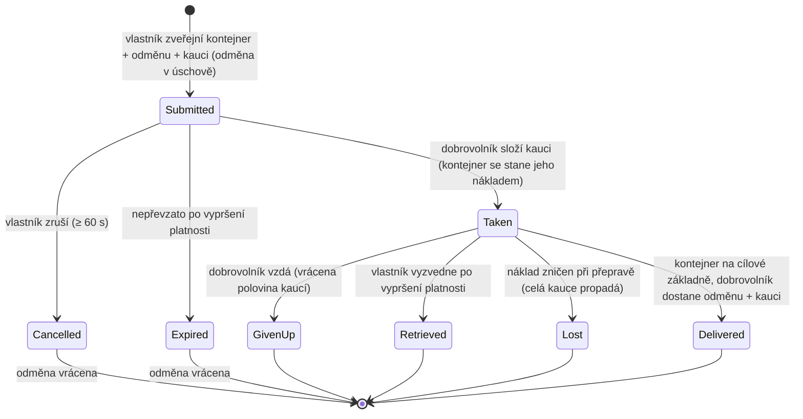

# Transport (přeprava položek)

**Transportní úkol** přesune kontejner s položkami z jedné základny na druhou, s
**dobrovolným přepravcem**, který dostane odměnu. Jedná se o dvousměrný trh:
**vlastník** zveřejní zásilku, **dobrovolník** ji převezme a doručí.

> Umístění v UI odpovídá [přehledu uživatelského rozhraní klienta](/cs/features/ui/) (kategorie
> **Úkoly** na horní liště). Mechaniky níže jsou potvrzeny na serveru.

## Dvě strany

- **Vlastník (příkazce)** — zveřejní zásilku: kontejner k přepravě, ze **zdrojové základny**
  na **cílovou základnu**, za **odměnu**, s **kaucí**, na **dobu trvání**.
- **Dobrovolník (přepravce)** — převezme úkol, odveze kontejner a doručí ho.

## Zveřejnění transportu (vlastník)

**Odeslat transport** s:
- **kontejnerem** (objemový obal) k přepravě,
- **odměnou**, kterou zaplatíte při doručení,
- **kaucí** (záruka, kterou přepravce složí),
- **zdrojovou základnou** a **cílovou základnou**,
- **dobou trvání** (dny), po kterou bude úkol otevřený.

Při odeslání je **odměna zajištěna** z vaší peněženky (úschova).

## Převzetí transportu (dobrovolník)

- **Převzít** úkol — složíte **kauci** jako záruku a kontejner
  se stane vaším nákladem k přepravě.

## Doručení a vyzvednutí

- **Doručit** — přivezte kontejner na cílovou základnu. Při doručení **dobrovolník
  dostane odměnu + kauci** a vlastník obdrží zboží.
- **Vyzvednout** — vlastník (nebo dobrovolník, v příslušném případě) vyzvedne
  kontejner zpět na základnu; při vyzvednutí je **kauce vrácena** a **odměna
  vrácena** vlastníkovi.

## Zrušení / vzdání

- **Zrušit** — zrušit úkol.
- **Vzdát** — dobrovolník úkol vzdá. Vzdání se aplikuje **penalizace kaucí**:
  vrácena je pouze **polovina** kaucí (zbytek propadá) — konstanta
  penalizace je 0,5 v `TransportAssignment.cs`.

## Prohlížení

- **Vypsat** transporty, **vypsat obsah** jednoho, **informace o kontejneru**,
  **běží?**, a **deník transportu**.

## Prouh peněz (na první pohled)

**Odměna** je platba vlastníka, zajištěná v úschově při odeslání a vyplácená pouze
při doručení. **Kauce** je záruka dobrovolníka: zaplacena vlastníkovi při převzetí,
držena, dokud je náklad v přepravě, a vrácena (s odměnou) při doručení.

| Událost | Podmínka | Vlastník | Dobrovolník | Kontejner |
|---|---|---|---|---|
| Odeslání | — | odměna v úschově | — | přesunut do transportního úložiště |
| Převzetí | nepřevzato | obdrží záruku kaucí | zaplatí kauci | stane se nákladem dobrovolníka |
| Doručení | na cílové základně | zboží obdrženo | dostane **odměnu + kauci** | doručeno |
| Zrušení | nepřevzato, ≥ 60 s po odeslání | odměna vrácena | — | zpět na zdrojovou základnu |
| Vzdání | převzato | odměna vrácena | **polovina** kaucí vrácena (penalizace 0,5) | zpět na zdrojovou základnu |
| Vypršení | nepřevzato, po vypršení platnosti | odměna vrácena | — | zpět na zdrojovou základnu |
| Vyzvednutí | převzato **a** po vypršení platnosti | odměna vrácena | — | zpět na zdrojovou základnu (okamžitě, pokud je připojen, jinak při dalším připojení dobrovolníka) |
| Náklad zničen | v přepravě | odměna vrácena **+ celá kauce** | celá kauce propadá | ztracen |

## Praktické poznámky

- **Žádné poplatky** — jediné peníze, které se pohybují, jsou odměna a kauce.
- **Odměna je v úschově** — vlastník ji nemůže utratit, dokud se transport nevyřeší.
- **Kauce je záruka přepravce** — její složení je to, co vám umožňuje převzít zásilku;
  ztráta nákladu v přepravě znamená propadnutí **celé** částky.
- **Vzdání vás stojí** — vzdání transportu znamená propadnutí poloviny vaší kaucí.
- **Doba trvání má význam, ale jen dokud není převzato** — vypršení platnosti, které
  nastavíte při odeslání, automaticky uzavírá pouze úkoly, které nikdo nepřevezal
  (server uklidí vypršené nepřevzaté úkoly každou hodinu). **Převzatý** úkol nikdy
  sám o sobě nevyprší; únikovým východiskem vlastníka je **Vyzvednutí**, které se
  stane dostupným po vypršení platnosti a zavolá náklad (a odměnu) zpět na zdrojovou
  základnu — okamžitě, pokud je přepravce připojen, nebo automaticky při dalším
  připojení přepravce.
- **Zkontrolujte obsah před převzetím** — prozkoumejte, co je v kontejneru, a trasu.

<!-- TODO: only the client UI remains (assignments screen layout).
     Money model confirmed: reward escrowed at submit (CashInOnSubmit), collateral paid
     by the volunteer on take (TakeCollateral -> PayCollateralToPrincipal), delivery pays
     volunteer reward+collateral (PayOutReward); cancel needs 60s after creation;
     expiry = submit time + client duration days (<=0 -> 1), cleaned hourly by
     MissionProcessor (_transportAssignmentInterval 1h), taken=0 only; retrieve requires
     expiry passed + taken, auto-completes on next dock; destroyed cargo refunds reward
     and forfeits full collateral to the owner.
     Developer notes: TransportAssignments/TransportAssignmentSubmit.cs;
     Services/MissionEngine/TransportAssignments/TransportAssignment.cs (reward/collateral
     escrow, PayOutReward = reward+collateral, PaybackCollateral, PaybackHalfCollateral
     = COLLATERAL_PENALTY on give-up, RetrieveToBasePublicContainer, expiry);
     TransportAssignmentTake/Deliver/Retrieve/Cancel/GiveUp/List/ListContent/
     ContainerInfo/Running/Log. -->