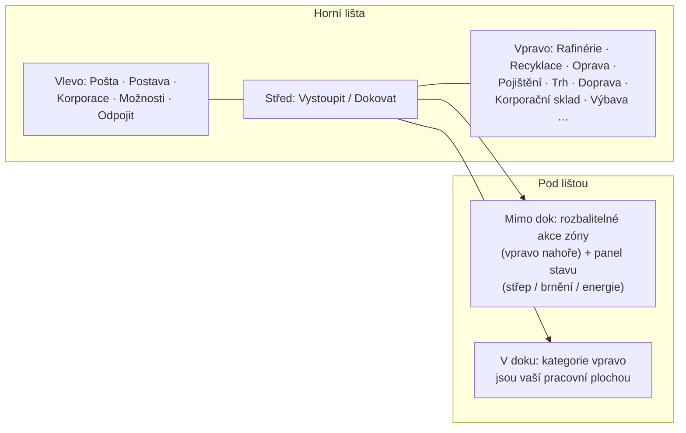

# Přehled uživatelského rozhraní klienta

Klient je rozhraní ve **stylu EVE Online**: celoobrazovkový pohled na vesmír/zónu s
plovoucími, **přizpůsobitelnými a přesouvatelnými okny**, která lze **zavřít a znovu otevřít**
podle potřeby. Napojení je řešeno systém po systému — viz stránky odkázané níže.

> Toto rozvržení je pracovní model poskytnutý projektem, sloužící k popisu toho, kde
> jednotlivé akce sídlí. Přesné názvy obrazovek se mohou mírně lišit; struktura je
> referenční.

## Horní lišta

Trvalá lišta v horní části obrazovky.

| Oblast | Obsah |
|---|---|
| **Vlevo** | Hlavní tlačítka: **Pošta**, **Postava**, **Korporace**, ostatní **Možnosti** a **Odpojit** |
| **Střed** | Tlačítko **Vystoupit / Dokovat** — hlavní přepínač mezi stavy v doku⇄mimo dok (viz [pohyb](/cs/features/movement/)) |
| **Vpravo** | Kategorie akcí jako tlačítka: **Rafinérie**, **Recyklace**, **Oprava**, **Pojištění**, **Trh**, **Doprava** (posilky), **Korporační sklad**, **Výbava**, … |

Kategorie vpravo otevírají okna příslušných systémů:

| Tlačítko | Otevře / provede | Stránka wiki |
|---|---|---|
| Rafinérie | Zpracování surovin na komponenty | [produkce](/cs/features/production/) |
| Recyklace | Rozklad předmětů na základní materiály | [produkce](/cs/features/production/) |
| Oprava | Oprava poškozených robotů/modulů | [produkce](/cs/features/production/) |
| Pojištění | Pojištění produkce/robotů | [produkce](/cs/features/production/) |
| Trh | Tržní objednávky a přímé nákupy | [trh](/cs/features/market/) |
| Doprava | Dopravní úkoly (posilky) | [doprava](/cs/features/transport/) |
| Korporační sklad | Hangár/sklad korporace | [skupiny](/cs/features/groups/) |
| Výbava | Nasazení modulů a munice na aktivního robota | [roboti](/cs/features/robots/) |

## Stav v doku

Během **dokování** jsou kategorie akcí vpravo hlavní pracovní plochou: zpracováváte,
obchodujete, vybavujete a spravujete sklad, aniž byste opustili základnu. Tlačítko
Vystoupit vás odpojí z doku do zóny (viz [pohyb](/cs/features/movement/) pro podmínky
vystoupení).

## Stav mimo dok

Během **pobytu mimo dok** (pilotujete svého aktivního robota v zóně):

- Oblast **vpravo nahoře** získává **rozbalitelné tlačítko akcí**: kliknutím se rozbalí
  seznam dalších akcí zóny směrem dolů (skenování, akce sběru/interakce, nástroje zóny —
  akce dokumentované na stránkách [sběr](/cs/features/gathering/) a [boj](/cs/features/combat/)).
- **Hlavní panel stavu** zobrazuje stav vašeho robota: **střep, brnění/trup, energie**
  a související bojový stav — stejná data, na která odkazuje stránka
  [boj](/cs/features/combat/) (např. kontrola „energetický systém v pořádku" při
  vystoupení).
- Kategorie dostupné pouze v základně (rafinérie, trh, …) jsou nedostupné, dokud se
  znovu nedokujete.

## Běžná okna

Většina systémů se otevírá ve standardním plovoucím okně: lišta s názvem, tlačítko
zavření, přizpůsobitelné okraje, obsah ve formě záložek nebo seznamu. Opakované systémy
(inventář/kontejnery, trh, produkční linky) mohou mít otevřeno více oken současně.

- **Inventář / kontejnery** — seznam kontejneru, přesun/skladování/balíkování předmětů,
  přejmenování, smazání — viz [předměty](/cs/features/items/).
- **Okno postavy** (tlačítko vlevo nahoře) — profil, rozšíření (výzkum), nastavení,
  kredity — viz [základ](/cs/features/getting-started/) a [výzkum](/cs/features/research/).
- **Okno korporace** (tlačítko vlevo nahoře) — informace o korporaci, hangár, dokumenty,
  hlasování, bulletin — viz [skupiny](/cs/features/groups/).
- **Okno pošty** (tlačítko vlevo nahoře) — osobní a hromadná pošta — viz
  [společenské](/cs/features/social/).

## Úmluva použitá v této wiki

- **„Horní lišta → X"** = tlačítko s názvem X na horní liště.
- **„Akce mimo dok"** = rozbalitelný seznam vpravo nahoře při pobytu v zóně.
- **Tlačítko Vystoupit/Dokovat** = přepínač ve středu horní lišty.

<!-- Note: this page is the agreed UI model (project-provided). If the real client
     differs in button names or placement, update this page first — every other
     features/ page references the conventions defined here. -->