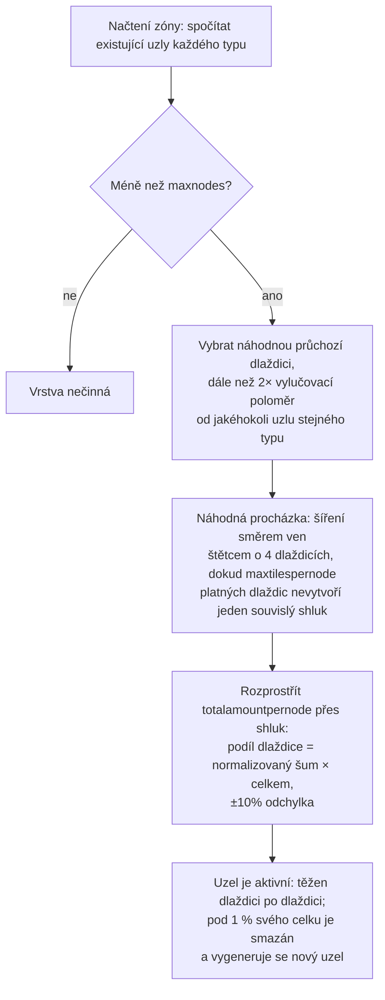

# Generování surovin v zóně

Tato stránka vysvětluje, jak server udržuje zásoby surovin v zóně. Oba systémy běží
nepřetržitě na pozadí, dokud je zóna načtena; k jejich fungování (tikání) není potřeba
žádná akce hráče.

## Konfigurace surovin zóny

Každá zóna je v databázi nakonfigurována pomocí dvou nezávislých seznamů:

- **Konfigurace rudy** (`mineralconfigs`) — jeden řádek pro každý typ rudy přítomný v zóně
  se čtyřmi parametry pro každý typ:
  | Sloupec | Význam |
  |---|---|
  | `maxnodes` | Kolik uzlů tohoto typu zóna udržuje |
  | `maxtilespernode` | Maximální počet dlaždic, které může pokrýt jeden uzel |
  | `totalamountpernode` | Celkové množství materiálu v novém uzlu, rozložené mezi jeho dlaždice |
  | `minthreshold` | Minimální poměr zaplnění dlaždice (0–1); dlaždice pod touto hodnotou po těžbě zaniknou |
- **Konfigurace rostlin** (`zones.fertility` + sada pravidel pro rostliny) — cílové
  pokrytí zóny vegetací (procento) a seznam druhů rostlin, kterým je povoleno zde růst
  (chování každého druhu je definováno souborem pravidel popsaným v sekci
  [Rostliny](/cs/content/plants/)).

Zóny bez konfigurace rudy (arény, výcvikové zóny, pevnosti, některé zóny gamma)
nemají vůbec žádné vrstvy rudy.

## Ložiska rudy

### Jak se uzel umísťuje

Když se zóna načte, vrstva každého typu rudy spočítá své existující uzly (uložené v
tabulce `mineralnodes`) a generuje nové, dokud není dosaženo hodnoty `maxnodes`. Nový uzel
se umísťuje pomocí **náhodné procházky** (random walk):

1. Vybere se náhodná průchozí dlaždice.
2. Musí být dostatečně daleko od nejbližšího existujícího uzlu stejného typu — vylučovací
   poloměr je odvozen z parametru `maxtilespernode` (`√(maxtilespernode/π) × 2`, počáteční bod
   pak musí být vzdálen nejméně dvojnásobek této hodnoty), takže se uzly nikdy nesloučí
   do jednoho obřího ložiska.
3. Z počáteční dlaždice se náhodná procházka šíří směrem ven (štětcem o velikosti 4 dlaždic současně)
   a shromažďuje až `maxtilespernode` platných dlaždic do jednoho souvislého shluku.
4. Materiál uzlu o množství `totalamountpernode` se rozprostře po celém shluku: podíl každé
   dlaždice je její (normalizovaná) hodnota šumu vynásobená celkovým množstvím s náhodnou
   odchylkou ±10 %, takže žádné dva uzly stejného typu nevypadají stejně.

Dlaždice je pro uzel platná pouze tehdy, pokud leží uvnitř zóny, není ostrovem, není
chráněna terraformací PBS a je průchozí. Dva vzácné typy mají **ochranná pásma** kolem
dokovacích základen a teleportů: **epriton** dodržuje minimální vzdálenost a **flux ore**
dodržuje dvojnásobek této vzdálenosti — flux ore se tedy nikdy nenachází přímo vedle základny.

### Jak se uzel spotřebovává

- Těžba odebírá materiál dlaždici po dlaždici.
- Uzel, který klesne pod **1 % svého nakonfigurovaného celkového množství**, je smazán
  a je vygenerován nový uzel (zpět ke kroku 1), aby zóna zůstala na hodnotě `maxnodes`.
- Uzly flux ore navíc spouštějí **spawnování NPC** — těžené (nebo zanikající) uzly
  vysílají události, na které systém NPC reaguje, a proto ložiska flux ore přitahují
  pozornost.

## Rostliny

### Skenování rostlin

Zóna je rozdělena na **oblasti 32×32 dlaždic**. Obslužný proces pro rostliny tyto dlaždice
prochází postupně, přičemž zpracovává jednu oblast za tik, s rychlostí nastavenou tak, aby
**celý průchod zónou trval zhruba 8 hodin** (lze upravit pro každou zónu zvlášť). Každá
„kostka“ 32×32 je zpracována pevným postupem:

1. **Validace** — odstranění neplatných rostlin (špatný podklad, mrtvé, na nesprávném místě).
2. **Růst** — posun každé rostliny do dalších fází růstu (viz
   [sběr](/cs/features/gathering/) pro `growRate` a plodnost).
3. **Spawn** — přidání nových rostlin tam, kde kostka nedosahuje svého cíle úrodnosti.
4. **Poškozování zdí** — blokovací výška rostlin časem klesá.
5. **Usmrcení podle vzdálenosti** — vynucení rozestupů mezi rostlinami stejného druhu (`killDistance`).
6. **Obnova materiálu** — regenerace malého množství plodů.

### Jak se vybírá nová rostlina

Dlaždice může vyklíčit pouze tehdy, pokud jí soubor zóny dává **potenciál růstu**
(bajt pro každou dlaždici zapečený ve vrstvě rostlin zóny — 0 znamená, že dlaždice nikdy
nevyklíčí). Při každém tiku pro každou způsobilou dlaždici:

- **Nejprve kontrola úrodnosti zóny**: pokud pokrytí blokujícími rostlinami v kostce již
  dosahuje hodnoty `fertility%` jejích pozemních dlaždic, nic nového zde nevyroste.
- **Šance pro jednotlivou dlaždici**: náhodný hod musí překonat potenciál růstu dané dlaždice.
- **Výběr druhu**:
  - Pokud dlaždice **nemá žádné rostlinné sousedy**, druh se určí váženým náhodným výběrem,
    kde vahou každého povoleného druhu je jeho `fertility` (druhy vysévané hráči jsou
    z přirozeného spawnu vyloučeny).
  - Pokud sousedy **má**, je to hod mincí: s 50% pravděpodobností aktuálně *dominantní*
    sousední druh (nejčastější v okolí), s 50% pravděpodobností výběr podle **šíření**
    vážený vzorcem `(počet sousedů × spreading)` pro každý druh — to je mechanismus,
    díky kterému se shluky rozšiřují o vlastní druh.
- **Limity a rozestupy**: druh s limitem `maxAmount` je přeskočen, jakmile jich má zóna
  dostatek, a dlaždice ve vzdálenosti do `killDistance` od jiné rostliny stejného druhu je
  přeskočena.

### Co to znamená pro hráče

- Hustota rostlin je omezena úrodností zóny — nikdy neuvidíte zónu se 100% pokrytím
  vegetací, pokud je její úrodnost 20.
- Shluky jsou standardem: šíření způsobuje, že si každý druh rozšiřuje vlastní ostrůvky,
  takže zóna má tendenci vytvářet druhová teritoria spíše než promíchanou směs typu „sůl a pepř“.
- Druhy s pravidlem `killDistance` (např. některé vysoce hodnotné rostliny) jsou rovnoměrně
  rozmístěny, což činí jejich polohu předvídatelnou, jakmile jednu najdete.
- Nové uzly se objevují tam, kam dopadne náhodná procházka — na zóně neexistuje žádné pevné
  „rudné místo“; je nutné skenovat terén (viz [sběr](/cs/features/gathering/)).

<!-- Developer notes: TerrainsModule.cs (per-zone layer construction: OreLayer for
     Solid, LiquidLayer for Liquid, GravelLayer for TrainingZone; LoadMineralNodes
     top-up); MineralLayer.cs (LoadMineralNodes: delete <1% nodes, generate to
     maxnodes; FluxOre -> OreNpcSpawnMessage on decrease/expiry);
     Generators/MineralNodeGeneratorBase.cs (FindStartPosition keep-out + spacing,
     NormalizeNoise, CreateMineralNode jitter); RandomWalkMineralNodeGenerator.cs
     (flood-fill brush 4, 50k step cap); MineralNodeRepository.cs (mineralnodes table,
     compressed per-tile values); PlantHandler.cs (32x32 areas, 8h full pass,
     PlantsGrowthTimerOverrideMin, scanner modes); NatureCube.cs (ProcessAll pipeline,
     SpawnPlants fertility/spawn/killDistance logic, GetNewPlantRule 50/50 ruling vs
     spreading); PlantRuleExtensions.cs (fertility-weighted + spreading-weighted
     draws); PlantInfo.cs (per-tile spawn byte comes from the zone's plant layer
     file, never assigned by server code). -->
