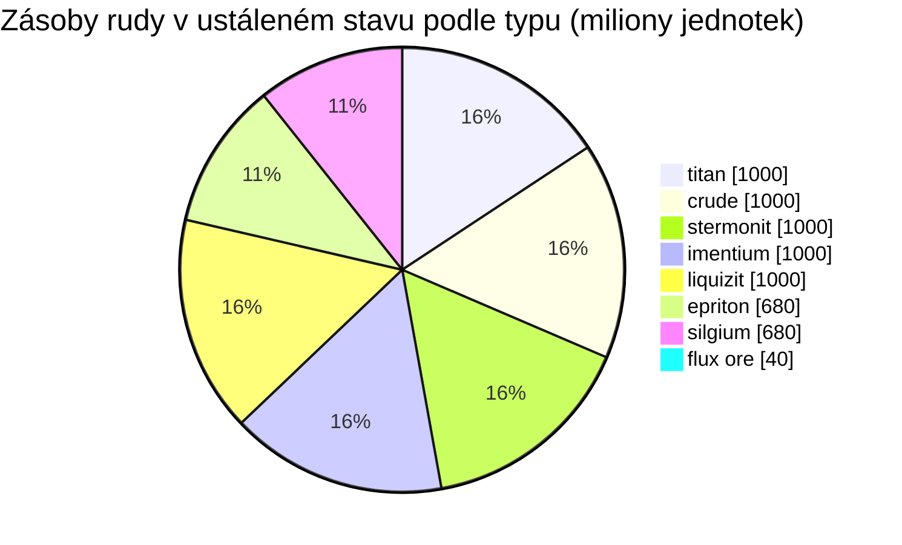

# Daoden (zone_ASI) — praktická ukázka

  <a href="/cs/zones/map/">
    
    <strong>Mapa světa</strong> — kde se tato zóna nachází mezi ostatními, se spoji teleportů. Otevřít celou mapu.
  </a>

Kde stojí teleportační sloupy této zóny (body označené cílem — ztlumené, pokud je
sloup vypnutý), místa přistání teleportů přicházejících z jiných zón (čárkované kruhy)
a výstupní brány (kosočtverce), pokud existují. Pozice odpovídají souřadnicím dlaždic
evidovaným serverem.
Čárkované čáry spojují dvojice místních (vnitrozónových) teleportačních sloupů.

Zóna s **otevřeným PvP** úrovně alpha — nejbohatší konfigurace rudy ve hře a
místo, kde se nacházejí vzácné typy. Obsahuje vše, co má New Virginia, plus epriton, silgium
a naleziště rudy flux ore, která přitahují útoky NPC.

| Fakt | Hodnota |
|---|---|
| ID zóny | 2 |
| Typ | PvP (otevřená) |
| Ochrana | [Beta](/cs/zones/protection/) — otevřené PvP, standardní terén |
| Velikost | 2048 × 2048 dlaždic |
| Úrodnost | 20 |
| Sada pravidel pro rostliny | 2 — 19 druhů (vč. plodin vysoké úrovně) |
| Typy rud | 8 (titan, crude, stermonit, imentium, liquizit, epriton, silgium, flux ore) |
| Celkem ložisek rudy | 64 (8 na typ) |

## Konfigurace rudy

| Materiál | Uzly | Max. dlaždic/uzel | Celkem na uzel | Min. práh |
|---|---|---|---|---|
| [titan](/cs/content/ores/titan/) | 8 | 500 | 125,000,000 | 0.5 |
| [crude](/cs/content/ores/crude/) | 8 | 1257 | 125,000,000 | 0.5 |
| [stermonit](/cs/content/ores/stermonit/) | 8 | 500 | 125,000,000 | 0.5 |
| [imentium](/cs/content/ores/imentium/) | 8 | 500 | 125,000,000 | 0.5 |
| [liquizit](/cs/content/ores/liquizit/) | 8 | 500 | 125,000,000 | 0.5 |
| [epriton](/cs/content/ores/epriton/) | 8 | 500 | 85,000,000 | 0.5 |
| [silgium](/cs/content/ores/silgium/) | 8 | 500 | 85,000,000 | 0.5 |
| [fluxore](/cs/content/ores/fluxore/) | 8 | 300 | 5,000,000 | 0.5 |

Pozoruhodné body:

- **8× více uzlů než New Virginia**, ale každý uzel je menší (500 dlaždic oproti 1 000):
  poloměr procházky klesá z 34 na 24 dlaždic pro standardní rudy. Skenování zde hraje větší
  roli — ložiska jsou tenčí a početnější.
- **Epriton a silgium** mají snížené celkové množství (85 M oproti 125 M) — vyšší hodnota,
  vzácnější zásoby. Epriton navíc dodržuje **minimální vzdálenost od základen a teleportů**,
  takže jeho uzly nikdy neleží u místa oživení/vstupu.
- **Flux ore je extrémní případ**: pouze 5 M na uzel na 300 dlaždicích (~16 600 na dlaždici —
  slabý pramínek, nikoli masivní ložisko), 8 uzlů a ochranné pásmo o **dvojnásobné** vzdálenosti
  od základen oproti epritonu. Těžba uzlu flux ore posílá události pro spawn do systému NPC —
  místa s flux ore jsou záměrně sporná a nebezpečná (viz [Systémy narušení a NPC](/cs/features/intrusion/)).
- Celková zásoba v ustáleném stavu: ~6,4 miliardy jednotek materiálu celkem.

## Směs rostlin

Sada pravidel 2 povoluje 19 druhů — kompletní směs alpha: základní druhy plus **devrinol**,
**wall** (zeď), **titanplant** a **plodiny vysoké úrovně** (vysoký electroplant, vysoký
železný strom, vysoký rustbush, vysoký slimeroot). Úrodnost je stále 20, takže hustota
je stejná jako v New Virginia — mění se to, *které* druhy mohou vyhrát výběr úrodnosti.
Vlastní váhy `fertility` plodin vysoké úrovně určují, jak často převáží nad travinami.

Pravidla pro jednotlivé druhy najdete v sekci [Rostliny](/cs/content/plants/); výtěžnost
rud v sekci [Rudy](/cs/content/ores/).

## Co to znamená pro hráče

- K dispozici je kompletní žebříček rud včetně ekonomiky flux ore — jedná se však o otevřené
  PvP, takže vše, co vytěžíte, vám může být odebráno (bezpečný přesun zboží mezi základnami
  viz [přeprava](/cs/features/transport/)).
- Počítejte s tlakem NPC v blízkosti uzlů flux ore; spawner reaguje na události těžby na
  těchto uzlech.
- Sběr rostlin se zde zaměřuje na varianty vysoké úrovně, které poskytují lepší plody než
  druhy nízké úrovně ve startovních zónách.

<!-- Developer notes: zones row id 2 (zonetype 2 = PvP, protected 0, fertility 20,
     plantruleset 2); mineralconfigs 8 rows (7 standard + fluxore 8/300/5M);
     MineralNodeGeneratorBase.KeepOutDist: Epriton = MINERAL_DISTANCE_FROM_BASE_MIN,
     FluxOre = 2x; MineralLayer.OnNodeDecrease/OnNodeExpired -> OreNpcSpawnMessage for
     FluxOre; plantrules rulesetid 2 = 19 files (4 harvestable, incl. devrinol and
     wall). -->
