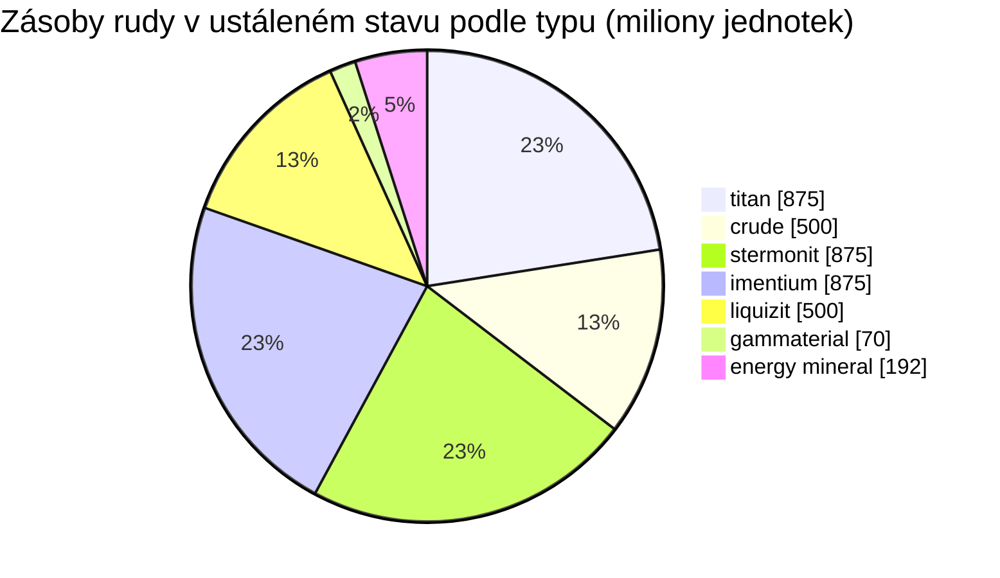

# zone_gamma_z106 — praktická ukázka

  <a href="/cs/zones/map/">
    
    <strong>Mapa světa</strong> — kde se tato zóna nachází mezi ostatními, se spoji teleportů. Otevřít celou mapu.
  </a>

Kde stojí teleportační sloupy této zóny (body označené cílem — ztlumené, pokud je
sloup vypnutý), místa přistání teleportů přicházejících z jiných zón (čárkované kruhy)
a výstupní brány (kosočtverce), pokud existují. Pozice odpovídají souřadnicím dlaždic
evidovaným serverem.

Zóna s **otevřeným PvP** vysoké úrovně: teraformovatelná, nízká úrodnost, varianty
rostlin 2. úrovně a úspornější ekonomika rud. Toto je podoba zóny pro „endgame“ — méně
zdrojů, o které se svádí tvrdší boj.

| Fakt | Hodnota |
|---|---|
| ID zóny | 106 |
| Typ | PvP (otevřená) |
| Ochrana | [Gamma](/cs/zones/protection/) — otevřené PvP, teraformovatelná |
| Velikost | 2048 × 2048 dlaždic |
| Úrodnost | 15 |
| Teraformovatelná | ano (technologický limit PBS 2) |
| Sada pravidel pro rostliny | 22 — 17 druhů („Gamma Plant Rules“, směs 2. úrovně) |
| Typy rud | 7 (titan, crude, stermonit, imentium, liquizit, gammaterial, energy mineral) |
| Celkem ložisek rudy | 44 |

## Konfigurace rudy

| Materiál | Uzly | Max. dlaždic/uzel | Celkem na uzel | Min. práh |
|---|---|---|---|---|
| [titan](/cs/content/ores/titan/) | 7 | 600 | 125,000,000 | 0.5 |
| [crude](/cs/content/ores/crude/) | 4 | 600 | 125,000,000 | 0.5 |
| [stermonit](/cs/content/ores/stermonit/) | 7 | 600 | 125,000,000 | 0.5 |
| [imentium](/cs/content/ores/imentium/) | 7 | 600 | 125,000,000 | 0.5 |
| [liquizit](/cs/content/ores/liquizit/) | 4 | 600 | 125,000,000 | 0.5 |
| [gammaterial](/cs/content/ores/gammaterial/) | 7 | 100 | 10,000,000 | 0.5 |
| [energymineral](/cs/content/ores/energymineral/) | 8 | 300 | 24,000,000 | 0.5 |

Pozoruhodné body:

- **Méně uzlů než v zónách alpha** (44 oproti 64 v Daodenu): crude a liquizit klesají
  na pouhé 4 uzly pro každý typ. Stejné celkové množství na uzel jako u standardních rud
  v zónách alpha, takže zásoba v ustáleném stavu (~3,9 miliardy jednotek celkem) je
  skromnější a pomaleji se obnovuje.
- **Dva exotické typy**: **gammaterial** v drobných uzlech o 100 dlaždicích (poloměr
  procházky 10 dlaždic — malé, snadno přehlédnutelné/lokalizovatelné, ~1,4 M na uzel)
  a **energy mineral** s 24 M na uzel.
- Žádný epriton, žádný flux ore — vzácné a ekonomické rudy zůstávají v úrovni alpha.

## Směs rostlin

Sada pravidel 22 povoluje 17 druhů: základní druhy plus **varianty 2. úrovně** — divoce
rostoucí plodiny vysoký železný strom t2 a vysoký rustbush t2 a **rostliny 2. úrovně
vysévané hráči** (vysoký electroplant t2, vysoký slimeroot t2). Vysévané rostliny mají
příznak `playerSeeded` — **nikdy** se nespawnují přirozeně; existují pouze v zahradách
hráčů (viz [sběr → rostliny](/cs/features/gathering/)).

Úrodnost je **15**, nikoli 20: kostka 32×32 může obsahovat nanejvýš ~15 % blokujících
rostlin, takže pokrytí rostlinami je viditelně řidší než v zónách alpha a losování
úrodnosti má o něco méně prostoru pro zaplnění, než se kostka „nasytí“.

Pravidla pro jednotlivé druhy (včetně množství plodů pro t2) najdete v sekci
[Rostliny](/cs/content/plants/); výtěžnost rud v sekci [Rudy](/cs/content/ores/).

## Co to znamená pro hráče

- Skromnější, pomalejší ekonomika: méně uzlů běžných rud znamená, že se tlak těžby
  projeví rychleji — vytěžený uzel crude trvá zóně déle nahradit.
- Řidší vegetace: s 15% úrodností je holá půda pravidlem a shluky rostlin výjimkou.
- Vysoce hodnotný sběr zde představují divoké rostliny 2. úrovně (železný strom /
  rustbush) a provozování hráčských zahrad s vysévanými rostlinami t2 (electroplant a
  slimeroot).
- Teraformace (technologický limit PBS 2) znamená, že samotný terén mohou hráči
  přetvářet (viz [Základny PBS](/cs/features/pbs/)).

<!-- Developer notes: zones row id 106 (zonetype 2 = PvP, protected 0, fertility 15,
     terraformable 1, pbsTechLimit 2, plantruleset 22); mineralconfigs 7 rows (crude
     and liquizit 4 nodes each); plantrules rulesetid 22 = 17 files, note "Gamma
     Plant Rules"; electroplant_seeded_t2.txt / slimeroot_seeded_t2.txt set
     playerSeeded=n1 (inherited via source= from electroplant_hi.txt /
     slimeroot_hi.txt) -> excluded from natural spawns in
     PlantRuleExtensions.GetWinnerPlantTypeBasedOnFertility. -->
