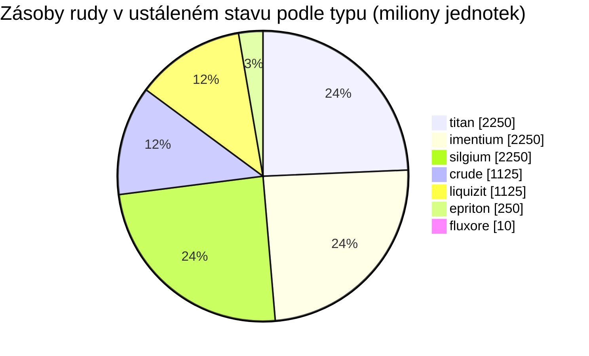

<!-- Generated by tools/generate from the live database (source: zones, mineralconfigs, plantrules, teleportdescriptions, strongholdexitconfig).
     Do not edit by hand; regenerate instead. -->
# zone_gamma_z114

  <a href="/cs/zones/map/">
    
    <strong>Mapa světa</strong> — kde se tato zóna nachází mezi ostatními, se spoji teleportů. Otevřít celou mapu.
  </a>

Kde stojí teleportační sloupy této zóny (body označené cílem — ztlumené, pokud je sloup vypnutý), místa přistání teleportů přicházejících z jiných zón (čárkované kruhy) a výstupní brány (kosočtverce), pokud existují. Pozice odpovídají souřadnicím dlaždic evidovaným serverem.

Otevřený PvP (beta) ostrov oblasti frontier belt — hráči mohou volně útočit a platí bloby. Udržuje 7 druhů rudy.

| Fakt | Hodnota |
|---|---|
| ID zóny | 114 |
| Typ | PvP |
| Ochrana | [Beta](/cs/zones/protection/) — otevřené PvP, standardní terén |
| Velikost | 2048×2048 dlaždic |
| Tier | T0 (zaznamenáno serverem) |
| Úrodnost | 15 |
| Rostlinné druhy | 15 (pravidla 10) |
| Typy rud | 7 |
| Celkem ložisek rudy | 47 |
| Technologický limit PBS | 0 |
| Max. dokovací základny | žádné |

## Konfigurace rudy

Generování uzlů, které tato zóna udržuje. Výtěžnost jednotlivých rud a vzorce generování najdete v sekci [Rudy](/cs/content/ores/) (sekce této zóny je odkazována níže).

| Materiál | Uzly | Max. dlaždic/uzel | Celkem na uzel | Min. práh |
|---|---|---|---|---|
| [titan](/cs/content/ores/titan/) | 10 | 600 | 225M | 0.5 |
| [crude](/cs/content/ores/crude/) | 5 | 600 | 225M | 0.5 |
| [imentium](/cs/content/ores/imentium/) | 10 | 600 | 225M | 0.5 |
| [liquizit](/cs/content/ores/liquizit/) | 5 | 600 | 225M | 0.5 |
| [epriton](/cs/content/ores/epriton/) | 5 | 300 | 50M | 0.5 |
| [silgium](/cs/content/ores/silgium/) | 10 | 600 | 225M | 0.5 |
| [fluxore](/cs/content/ores/fluxore/) | 2 | 200 | 5M | 0.5 |

[Index zón](/cs/zones/zone-index/) · [Mapa světa](/cs/zones/map/#t1) · [Úrovně ochrany](/cs/zones/protection/)
