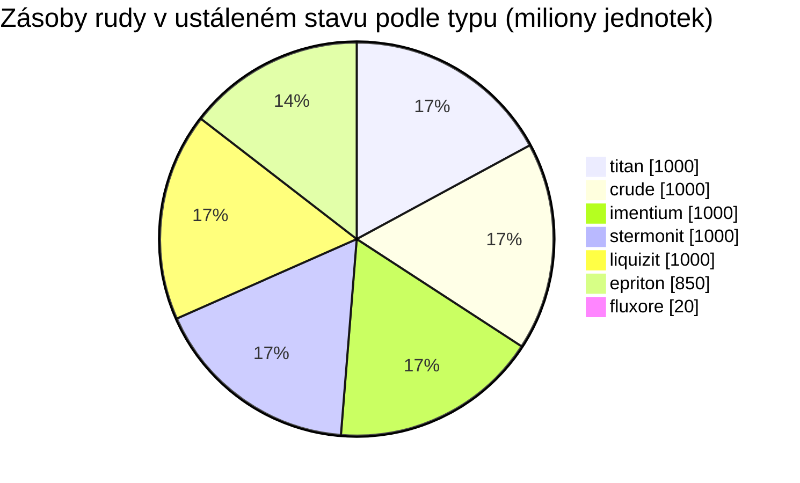

<!-- Generated by tools/generate from the live database (source: zones, mineralconfigs, plantrules, teleportdescriptions, strongholdexitconfig).
     Do not edit by hand; regenerate instead. -->
# Domhalarn (zone_ICS_A_real)

  <a href="/cs/zones/map/">
    
    <strong>Mapa světa</strong> — kde se tato zóna nachází mezi ostatními, se spoji teleportů. Otevřít celou mapu.
  </a>

Kde stojí teleportační sloupy této zóny (body označené cílem — ztlumené, pokud je sloup vypnutý), místa přistání teleportů přicházejících z jiných zón (čárkované kruhy) a výstupní brány (kosočtverce), pokud existují. Pozice odpovídají souřadnicím dlaždic evidovaným serverem. Čárkované čáry spojují dvojice místních (vnitrozónových) teleportačních sloupů.

Otevřený PvP (beta) ostrov oblasti Attalica (ICS) — hráči mohou volně útočit a platí bloby. Udržuje 7 druhů rudy.

| Fakt | Hodnota |
|---|---|
| ID zóny | 3 |
| Typ | PvP |
| Ochrana | [Beta](/cs/zones/protection/) — otevřené PvP, standardní terén |
| Velikost | 2048×2048 dlaždic |
| Úrodnost | 20 |
| Rostlinné druhy | 17 (pravidla 3) |
| Typy rud | 7 |
| Celkem ložisek rudy | 54 |
| Max. dokovací základny | žádné |

## Konfigurace rudy

Generování uzlů, které tato zóna udržuje. Výtěžnost jednotlivých rud a vzorce generování najdete v sekci [Rudy](/cs/content/ores/) (sekce této zóny je odkazována níže).

| Materiál | Uzly | Max. dlaždic/uzel | Celkem na uzel | Min. práh |
|---|---|---|---|---|
| [titan](/cs/content/ores/titan/) | 8 | 500 | 125M | 0.5 |
| [crude](/cs/content/ores/crude/) | 8 | 1.257k | 125M | 0.5 |
| [stermonit](/cs/content/ores/stermonit/) | 8 | 500 | 125M | 0.5 |
| [imentium](/cs/content/ores/imentium/) | 8 | 500 | 125M | 0.5 |
| [liquizit](/cs/content/ores/liquizit/) | 8 | 500 | 125M | 0.5 |
| [epriton](/cs/content/ores/epriton/) | 10 | 350 | 85M | 0.5 |
| [fluxore](/cs/content/ores/fluxore/) | 4 | 300 | 5M | 0.5 |

[Index zón](/cs/zones/zone-index/) · [Mapa světa](/cs/zones/map/#beta) · [Úrovně ochrany](/cs/zones/protection/)
