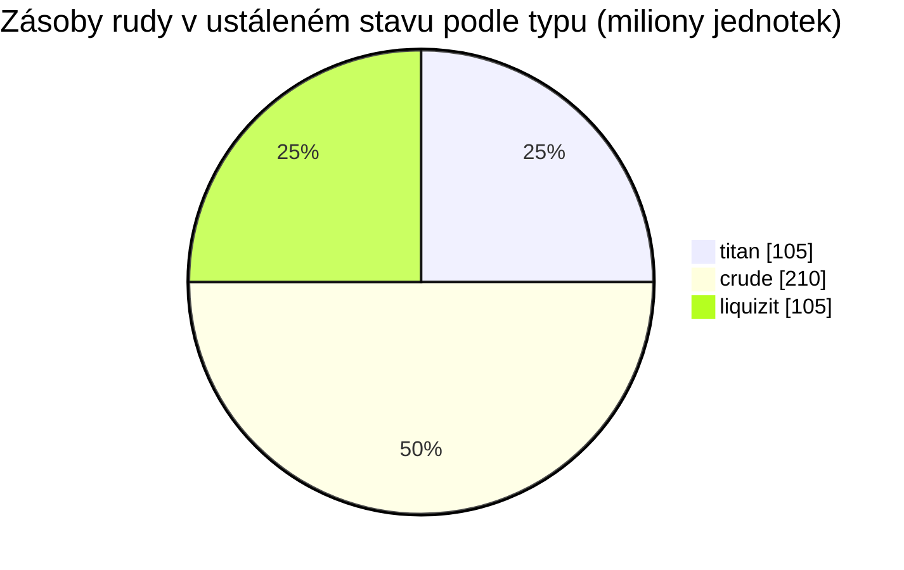

# New Virginia (zone_TM) — praktická ukázka

  <a href="/cs/zones/map/">
    
    <strong>Mapa světa</strong> — kde se tato zóna nachází mezi ostatními, se spoji teleportů. Otevřít celou mapu.
  </a>

Kde stojí teleportační sloupy této zóny (body označené cílem — ztlumené, pokud je
sloup vypnutý), místa přistání teleportů přicházejících z jiných zón (čárkované kruhy)
a výstupní brány (kosočtverce), pokud existují. Pozice odpovídají souřadnicím dlaždic
evidovaným serverem.
Čárkované čáry spojují dvojice místních (vnitrozónových) teleportačních sloupů.

Startovní **chráněná PvE** zóna nízké úrovně — bezpečné místo, kde nové postavy
získávají suroviny. Její konfigurace představuje nejjednodušší část spektra: málo
typů rudy, velké uzly a základní směs rostlin.

| Fakt | Hodnota |
|---|---|
| ID zóny | 0 |
| Typ | PvE (chráněná) |
| Ochrana | [Alpha](/cs/zones/protection/) — chráněná, PvP zakázáno |
| Velikost | 2048 × 2048 dlaždic |
| Úrodnost | 20 |
| Sada pravidel pro rostliny | 0 — 15 druhů (základní směs „tm pve“) |
| Typy rud | 3 (titan, crude, liquizit) |
| Celkem ložisek rudy | 21 (7 na typ) |

## Konfigurace rudy

| Materiál | Uzly | Max. dlaždic/uzel | Celkem na uzel | Min. práh |
|---|---|---|---|---|
| [titan](/cs/content/ores/titan/) | 7 | 1000 | 15,000,000 | 0.5 |
| [crude](/cs/content/ores/crude/) | 7 | 1257 | 30,000,000 | 0.5 |
| [liquizit](/cs/content/ores/liquizit/) | 7 | 1000 | 15,000,000 | 0.5 |

Pozoruhodné body:

- **Velké, řídké uzly** — každý o rozloze 1 000–1 257 dlaždic (poloměr procházky
  `(int)√(dlaždice/π)×2` = 34–40 dlaždic), takže každý uzel tvoří velký shluk a v zóně
  je pouze 7 uzlů od každého typu. Celková zásoba v ustáleném stavu činí zhruba 420
  milionů jednotek materiálu (105 M titan + 210 M crude + 105 M liquizit).
- **Žádné vzácné typy** — žádný epriton, žádný flux ore, takže zde nejsou žádná
  ochranná pásma kolem základen ani rudná naleziště způsobující spawnování NPC.
- `minthreshold` 0.5 znamená, že dlaždice je využitelná pouze tehdy, pokud je její
  zaplnění šumem alespoň poloviční oproti maximu — okraje každého shluku jsou tenké.

Výtěžnost jednotlivých typů (na co se jednotka každé rudy rafinuje a vzorce pro
generování uzlů za výše uvedenými čísly) najdete v sekci [Rudy](/cs/content/ores/).

## Směs rostlin

Sada pravidel 0 povoluje 15 druhů — základní startovní sadu: tráva (a/b), borovice,
keře (a/b), rango, měděný strom, rákosí, nanopšenice, základní varianty
rustbush/slimeroot/electroplant, bonsaj a základní železný strom. Žádné zdi, žádný
devrinol, žádné plodiny vysoké úrovně.

Při úrodnosti 20 může kostka 32×32 obsahovat nanejvýš ~20 % blokujících rostlin;
na celé mapě 2048×2048 to představuje horní hranici zhruba 838 000 dlaždic s
rostlinami (v praxi méně — voda a ostrovy nejsou pevnina). Výběr druhů je vážen
hodnotou `fertility` v každém pravidle, takže dominují základní trávy a keře, zatímco
nízkopodlažní plodiny zůstávají vzácné.

Kompletní pravidla pro jednotlivé druhy (growRate, plody, odolnost) najdete v sekci
[Rostliny](/cs/content/plants/).

## Co to znamená pro hráče

- Bezpečná startovní ekonomika: tři běžné rudy ve velkých shlucích, které lze snadno skenovat.
- Sklízetelné plodiny jsou zde varianty nízké úrovně — vysoce hodnotné rostliny (vysoká
  úroveň electroplant/železný strom/rustbush/slimeroot) se objevují v pozdějších zónách.
- Vzhledem k tomu, že je zóna chráněná, je riziko PvP jedinou věcí, která v těžebním
  cyklu chybí (vstup do zóny viz [pohyb](/cs/features/movement/)).

<!-- Developer notes: zones row id 0 (zonetype 1 = PvE, protected 1, fertility 20,
     plantruleset 0); mineralconfigs 3 rows (titan/crude/liquizit, 7 nodes each);
     plantrules rulesetid 0 = 15 files, note "tm pve". Node radius formula and
     threshold semantics: see generation.md. -->
