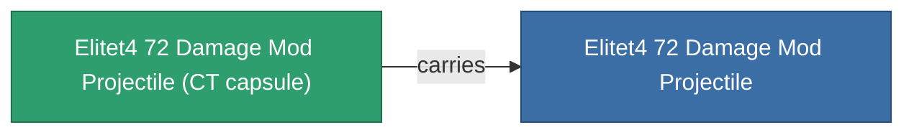

<!-- Generated by tools/generate from the live database (source: entitydefaults definition 6053, aggregatevalues via aggregatefields).
     Do not edit by hand; regenerate instead. -->

# Elitet4 72 Damage Mod Projectile

|  |  |
|---|---|
| Definition | `def_elitet4_72_damage_mod_projectile` |
| Stufe | T4 (special) |
| Häufigkeit | 100 |
| Volumen | 0.5 |
| Masse | 100 |
| Kategorie | Modules / Enhancements |
| Hinweis | elite module |

## Statistiken

| Feld | Wert |
|---|---|
| cpu_usage | 15 |
| damage_projectile_modifier | 0.25 |
| powergrid_usage | 5 |
| projectile_falloff_modifier | 1.05 |
| projectile_optimal_range_modifier | 1.025 |

## Transportkapsel

A transport capsule (CT) exists for this item — it is how the item moves between players and zones.

## Wo kaufen

Fixed-price vendors that sell this item (see the [Item shop](/de/content/shop/) for the full catalog).

| Vendor | Qty | Credits | UniCoin |
|---|---|---|---|
| Daoden outpost | ∞ | 500M | 25k |

<!-- production:generated -->
## Produktion

**Hergestellt aus 2 Komponenten** — baue die Komponenten zusammen, um es herzustellen (vollständige Liste in [Rezepte](/de/content/recipes/)):

**Bauplan:** [Elitet4 72 Damage Mod Projectile Cprg](/content/items/elitet4-72-damage-mod-projectile-cprg/)

<svg class="prod-card-icon" aria-hidden="true"><use href="#mi-grid"/></svg><a class="prod-card-name" href="/de/content/items/material-boss-z72/">Material Boss Z72</a>

benötigt: <b>400</b>

<svg class="prod-card-icon" aria-hidden="true"><use href="#mi-panel"/></svg><a class="prod-card-name" href="/de/content/items/named3-damage-mod-projectile/">DVT-800g firearm tuning</a>

benötigt: <b>1</b>

