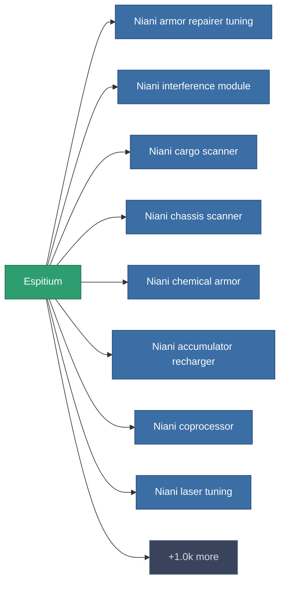

<!-- Generated by tools/generate from the live database (source: entitydefaults definition 189, aggregatevalues via aggregatefields).
     Do not edit by hand; regenerate instead. -->

# Espitium

|  |  |
|---|---|
| Definition | `def_espitium` |
| Stufe | – |
| Häufigkeit | 100 |
| Volumen | 0 |
| Masse | 0.35 |
| Kategorie | Materials |

_Keine Statistiken — dieses Element trägt keine aggregierten Werte._

<!-- production:generated -->
## Produktion

**Hergestellt aus 3 Komponenten** — baue die Komponenten zusammen, um es herzustellen (vollständige Liste in [Rezepte](/de/content/recipes/)):

<svg class="prod-card-icon" aria-hidden="true"><use href="#mi-grid"/></svg><a class="prod-card-name" href="/de/content/items/crude/">HDT</a>

benötigt: <b>50</b>

<svg class="prod-card-icon" aria-hidden="true"><use href="#mi-grid"/></svg><a class="prod-card-name" href="/de/content/items/epriton/">Epriton</a>

benötigt: <b>50</b>

<svg class="prod-card-icon" aria-hidden="true"><use href="#mi-grid"/></svg><a class="prod-card-name" href="/de/content/items/liquizit/">Liquizit</a>

benötigt: <b>75</b>

## Verwendet in Produktion

**Komponente von 1.0k Artikeln** — eine Auswahl dessen, was damit produziert werden kann (vollständige Liste in [Rezepte](/de/content/recipes/)).

