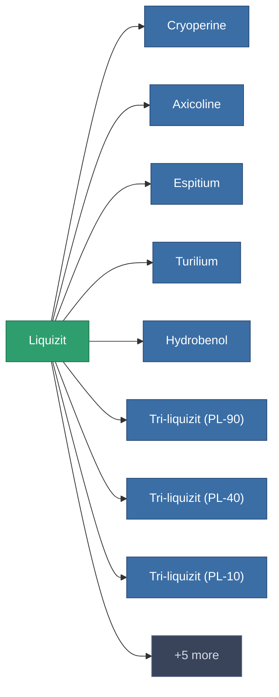

<!-- Generated by tools/generate from the live database (source: entitydefaults definition 173, aggregatevalues via aggregatefields).
     Do not edit by hand; regenerate instead. -->

# Liquizit

|  |  |
|---|---|
| Definition | `def_liquizit` |
| Stufe | – |
| Häufigkeit | 100 |
| Volumen | 0 |
| Masse | 0.02 |
| Kategorie | Materials |

_Keine Statistiken — dieses Element trägt keine aggregierten Werte._

<!-- production:generated -->
## Verwendet in Produktion

**Komponente von 13 Artikeln** — eine Auswahl dessen, was damit produziert werden kann (vollständige Liste in [Rezepte](/de/content/recipes/)).

