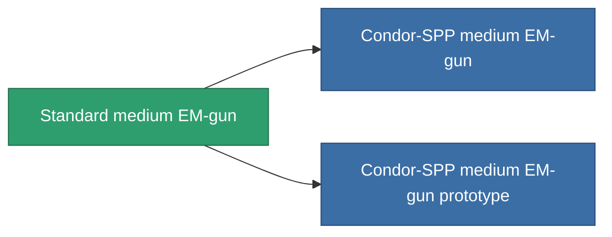

<!-- Generated by tools/generate from the live database (source: entitydefaults definition 1000, aggregatevalues via aggregatefields).
     Do not edit by hand; regenerate instead. -->

# Standard medium EM-gun

|  |  |
|---|---|
| Definition | `def_longrange_standard_medium_railgun` |
| Stufe | T1 |
| Häufigkeit | 100 |
| Volumen | 1 |
| Masse | 650 |
| Kategorie | Modules / Weapons |

## Statistiken

| Feld | Wert |
|---|---|
| accuracy | 14 |
| core_usage | 22 |
| cpu_usage | 40 |
| cycle_time | 10k |
| damage_modifier | 2 |
| falloff | 7.5 |
| least_optimal | 18 |
| optimal_range | 29 |
| powergrid_usage | 185 |

<!-- production:generated -->
## Produktion

**Hergestellt aus 5 Komponenten, Forschungsebene 4** — baue die Komponenten zusammen, um es herzustellen (vollständige Liste in [Rezepte](/de/content/recipes/)):

**Bauplan:** [Standard medium EM-gun CT](/content/items/longrange-standard-medium-railgun-cprg/)

<svg class="prod-card-icon" aria-hidden="true"><use href="#mi-grid"/></svg><a class="prod-card-name" href="/de/content/items/axicol/">Cryoperine</a>

benötigt: <b>50</b>

<svg class="prod-card-icon" aria-hidden="true"><use href="#mi-grid"/></svg><a class="prod-card-name" href="/de/content/items/axicoline/">Axicoline</a>

benötigt: <b>100</b>

<svg class="prod-card-icon" aria-hidden="true"><use href="#mi-grid"/></svg><a class="prod-card-name" href="/de/content/items/chollonin/">Chollonin</a>

benötigt: <b>50</b>

<svg class="prod-card-icon" aria-hidden="true"><use href="#mi-grid"/></svg><a class="prod-card-name" href="/de/content/items/polynitrocol/">Polynitrocol</a>

benötigt: <b>100</b>

<svg class="prod-card-icon" aria-hidden="true"><use href="#mi-grid"/></svg><a class="prod-card-name" href="/de/content/items/titanium/">Titanium</a>

benötigt: <b>100</b>

## Verwendet in Produktion

**Komponente von 2 Artikeln** — alles, was es in der Produktion verwendet:

