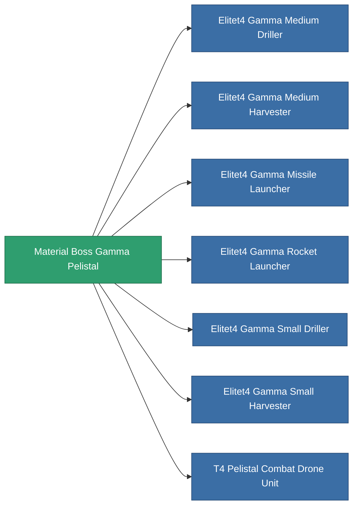

<!-- Generated by tools/generate from the live database (source: entitydefaults definition 6201, aggregatevalues via aggregatefields).
     Do not edit by hand; regenerate instead. -->

# Material Boss Gamma Pelistal

|  |  |
|---|---|
| Definition | `def_material_boss_gamma_pelistal` |
| Stufe | – |
| Häufigkeit | 100 |
| Volumen | 0 |
| Masse | 0.25 |
| Kategorie | Materials |
| Hinweis | elite module material |

_Keine Statistiken — dieses Element trägt keine aggregierten Werte._

<!-- production:generated -->
## Verwendet in Produktion

**Komponente von 7 Artikeln** — alles, was es in der Produktion verwendet:

