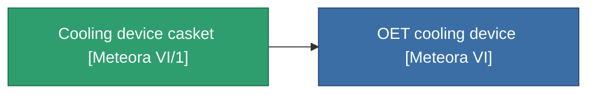

<!-- Generated by tools/generate from the live database (source: entitydefaults definition 4090, aggregatevalues via aggregatefields).
     Do not edit by hand; regenerate instead. -->

# Cooling device casket [Meteora VI/1]

|  |  |
|---|---|
| Definition | `def_missionitem_ics_ii_level02_exp3_06_t01` |
| Stufe | – |
| Häufigkeit | 100 |
| Volumen | 1 |
| Masse | 50 |
| Kategorie | Mission items |

_Keine Statistiken — dieses Element trägt keine aggregierten Werte._

<!-- production:generated -->
## Verwendet in Produktion

**Komponente von 1 Artikeln** — alles, was es in der Produktion verwendet:

