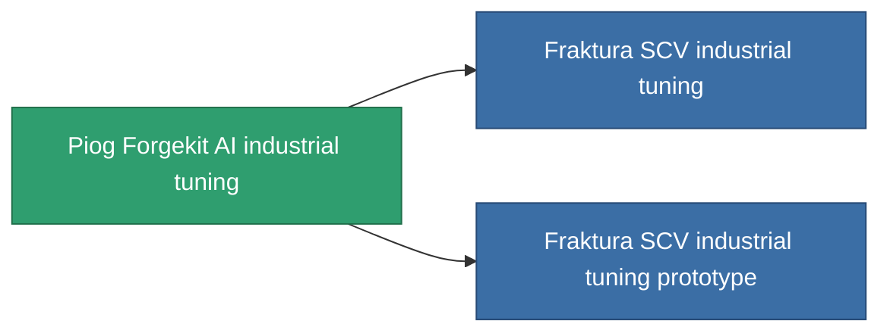

<!-- Generated by tools/generate from the live database (source: entitydefaults definition 804, aggregatevalues via aggregatefields).
     Do not edit by hand; regenerate instead. -->

# Piog Forgekit AI industrial tuning

|  |  |
|---|---|
| Definition | `def_named1_mining_upgrade` |
| Stufe | T2 |
| Häufigkeit | 100 |
| Volumen | 0.1 |
| Masse | 60 |
| Kategorie | Modules / Enhancements |
| Tier line | [Standard industrial tuning](/de/content/items/standard-mining-upgrade/) (T1) → **Piog Forgekit AI industrial tuning** (T2) → [Fraktura SCV industrial tuning](/de/content/items/named2-mining-upgrade/) (T3) → [Piog Forgekit BW1 industrial tuning](/de/content/items/named3-mining-upgrade/) (T4) |

## Statistiken

| Feld | Wert |
|---|---|
| cpu_usage | 33 |
| harvesting_amount_modifier | 1.05 |
| mining_amount_modifier | 1.05 |
| powergrid_usage | 18 |

<!-- production:generated -->
## Produktion

**Hergestellt aus 4 Komponenten, Forschungsebene 4** — baue die Komponenten zusammen, um es herzustellen (vollständige Liste in [Rezepte](/de/content/recipes/)):

**Bauplan:** [Piog Forgekit AI industrial tuning CT](/content/items/named1-mining-upgrade-cprg/)

<svg class="prod-card-icon" aria-hidden="true"><use href="#mi-grid"/></svg><a class="prod-card-name" href="/de/content/items/axicol/">Cryoperine</a>

benötigt: <b>200</b>

<svg class="prod-card-icon" aria-hidden="true"><use href="#mi-crystal"/></svg><a class="prod-card-name" href="/de/content/items/robotshard-common-basic/">Damaged common fragment</a>

benötigt: <b>30</b>

<svg class="prod-card-icon" aria-hidden="true"><use href="#mi-panel"/></svg><a class="prod-card-name" href="/de/content/items/standard-mining-upgrade/">Standard industrial tuning</a>

benötigt: <b>1</b>

<svg class="prod-card-icon" aria-hidden="true"><use href="#mi-grid"/></svg><a class="prod-card-name" href="/de/content/items/titanium/">Titanium</a>

benötigt: <b>50</b>

## Verwendet in Produktion

**Komponente von 2 Artikeln** — alles, was es in der Produktion verwendet:

