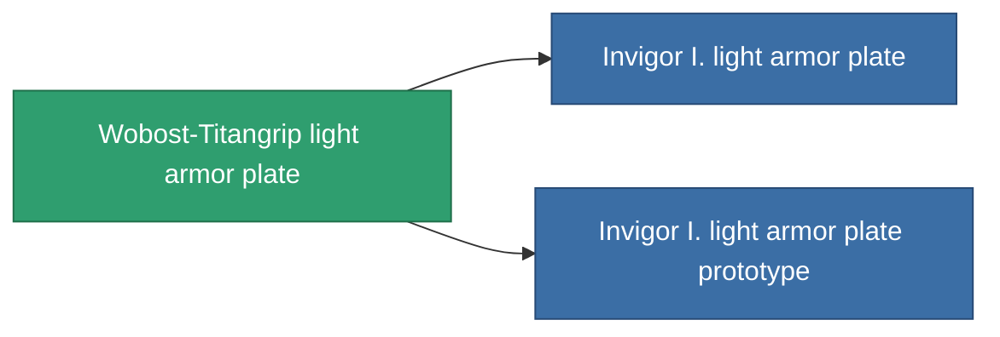

<!-- Generated by tools/generate from the live database (source: entitydefaults definition 684, aggregatevalues via aggregatefields).
     Do not edit by hand; regenerate instead. -->

# Wobost-Titangrip light armor plate

|  |  |
|---|---|
| Definition | `def_named1_small_armor_plate` |
| Stufe | T2 |
| Häufigkeit | 100 |
| Volumen | 1 |
| Masse | 450 |
| Kategorie | Modules / Armor |
| Tier line | [Standard light armor plate](/de/content/items/standard-small-armor-plate/) (T1) → **Wobost-Titangrip light armor plate** (T2) → [Invigor I. light armor plate](/de/content/items/named2-small-armor-plate/) (T3) → [Karapas light armor plate](/de/content/items/named3-small-armor-plate/) (T4) |

## Statistiken

| Feld | Wert |
|---|---|
| armor_max | 450 |
| cpu_usage | 1 |
| massiveness | 0.1 |
| powergrid_usage | 13 |
| signature_radius | 0.35 |

<!-- production:generated -->
## Produktion

**Hergestellt aus 4 Komponenten, Forschungsebene 2** — baue die Komponenten zusammen, um es herzustellen (vollständige Liste in [Rezepte](/de/content/recipes/)):

**Bauplan:** [Wobost-Titangrip light armor plate CT](/de/content/items/named1-small-armor-plate-cprg/)

<svg class="prod-card-icon" aria-hidden="true"><use href="#mi-grid"/></svg><a class="prod-card-name" href="/de/content/items/plasteosine/">Plasteosine</a>

benötigt: <b>350</b>

<svg class="prod-card-icon" aria-hidden="true"><use href="#mi-crystal"/></svg><a class="prod-card-name" href="/de/content/items/robotshard-common-basic/">Damaged common fragment</a>

benötigt: <b>30</b>

<svg class="prod-card-icon" aria-hidden="true"><use href="#mi-tree"/></svg><a class="prod-card-name" href="/de/content/items/standard-small-armor-plate/">Standard light armor plate</a>

benötigt: <b>1</b>

<svg class="prod-card-icon" aria-hidden="true"><use href="#mi-grid"/></svg><a class="prod-card-name" href="/de/content/items/titanium/">Titanium</a>

benötigt: <b>250</b>

## Verwendet in Produktion

**Komponente von 2 Artikeln** — alles, was es in der Produktion verwendet:

