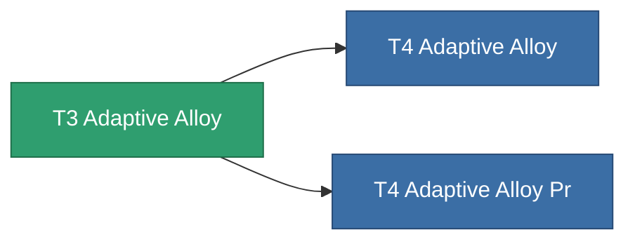

<!-- Generated by tools/generate from the live database (source: entitydefaults definition 8793, aggregatevalues via aggregatefields).
     Do not edit by hand; regenerate instead. -->

# T3 Adaptive Alloy

|  |  |
|---|---|
| Definition | `def_named2_adaptive_alloy` |
| Stufe | T3 |
| Häufigkeit | 100 |
| Volumen | 1.5 |
| Masse | 500 |
| Kategorie | Modules / Enhancements |
| Tier line | [Standard Adaptive Alloy](/de/content/items/standard-adaptive-alloy/) (T1) → [T2 Adaptive Alloy](/de/content/items/named1-adaptive-alloy/) (T2) → **T3 Adaptive Alloy** (T3) → [T4 Adaptive Alloy](/de/content/items/named3-adaptive-alloy/) (T4) |

## Statistiken

| Feld | Wert |
|---|---|
| adaptive_resist_points | 80 |
| cpu_usage | 40 |
| powergrid_usage | 12 |

<!-- production:generated -->
## Produktion

**Hergestellt aus 14 Komponenten** — baue die Komponenten zusammen, um es herzustellen (vollständige Liste in [Rezepte](/de/content/recipes/)):

**Bauplan:** [T3 Adaptive Alloy Cprg](/de/content/items/named2-adaptive-alloy-cprg/)

<svg class="prod-card-icon" aria-hidden="true"><use href="#mi-grid"/></svg><a class="prod-card-name" href="/de/content/items/alligior/">Alligior</a>

benötigt: <b>250</b>

<svg class="prod-card-icon" aria-hidden="true"><use href="#mi-grid"/></svg><a class="prod-card-name" href="/de/content/items/axicol/">Cryoperine</a>

benötigt: <b>100</b>

<svg class="prod-card-icon" aria-hidden="true"><use href="#mi-grid"/></svg><a class="prod-card-name" href="/de/content/items/chollonin/">Chollonin</a>

benötigt: <b>25</b>

<svg class="prod-card-icon" aria-hidden="true"><use href="#mi-grid"/></svg><a class="prod-card-name" href="/de/content/items/espitium/">Espitium</a>

benötigt: <b>100</b>

<svg class="prod-card-icon" aria-hidden="true"><use href="#mi-grid"/></svg><a class="prod-card-name" href="/de/content/items/isopropentol/">Isopropentol</a>

benötigt: <b>65</b>

<svg class="prod-card-icon" aria-hidden="true"><use href="#mi-grid"/></svg><a class="prod-card-name" href="/de/content/items/metachropin/">Metachropin</a>

benötigt: <b>65</b>

<svg class="prod-card-icon" aria-hidden="true"><use href="#mi-crystal"/></svg><a class="prod-card-name" href="/de/content/items/named1-adaptive-alloy/">T2 Adaptive Alloy</a>

benötigt: <b>1</b>

<svg class="prod-card-icon" aria-hidden="true"><use href="#mi-grid"/></svg><a class="prod-card-name" href="/de/content/items/plasteosine/">Plasteosine</a>

benötigt: <b>250</b>

<svg class="prod-card-icon" aria-hidden="true"><use href="#mi-grid"/></svg><a class="prod-card-name" href="/de/content/items/prilumium/">Prilumium</a>

benötigt: <b>25</b>

<svg class="prod-card-icon" aria-hidden="true"><use href="#mi-crystal"/></svg><a class="prod-card-name" href="/de/content/items/robotshard-common-advanced/">Functional common fragment</a>

benötigt: <b>20</b>

<svg class="prod-card-icon" aria-hidden="true"><use href="#mi-crystal"/></svg><a class="prod-card-name" href="/de/content/items/robotshard-common-basic/">Damaged common fragment</a>

benötigt: <b>20</b>

<svg class="prod-card-icon" aria-hidden="true"><use href="#mi-grid"/></svg><a class="prod-card-name" href="/de/content/items/statichnol/">Statichnol</a>

benötigt: <b>65</b>

<svg class="prod-card-icon" aria-hidden="true"><use href="#mi-grid"/></svg><a class="prod-card-name" href="/de/content/items/titanium/">Titanium</a>

benötigt: <b>200</b>

<svg class="prod-card-icon" aria-hidden="true"><use href="#mi-grid"/></svg><a class="prod-card-name" href="/de/content/items/vitricyl/">Vitricyl</a>

benötigt: <b>25</b>

## Verwendet in Produktion

**Komponente von 2 Artikeln** — alles, was es in der Produktion verwendet:

