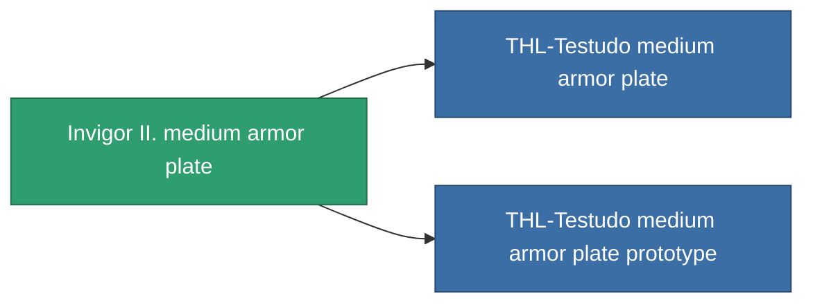

<!-- Generated by tools/generate from the live database (source: entitydefaults definition 688, aggregatevalues via aggregatefields).
     Do not edit by hand; regenerate instead. -->

# Invigor II. medium armor plate

|  |  |
|---|---|
| Definition | `def_named2_medium_armor_plate` |
| Stufe | T3 |
| Häufigkeit | 100 |
| Volumen | 2 |
| Masse | 3000 |
| Kategorie | Modules / Armor |
| Tier line | [Standard medium armor plate](/de/content/items/standard-medium-armor-plate/) (T1) → [Azilo-Protec Duoforge medium armor plate](/de/content/items/named1-medium-armor-plate/) (T2) → **Invigor II. medium armor plate** (T3) → [THL-Testudo medium armor plate](/de/content/items/named3-medium-armor-plate/) (T4) |

## Statistiken

| Feld | Wert |
|---|---|
| armor_max | 1.45k |
| cpu_usage | 2 |
| massiveness | 0.13 |
| powergrid_usage | 75 |
| signature_radius | 1 |

<!-- production:generated -->
## Produktion

**Hergestellt aus 6 Komponenten, Forschungsebene 5** — baue die Komponenten zusammen, um es herzustellen (vollständige Liste in [Rezepte](/de/content/recipes/)):

**Bauplan:** [Invigor II. medium armor plate CT](/de/content/items/named2-medium-armor-plate-cprg/)

<svg class="prod-card-icon" aria-hidden="true"><use href="#mi-grid"/></svg><a class="prod-card-name" href="/de/content/items/alligior/">Alligior</a>

benötigt: <b>350</b>

<svg class="prod-card-icon" aria-hidden="true"><use href="#mi-tree"/></svg><a class="prod-card-name" href="/de/content/items/named1-medium-armor-plate/">Azilo-Protec Duoforge medium armor plate</a>

benötigt: <b>1</b>

<svg class="prod-card-icon" aria-hidden="true"><use href="#mi-grid"/></svg><a class="prod-card-name" href="/de/content/items/plasteosine/">Plasteosine</a>

benötigt: <b>350</b>

<svg class="prod-card-icon" aria-hidden="true"><use href="#mi-crystal"/></svg><a class="prod-card-name" href="/de/content/items/robotshard-common-advanced/">Functional common fragment</a>

benötigt: <b>40</b>

<svg class="prod-card-icon" aria-hidden="true"><use href="#mi-crystal"/></svg><a class="prod-card-name" href="/de/content/items/robotshard-common-basic/">Damaged common fragment</a>

benötigt: <b>40</b>

<svg class="prod-card-icon" aria-hidden="true"><use href="#mi-grid"/></svg><a class="prod-card-name" href="/de/content/items/titanium/">Titanium</a>

benötigt: <b>500</b>

## Verwendet in Produktion

**Komponente von 2 Artikeln** — alles, was es in der Produktion verwendet:

