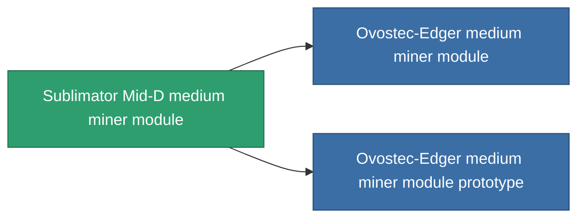

<!-- Generated by tools/generate from the live database (source: entitydefaults definition 802, aggregatevalues via aggregatefields).
     Do not edit by hand; regenerate instead. -->

# Sublimator Mid-D medium miner module

|  |  |
|---|---|
| Definition | `def_named2_medium_driller` |
| Stufe | T3 |
| Häufigkeit | 100 |
| Volumen | 1.5 |
| Masse | 1000 |
| Kategorie | Modules / Enhancements |
| Tier line | [Standard medium miner module](/de/content/items/standard-medium-driller/) (T1) → [MMA v12-'Alkhemir' medium miner module](/de/content/items/named1-medium-driller/) (T2) → **Sublimator Mid-D medium miner module** (T3) → [Ovostec-Edger medium miner module](/de/content/items/named3-medium-driller/) (T4) |

## Statistiken

| Feld | Wert |
|---|---|
| core_usage | 60 |
| cpu_usage | 52 |
| cycle_time | 11k |
| optimal_range | 3 |
| powergrid_usage | 160 |

<!-- production:generated -->
## Produktion

**Hergestellt aus 6 Komponenten, Forschungsebene 5** — baue die Komponenten zusammen, um es herzustellen (vollständige Liste in [Rezepte](/de/content/recipes/)):

**Bauplan:** [Sublimator Mid-D medium miner module CT](/content/items/named2-medium-driller-cprg/)

<svg class="prod-card-icon" aria-hidden="true"><use href="#mi-grid"/></svg><a class="prod-card-name" href="/de/content/items/axicol/">Cryoperine</a>

benötigt: <b>50</b>

<svg class="prod-card-icon" aria-hidden="true"><use href="#mi-grid"/></svg><a class="prod-card-name" href="/de/content/items/espitium/">Espitium</a>

benötigt: <b>50</b>

<svg class="prod-card-icon" aria-hidden="true"><use href="#mi-panel"/></svg><a class="prod-card-name" href="/de/content/items/named1-medium-driller/">MMA v12-'Alkhemir' medium miner module</a>

benötigt: <b>1</b>

<svg class="prod-card-icon" aria-hidden="true"><use href="#mi-crystal"/></svg><a class="prod-card-name" href="/de/content/items/robotshard-common-advanced/">Functional common fragment</a>

benötigt: <b>40</b>

<svg class="prod-card-icon" aria-hidden="true"><use href="#mi-crystal"/></svg><a class="prod-card-name" href="/de/content/items/robotshard-common-basic/">Damaged common fragment</a>

benötigt: <b>40</b>

<svg class="prod-card-icon" aria-hidden="true"><use href="#mi-grid"/></svg><a class="prod-card-name" href="/de/content/items/titanium/">Titanium</a>

benötigt: <b>300</b>

## Verwendet in Produktion

**Komponente von 2 Artikeln** — alles, was es in der Produktion verwendet:

