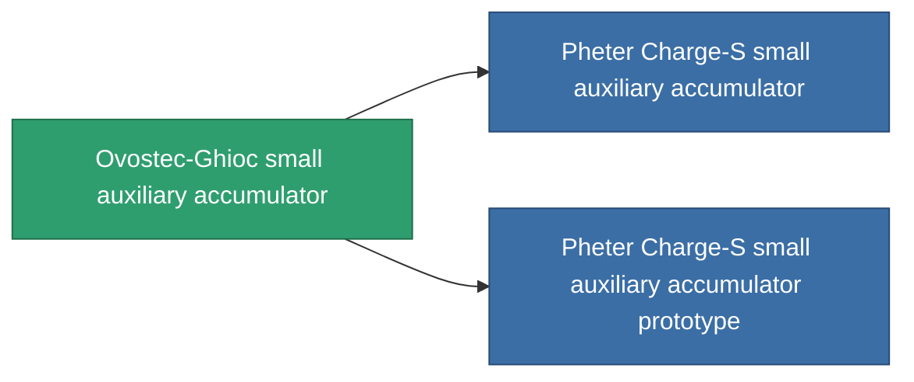

<!-- Generated by tools/generate from the live database (source: entitydefaults definition 814, aggregatevalues via aggregatefields).
     Do not edit by hand; regenerate instead. -->

# Ovostec-Ghioc small auxiliary accumulator

|  |  |
|---|---|
| Definition | `def_named2_small_core_battery` |
| Stufe | T3 |
| Häufigkeit | 100 |
| Volumen | 0.5 |
| Masse | 100 |
| Kategorie | Modules / Power |
| Tier line | [Standard small auxiliary accumulator](/de/content/items/standard-small-core-battery/) (T1) → [Co-Fuse small auxiliary accumulator](/de/content/items/named1-small-core-battery/) (T2) → **Ovostec-Ghioc small auxiliary accumulator** (T3) → [Pheter Charge-S small auxiliary accumulator](/de/content/items/named3-small-core-battery/) (T4) |

## Statistiken

| Feld | Wert |
|---|---|
| core_max | 85 |
| cpu_usage | 37 |
| powergrid_usage | 15 |

<!-- production:generated -->
## Produktion

**Hergestellt aus 6 Komponenten, Forschungsebene 5** — baue die Komponenten zusammen, um es herzustellen (vollständige Liste in [Rezepte](/de/content/recipes/)):

**Bauplan:** [Ovostec-Ghioc small auxiliary accumulator CT](/de/content/items/named2-small-core-battery-cprg/)

<svg class="prod-card-icon" aria-hidden="true"><use href="#mi-grid"/></svg><a class="prod-card-name" href="/de/content/items/axicol/">Cryoperine</a>

benötigt: <b>100</b>

<svg class="prod-card-icon" aria-hidden="true"><use href="#mi-grid"/></svg><a class="prod-card-name" href="/de/content/items/espitium/">Espitium</a>

benötigt: <b>100</b>

<svg class="prod-card-icon" aria-hidden="true"><use href="#mi-grid"/></svg><a class="prod-card-name" href="/de/content/items/named1-small-core-battery/">Co-Fuse small auxiliary accumulator</a>

benötigt: <b>1</b>

<svg class="prod-card-icon" aria-hidden="true"><use href="#mi-crystal"/></svg><a class="prod-card-name" href="/de/content/items/robotshard-common-advanced/">Functional common fragment</a>

benötigt: <b>20</b>

<svg class="prod-card-icon" aria-hidden="true"><use href="#mi-crystal"/></svg><a class="prod-card-name" href="/de/content/items/robotshard-common-basic/">Damaged common fragment</a>

benötigt: <b>20</b>

<svg class="prod-card-icon" aria-hidden="true"><use href="#mi-grid"/></svg><a class="prod-card-name" href="/de/content/items/titanium/">Titanium</a>

benötigt: <b>100</b>

## Verwendet in Produktion

**Komponente von 2 Artikeln** — alles, was es in der Produktion verwendet:

