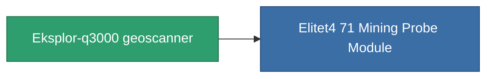

<!-- Generated by tools/generate from the live database (source: entitydefaults definition 782, aggregatevalues via aggregatefields).
     Do not edit by hand; regenerate instead. -->

# Eksplor-q3000 geoscanner

|  |  |
|---|---|
| Definition | `def_named3_mining_probe_module` |
| Stufe | T4 |
| Häufigkeit | 100 |
| Volumen | 1 |
| Masse | 200 |
| Kategorie | Modules / Enhancements |
| Tier line | [Standard geoscanner](/de/content/items/standard-mining-probe-module/) (T1) → [Ovostec-Chisomel geoscanner](/de/content/items/named1-mining-probe-module/) (T2) → [Syverz geoscanner](/de/content/items/named2-mining-probe-module/) (T3) → **Eksplor-q3000 geoscanner** (T4) |

## Statistiken

| Feld | Wert |
|---|---|
| core_usage | 90 |
| cpu_usage | 60 |
| cycle_time | 10k |
| mining_probe_accuracy | 0.7 |
| powergrid_usage | 53 |

<!-- production:generated -->
## Produktion

**Hergestellt aus 8 Komponenten, Forschungsebene 4** — baue die Komponenten zusammen, um es herzustellen (vollständige Liste in [Rezepte](/de/content/recipes/)):

**Bauplan:** [Eksplor-q3000 geoscanner CT](/content/items/named3-mining-probe-module-cprg/)

<svg class="prod-card-icon" aria-hidden="true"><use href="#mi-grid"/></svg><a class="prod-card-name" href="/de/content/items/axicol/">Cryoperine</a>

benötigt: <b>350</b>

<svg class="prod-card-icon" aria-hidden="true"><use href="#mi-grid"/></svg><a class="prod-card-name" href="/de/content/items/espitium/">Espitium</a>

benötigt: <b>350</b>

<svg class="prod-card-icon" aria-hidden="true"><use href="#mi-grid"/></svg><a class="prod-card-name" href="/de/content/items/named2-mining-probe-module/">Syverz geoscanner</a>

benötigt: <b>1</b>

<svg class="prod-card-icon" aria-hidden="true"><use href="#mi-crystal"/></svg><a class="prod-card-name" href="/de/content/items/robotshard-common-advanced/">Functional common fragment</a>

benötigt: <b>30</b>

<svg class="prod-card-icon" aria-hidden="true"><use href="#mi-crystal"/></svg><a class="prod-card-name" href="/de/content/items/robotshard-common-basic/">Damaged common fragment</a>

benötigt: <b>15</b>

<svg class="prod-card-icon" aria-hidden="true"><use href="#mi-crystal"/></svg><a class="prod-card-name" href="/de/content/items/robotshard-common-expert/">Perfect common fragment</a>

benötigt: <b>45</b>

<svg class="prod-card-icon" aria-hidden="true"><use href="#mi-grid"/></svg><a class="prod-card-name" href="/de/content/items/titanium/">Titanium</a>

benötigt: <b>50</b>

<svg class="prod-card-icon" aria-hidden="true"><use href="#mi-grid"/></svg><a class="prod-card-name" href="/de/content/items/unimetal/">Briochit</a>

benötigt: <b>50</b>

## Verwendet in Produktion

**Komponente von 1 Artikeln** — alles, was es in der Produktion verwendet:

