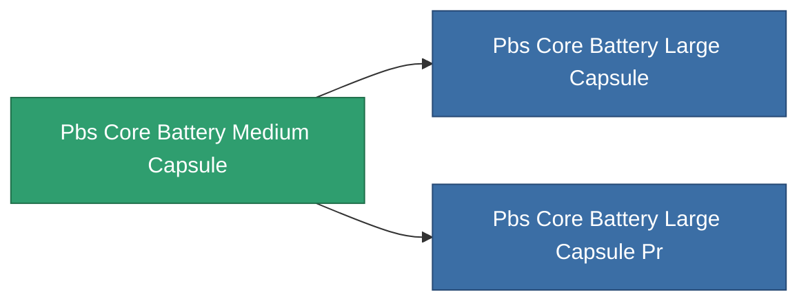

<!-- Generated by tools/generate from the live database (source: entitydefaults definition 5127, aggregatevalues via aggregatefields).
     Do not edit by hand; regenerate instead. -->

# Pbs Core Battery Medium Capsule

|  |  |
|---|---|
| Definition | `def_pbs_core_battery_medium_capsule` |
| Stufe | T2 |
| Häufigkeit | 100 |
| Volumen | 187 |
| Masse | 187000 |
| Kategorie | Special & other / Miscellaneous |

## Statistiken

| Feld | Wert |
|---|---|
| armor_max | 65k |
| core_max | 16.128M |
| resist_chemical | 75 |
| resist_explosive | 75 |
| resist_kinetic | 75 |
| resist_thermal | 75 |
| signature_radius | 50 |
| stealth_strength | 50 |

<!-- production:generated -->
## Produktion

**Hergestellt aus 7 Komponenten** — baue die Komponenten zusammen, um es herzustellen (vollständige Liste in [Rezepte](/de/content/recipes/)):

**Bauplan:** [Advanced energy battery foundation CT](/content/items/pbs-core-battery-medium-capsule-cprg/)

<svg class="prod-card-icon" aria-hidden="true"><use href="#mi-grid"/></svg><a class="prod-card-name" href="/de/content/items/axicol/">Cryoperine</a>

benötigt: <b>2.5k</b>

<svg class="prod-card-icon" aria-hidden="true"><use href="#mi-grid"/></svg><a class="prod-card-name" href="/de/content/items/espitium/">Espitium</a>

benötigt: <b>5.0k</b>

<svg class="prod-card-icon" aria-hidden="true"><use href="#mi-grid"/></svg><a class="prod-card-name" href="/de/content/items/gamma-buildblock/">Coalimin</a>

benötigt: <b>1.0k</b>

<svg class="prod-card-icon" aria-hidden="true"><use href="#mi-grid"/></svg><a class="prod-card-name" href="/de/content/items/gamma-energyblock/">Tiraizin</a>

benötigt: <b>2.5k</b>

<svg class="prod-card-icon" aria-hidden="true"><use href="#mi-crystal"/></svg><a class="prod-card-name" href="/de/content/items/pbs-core-battery-small-capsule/">Pbs Core Battery Small Capsule</a>

benötigt: <b>1</b>

<svg class="prod-card-icon" aria-hidden="true"><use href="#mi-grid"/></svg><a class="prod-card-name" href="/de/content/items/titanium/">Titanium</a>

benötigt: <b>1.0k</b>

<svg class="prod-card-icon" aria-hidden="true"><use href="#mi-grid"/></svg><a class="prod-card-name" href="/de/content/items/unimetal/">Briochit</a>

benötigt: <b>2.0k</b>

## Verwendet in Produktion

**Komponente von 2 Artikeln** — alles, was es in der Produktion verwendet:

