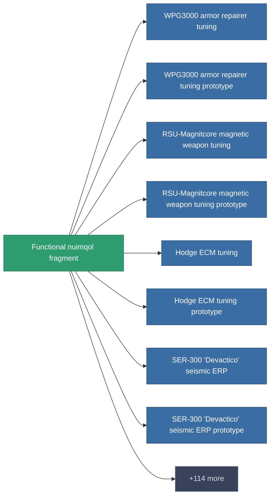

<!-- Generated by tools/generate from the live database (source: entitydefaults definition 1987, aggregatevalues via aggregatefields).
     Do not edit by hand; regenerate instead. -->

# Functional nuimqol fragment

|  |  |
|---|---|
| Definition | `def_robotshard_nuimqol_advanced` |
| Stufe | – |
| Häufigkeit | 100 |
| Volumen | 0.01 |
| Masse | 1 |
| Kategorie | Materials |

_Keine Statistiken — dieses Element trägt keine aggregierten Werte._

<!-- production:generated -->
## Produktion

**Hergestellt aus 3 Komponenten** — baue die Komponenten zusammen, um es herzustellen (vollständige Liste in [Rezepte](/de/content/recipes/)):

<svg class="prod-card-icon" aria-hidden="true"><use href="#mi-grid"/></svg><a class="prod-card-name" href="/de/content/items/chollonin/">Chollonin</a>

benötigt: <b>2</b>

<svg class="prod-card-icon" aria-hidden="true"><use href="#mi-grid"/></svg><a class="prod-card-name" href="/de/content/items/polynitrocol/">Polynitrocol</a>

benötigt: <b>2</b>

<svg class="prod-card-icon" aria-hidden="true"><use href="#mi-grid"/></svg><a class="prod-card-name" href="/de/content/items/statichnol/">Statichnol</a>

benötigt: <b>2</b>

## Verwendet in Produktion

**Komponente von 122 Artikeln** — eine Auswahl dessen, was damit produziert werden kann (vollständige Liste in [Rezepte](/de/content/recipes/)).

