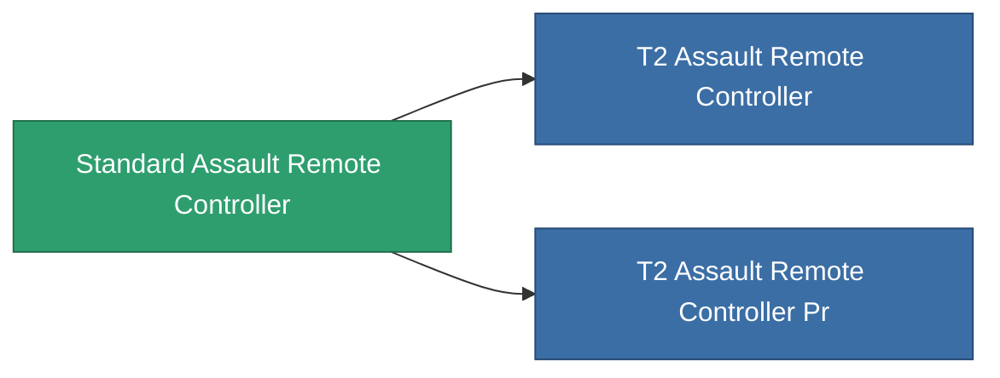

<!-- Generated by tools/generate from the live database (source: entitydefaults definition 8324, aggregatevalues via aggregatefields).
     Do not edit by hand; regenerate instead. -->

# Standard Assault Remote Controller

|  |  |
|---|---|
| Definition | `def_standard_assault_remote_controller` |
| Stufe | T1 |
| Häufigkeit | 100 |
| Volumen | 1 |
| Masse | 1 |
| Kategorie | Modules / Remote control |
| Tier line | **Standard Assault Remote Controller** (T1) → [T2 Assault Remote Controller](/de/content/items/named1-assault-remote-controller/) (T2) → [T3 Assault Remote Controller](/de/content/items/named2-assault-remote-controller/) (T3) → [T4 Assault Remote Controller](/de/content/items/named3-assault-remote-controller/) (T4) |

## Statistiken

| Feld | Wert |
|---|---|
| core_usage | 150 |
| cpu_usage | 250 |
| cycle_time | 10k |
| drone_amplification_accuracy_modifier | 1 |
| drone_amplification_armor_max_modifier | 1 |
| drone_amplification_core_max_modifier | 1 |
| drone_amplification_core_recharge_time_modifier | 1 |
| drone_amplification_cycle_time_modifier | 1 |
| drone_amplification_damage_modifier | 1 |
| drone_amplification_locking_time_modifier | 1 |
| drone_amplification_long_range_modifier | 1 |
| drone_amplification_reactor_radiation_modifier | 1 |
| drone_amplification_speed_max_modifier | 1 |
| powergrid_usage | 65 |
| remote_control_bandwidth_max | 5 |
| remote_control_lifetime | 180k |
| remote_control_operational_range | 20 |

<!-- production:generated -->
## Produktion

**Hergestellt aus 4 Komponenten, Forschungsebene 5** — baue die Komponenten zusammen, um es herzustellen (vollständige Liste in [Rezepte](/de/content/recipes/)):

**Bauplan:** [Standard Assault Remote Controller Cprg](/de/content/items/standard-assault-remote-controller-cprg/)

<svg class="prod-card-icon" aria-hidden="true"><use href="#mi-grid"/></svg><a class="prod-card-name" href="/de/content/items/axicol/">Cryoperine</a>

benötigt: <b>250</b>

<svg class="prod-card-icon" aria-hidden="true"><use href="#mi-grid"/></svg><a class="prod-card-name" href="/de/content/items/axicoline/">Axicoline</a>

benötigt: <b>100</b>

<svg class="prod-card-icon" aria-hidden="true"><use href="#mi-grid"/></svg><a class="prod-card-name" href="/de/content/items/espitium/">Espitium</a>

benötigt: <b>50</b>

<svg class="prod-card-icon" aria-hidden="true"><use href="#mi-grid"/></svg><a class="prod-card-name" href="/de/content/items/titanium/">Titanium</a>

benötigt: <b>50</b>

## Verwendet in Produktion

**Komponente von 2 Artikeln** — alles, was es in der Produktion verwendet:

