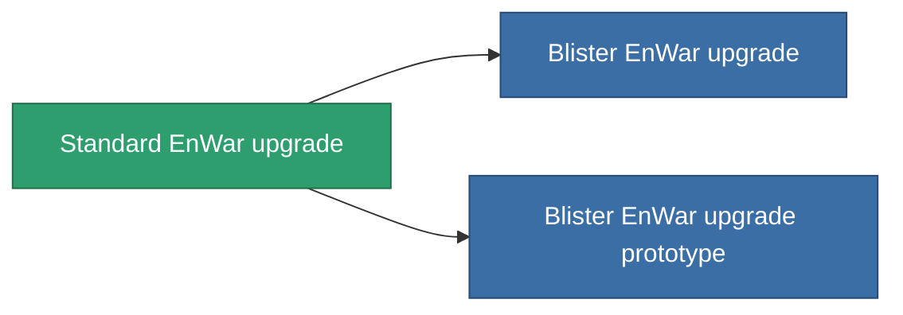

<!-- Generated by tools/generate from the live database (source: entitydefaults definition 4577, aggregatevalues via aggregatefields).
     Do not edit by hand; regenerate instead. -->

# Standard EnWar upgrade

|  |  |
|---|---|
| Definition | `def_standard_energy_warfare_upgrade` |
| Stufe | T1 |
| Häufigkeit | 100 |
| Volumen | 1 |
| Masse | 250 |
| Kategorie | Modules / Enhancements |
| Tier line | **Standard EnWar upgrade** (T1) → [Blister EnWar upgrade](/de/content/items/named1-energy-warfare-upgrade/) (T2) → [OM-Shock EnWar upgrade](/de/content/items/named2-energy-warfare-upgrade/) (T3) → [XT-Shock EnWar upgrade](/de/content/items/named3-energy-warfare-upgrade/) (T4) |

## Statistiken

| Feld | Wert |
|---|---|
| core_usage_energy_neutralizers_modifier | 1.1 |
| cpu_usage | 25 |
| energy_neutralized_amount_modifier | 1.2 |
| energy_vampired_amount_modifier | 1.1 |
| powergrid_usage | 45 |

<!-- production:generated -->
## Produktion

**Hergestellt aus 5 Komponenten, Forschungsebene 5** — baue die Komponenten zusammen, um es herzustellen (vollständige Liste in [Rezepte](/de/content/recipes/)):

**Bauplan:** [Standard EnWar upgrade CT](/content/items/standard-energy-warfare-upgrade-cprg/)

<svg class="prod-card-icon" aria-hidden="true"><use href="#mi-grid"/></svg><a class="prod-card-name" href="/de/content/items/axicol/">Cryoperine</a>

benötigt: <b>150</b>

<svg class="prod-card-icon" aria-hidden="true"><use href="#mi-grid"/></svg><a class="prod-card-name" href="/de/content/items/axicoline/">Axicoline</a>

benötigt: <b>50</b>

<svg class="prod-card-icon" aria-hidden="true"><use href="#mi-grid"/></svg><a class="prod-card-name" href="/de/content/items/phlobotil/">Phlobotil</a>

benötigt: <b>50</b>

<svg class="prod-card-icon" aria-hidden="true"><use href="#mi-grid"/></svg><a class="prod-card-name" href="/de/content/items/titanium/">Titanium</a>

benötigt: <b>50</b>

<svg class="prod-card-icon" aria-hidden="true"><use href="#mi-grid"/></svg><a class="prod-card-name" href="/de/content/items/vitricyl/">Vitricyl</a>

benötigt: <b>150</b>

## Verwendet in Produktion

**Komponente von 2 Artikeln** — alles, was es in der Produktion verwendet:

