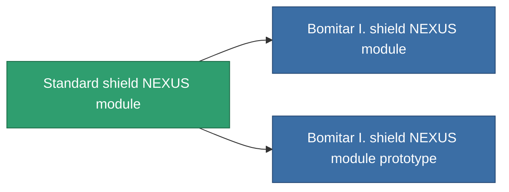

<!-- Generated by tools/generate from the live database (source: entitydefaults definition 2559, aggregatevalues via aggregatefields).
     Do not edit by hand; regenerate instead. -->

# Standard shield NEXUS module

|  |  |
|---|---|
| Definition | `def_standard_gang_assist_shield_calculation_module` |
| Stufe | T1 |
| Häufigkeit | 100 |
| Volumen | 0.2 |
| Masse | 50 |
| Kategorie | Modules / Shield |
| Tier line | **Standard shield NEXUS module** (T1) → [Bomitar I. shield NEXUS module](/de/content/items/named1-gang-assist-shield-calculation-module/) (T2) → [Stasis-Gen shield NEXUS module](/de/content/items/named2-gang-assist-shield-calculation-module/) (T3) → [Bomitar II. shield NEXUS module](/de/content/items/named3-gang-assist-shield-calculation-module/) (T4) |
| Hinweis | shield absorbtion ratiot javit |

## Statistiken

| Feld | Wert |
|---|---|
| core_usage | 35 |
| cpu_usage | 85 |
| cycle_time | 10k |
| default_effect_range | 100 |
| effect_shield_absorbtion_modifier | 1.02 |
| powergrid_usage | 35 |

<!-- production:generated -->
## Produktion

**Hergestellt aus 5 Komponenten, Forschungsebene 4** — baue die Komponenten zusammen, um es herzustellen (vollständige Liste in [Rezepte](/de/content/recipes/)):

**Bauplan:** [Standard shield NEXUS module CT](/content/items/standard-gang-assist-shield-calculation-module-cprg/)

<svg class="prod-card-icon" aria-hidden="true"><use href="#mi-grid"/></svg><a class="prod-card-name" href="/de/content/items/axicol/">Cryoperine</a>

benötigt: <b>250</b>

<svg class="prod-card-icon" aria-hidden="true"><use href="#mi-grid"/></svg><a class="prod-card-name" href="/de/content/items/isopropentol/">Isopropentol</a>

benötigt: <b>50</b>

<svg class="prod-card-icon" aria-hidden="true"><use href="#mi-grid"/></svg><a class="prod-card-name" href="/de/content/items/plasteosine/">Plasteosine</a>

benötigt: <b>50</b>

<svg class="prod-card-icon" aria-hidden="true"><use href="#mi-grid"/></svg><a class="prod-card-name" href="/de/content/items/titanium/">Titanium</a>

benötigt: <b>50</b>

<svg class="prod-card-icon" aria-hidden="true"><use href="#mi-grid"/></svg><a class="prod-card-name" href="/de/content/items/vitricyl/">Vitricyl</a>

benötigt: <b>250</b>

## Verwendet in Produktion

**Komponente von 2 Artikeln** — alles, was es in der Produktion verwendet:

