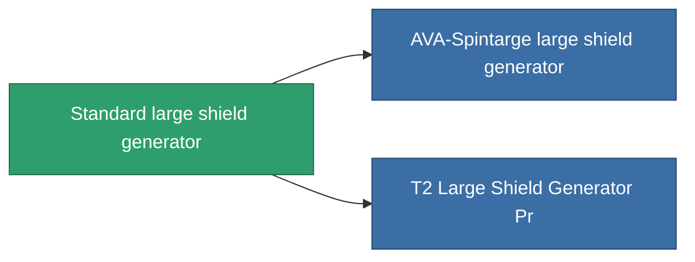

<!-- Generated by tools/generate from the live database (source: entitydefaults definition 30, aggregatevalues via aggregatefields).
     Do not edit by hand; regenerate instead. -->

# Standard large shield generator

|  |  |
|---|---|
| Definition | `def_standard_large_shield_generator` |
| Stufe | T1 |
| Häufigkeit | 100 |
| Volumen | 1 |
| Masse | 800 |
| Kategorie | Modules / Shield |
| Tier line | **Standard large shield generator** (T1) → [AVA-Spintarge large shield generator](/de/content/items/named1-large-shield-generator/) (T2) → [Gegel Ioner large shield generator](/de/content/items/named2-large-shield-generator/) (T3) → [Umbeler large shield generator](/de/content/items/named3-large-shield-generator/) (T4) |

## Statistiken

| Feld | Wert |
|---|---|
| core_usage | 30 |
| cpu_usage | 325 |
| cycle_time | 10k |
| powergrid_usage | 1.25k |
| shield_absorbtion | 1.9048 |
| shield_radius | 30 |

<!-- production:generated -->
## Produktion

**Hergestellt aus 6 Komponenten** — baue die Komponenten zusammen, um es herzustellen (vollständige Liste in [Rezepte](/de/content/recipes/)):

**Bauplan:** [Standard Large Shield Generator Cprg](/de/content/items/standard-large-shield-generator-cprg/)

<svg class="prod-card-icon" aria-hidden="true"><use href="#mi-grid"/></svg><a class="prod-card-name" href="/de/content/items/axicol/">Cryoperine</a>

benötigt: <b>300</b>

<svg class="prod-card-icon" aria-hidden="true"><use href="#mi-grid"/></svg><a class="prod-card-name" href="/de/content/items/isopropentol/">Isopropentol</a>

benötigt: <b>600</b>

<svg class="prod-card-icon" aria-hidden="true"><use href="#mi-grid"/></svg><a class="prod-card-name" href="/de/content/items/plasteosine/">Plasteosine</a>

benötigt: <b>600</b>

<svg class="prod-card-icon" aria-hidden="true"><use href="#mi-grid"/></svg><a class="prod-card-name" href="/de/content/items/specimen-sap-item-flux/">Specimen Sap Item Flux</a>

benötigt: <b>25</b>

<svg class="prod-card-icon" aria-hidden="true"><use href="#mi-grid"/></svg><a class="prod-card-name" href="/de/content/items/titanium/">Titanium</a>

benötigt: <b>300</b>

<svg class="prod-card-icon" aria-hidden="true"><use href="#mi-grid"/></svg><a class="prod-card-name" href="/de/content/items/vitricyl/">Vitricyl</a>

benötigt: <b>300</b>

## Verwendet in Produktion

**Komponente von 2 Artikeln** — alles, was es in der Produktion verwendet:

