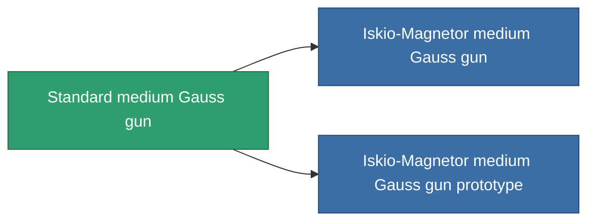

<!-- Generated by tools/generate from the live database (source: entitydefaults definition 67, aggregatevalues via aggregatefields).
     Do not edit by hand; regenerate instead. -->

# Standard medium Gauss gun

|  |  |
|---|---|
| Definition | `def_standard_medium_railgun` |
| Stufe | T1 |
| Häufigkeit | 100 |
| Volumen | 1 |
| Masse | 500 |
| Kategorie | Modules / Weapons |
| Tier line | **Standard medium Gauss gun** (T1) → [Iskio-Magnetor medium Gauss gun](/de/content/items/named1-medium-railgun/) (T2) → [Nuimtec-Midion AMS medium Gauss gun](/de/content/items/named2-medium-railgun/) (T3) → [Prompt medium Gauss gun](/de/content/items/named3-medium-railgun/) (T4) |

## Statistiken

| Feld | Wert |
|---|---|
| accuracy | 13.5 |
| core_usage | 15 |
| cpu_usage | 32 |
| cycle_time | 6k |
| damage_modifier | 1.7 |
| falloff | 7.5 |
| least_optimal | 12 |
| optimal_range | 15 |
| powergrid_usage | 150 |

<!-- production:generated -->
## Produktion

**Hergestellt aus 3 Komponenten, Forschungsebene 4** — baue die Komponenten zusammen, um es herzustellen (vollständige Liste in [Rezepte](/de/content/recipes/)):

**Bauplan:** [Standard medium Gauss gun CT](/content/items/standard-medium-railgun-cprg/)

<svg class="prod-card-icon" aria-hidden="true"><use href="#mi-grid"/></svg><a class="prod-card-name" href="/de/content/items/axicoline/">Axicoline</a>

benötigt: <b>100</b>

<svg class="prod-card-icon" aria-hidden="true"><use href="#mi-grid"/></svg><a class="prod-card-name" href="/de/content/items/polynitrocol/">Polynitrocol</a>

benötigt: <b>100</b>

<svg class="prod-card-icon" aria-hidden="true"><use href="#mi-grid"/></svg><a class="prod-card-name" href="/de/content/items/titanium/">Titanium</a>

benötigt: <b>100</b>

## Verwendet in Produktion

**Komponente von 2 Artikeln** — alles, was es in der Produktion verwendet:

