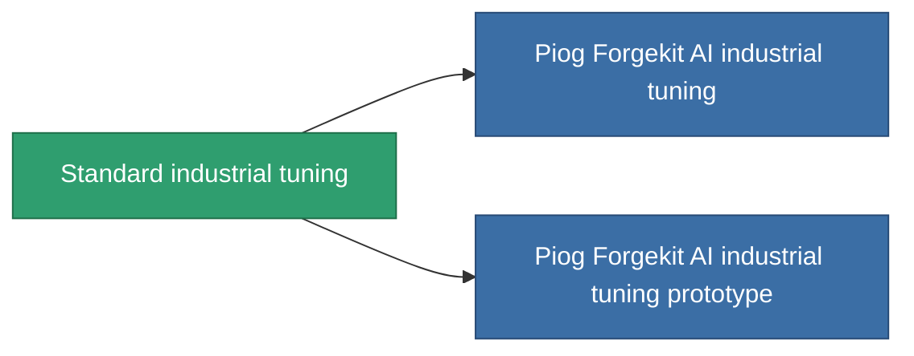

<!-- Generated by tools/generate from the live database (source: entitydefaults definition 56, aggregatevalues via aggregatefields).
     Do not edit by hand; regenerate instead. -->

# Standard industrial tuning

|  |  |
|---|---|
| Definition | `def_standard_mining_upgrade` |
| Stufe | T1 |
| Häufigkeit | 100 |
| Volumen | 1 |
| Masse | 100 |
| Kategorie | Modules / Enhancements |
| Tier line | **Standard industrial tuning** (T1) → [Piog Forgekit AI industrial tuning](/de/content/items/named1-mining-upgrade/) (T2) → [Fraktura SCV industrial tuning](/de/content/items/named2-mining-upgrade/) (T3) → [Piog Forgekit BW1 industrial tuning](/de/content/items/named3-mining-upgrade/) (T4) |

## Statistiken

| Feld | Wert |
|---|---|
| cpu_usage | 35 |
| harvesting_amount_modifier | 1.05 |
| mining_amount_modifier | 1.05 |
| powergrid_usage | 20 |

<!-- production:generated -->
## Produktion

**Hergestellt aus 2 Komponenten, Forschungsebene 3** — baue die Komponenten zusammen, um es herzustellen (vollständige Liste in [Rezepte](/de/content/recipes/)):

**Bauplan:** [Standard industrial tuning CT](/de/content/items/standard-mining-upgrade-cprg/)

<svg class="prod-card-icon" aria-hidden="true"><use href="#mi-grid"/></svg><a class="prod-card-name" href="/de/content/items/axicol/">Cryoperine</a>

benötigt: <b>200</b>

<svg class="prod-card-icon" aria-hidden="true"><use href="#mi-grid"/></svg><a class="prod-card-name" href="/de/content/items/titanium/">Titanium</a>

benötigt: <b>50</b>

## Verwendet in Produktion

**Komponente von 2 Artikeln** — alles, was es in der Produktion verwendet:

