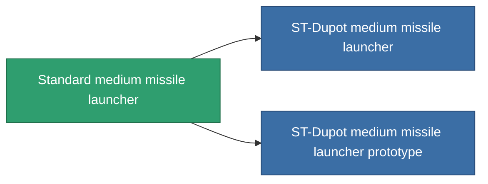

<!-- Generated by tools/generate from the live database (source: entitydefaults definition 64, aggregatevalues via aggregatefields).
     Do not edit by hand; regenerate instead. -->

# Standard medium missile launcher

|  |  |
|---|---|
| Definition | `def_standard_missile_launcher` |
| Stufe | T1 |
| Häufigkeit | 100 |
| Volumen | 2 |
| Masse | 500 |
| Kategorie | Modules / Weapons |
| Tier line | **Standard medium missile launcher** (T1) → [ST-Dupot medium missile launcher](/de/content/items/named1-missile-launcher/) (T2) → [Vollert medium missile launcher](/de/content/items/named2-missile-launcher/) (T3) → [Pelistec-TR250 medium missile launcher](/de/content/items/named3-missile-launcher/) (T4) |

## Statistiken

| Feld | Wert |
|---|---|
| accuracy | 1 |
| core_usage | 2 |
| cpu_usage | 40 |
| cycle_time | 14k |
| damage_modifier | 1 |
| powergrid_usage | 150 |

<!-- production:generated -->
## Produktion

**Hergestellt aus 3 Komponenten, Forschungsebene 4** — baue die Komponenten zusammen, um es herzustellen (vollständige Liste in [Rezepte](/de/content/recipes/)):

**Bauplan:** [Standard medium missile launcher CT](/content/items/standard-missile-launcher-cprg/)

<svg class="prod-card-icon" aria-hidden="true"><use href="#mi-grid"/></svg><a class="prod-card-name" href="/de/content/items/axicoline/">Axicoline</a>

benötigt: <b>100</b>

<svg class="prod-card-icon" aria-hidden="true"><use href="#mi-grid"/></svg><a class="prod-card-name" href="/de/content/items/phlobotil/">Phlobotil</a>

benötigt: <b>100</b>

<svg class="prod-card-icon" aria-hidden="true"><use href="#mi-grid"/></svg><a class="prod-card-name" href="/de/content/items/titanium/">Titanium</a>

benötigt: <b>100</b>

## Verwendet in Produktion

**Komponente von 2 Artikeln** — alles, was es in der Produktion verwendet:

