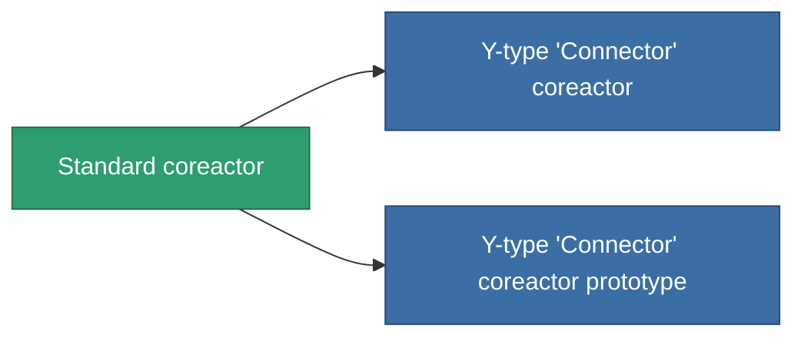

<!-- Generated by tools/generate from the live database (source: entitydefaults definition 42, aggregatevalues via aggregatefields).
     Do not edit by hand; regenerate instead. -->

# Standard coreactor

|  |  |
|---|---|
| Definition | `def_standard_powergrid_upgrades` |
| Stufe | T1 |
| Häufigkeit | 100 |
| Volumen | 0.5 |
| Masse | 100 |
| Kategorie | Modules / Power |
| Tier line | **Standard coreactor** (T1) → [Y-type 'Connector' coreactor](/de/content/items/named1-powergrid-upgrades/) (T2) → [Palp coreactor](/de/content/items/named2-powergrid-upgrades/) (T3) → [E-set 15VaW coreactor](/de/content/items/named3-powergrid-upgrades/) (T4) |

## Statistiken

| Feld | Wert |
|---|---|
| cpu_usage | 35 |
| powergrid_max_modifier | 1.1 |

<!-- production:generated -->
## Produktion

**Hergestellt aus 2 Komponenten, Forschungsebene 3** — baue die Komponenten zusammen, um es herzustellen (vollständige Liste in [Rezepte](/de/content/recipes/)):

**Bauplan:** [Standard coreactor CT](/content/items/standard-powergrid-upgrades-cprg/)

<svg class="prod-card-icon" aria-hidden="true"><use href="#mi-grid"/></svg><a class="prod-card-name" href="/de/content/items/axicol/">Cryoperine</a>

benötigt: <b>300</b>

<svg class="prod-card-icon" aria-hidden="true"><use href="#mi-grid"/></svg><a class="prod-card-name" href="/de/content/items/titanium/">Titanium</a>

benötigt: <b>200</b>

## Verwendet in Produktion

**Komponente von 2 Artikeln** — alles, was es in der Produktion verwendet:

