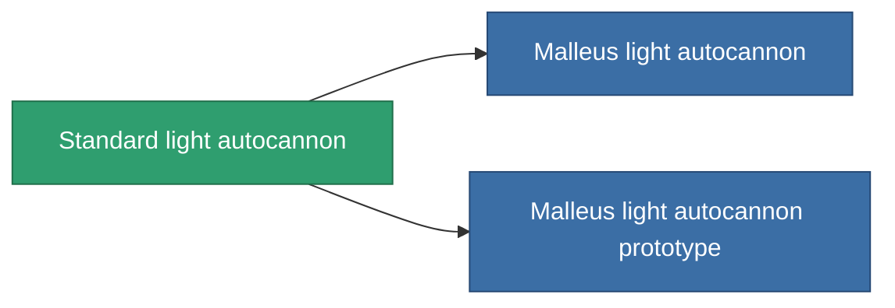

<!-- Generated by tools/generate from the live database (source: entitydefaults definition 60, aggregatevalues via aggregatefields).
     Do not edit by hand; regenerate instead. -->

# Standard light autocannon

|  |  |
|---|---|
| Definition | `def_standard_small_autocannon` |
| Stufe | T1 |
| Häufigkeit | 100 |
| Volumen | 0.6 |
| Masse | 250 |
| Kategorie | Modules / Weapons |
| Tier line | **Standard light autocannon** (T1) → [Malleus light autocannon](/de/content/items/named1-small-autocannon/) (T2) → [Senner Carbine light autocannon](/de/content/items/named2-small-autocannon/) (T3) → [Astoc M45 light autocannon](/de/content/items/named3-small-autocannon/) (T4) |

## Statistiken

| Feld | Wert |
|---|---|
| accuracy | 6 |
| core_usage | 1 |
| cpu_usage | 5 |
| cycle_time | 3.2k |
| damage_modifier | 1.2 |
| falloff | 12.5 |
| least_optimal | 2 |
| optimal_range | 7.5 |
| powergrid_usage | 15 |

<!-- production:generated -->
## Produktion

**Hergestellt aus 2 Komponenten, Forschungsebene 1** — baue die Komponenten zusammen, um es herzustellen (vollständige Liste in [Rezepte](/de/content/recipes/)):

**Bauplan:** [Standard light autocannon CT](/de/content/items/standard-small-autocannon-cprg/)

<svg class="prod-card-icon" aria-hidden="true"><use href="#mi-grid"/></svg><a class="prod-card-name" href="/de/content/items/axicoline/">Axicoline</a>

benötigt: <b>100</b>

<svg class="prod-card-icon" aria-hidden="true"><use href="#mi-grid"/></svg><a class="prod-card-name" href="/de/content/items/titanium/">Titanium</a>

benötigt: <b>50</b>

## Verwendet in Produktion

**Komponente von 2 Artikeln** — alles, was es in der Produktion verwendet:

