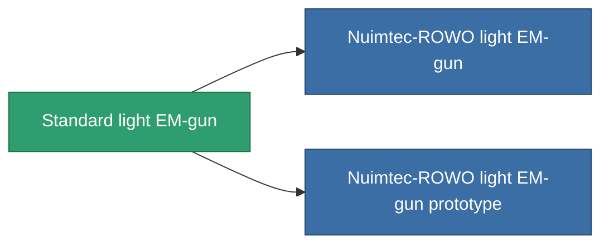

<!-- Generated by tools/generate from the live database (source: entitydefaults definition 66, aggregatevalues via aggregatefields).
     Do not edit by hand; regenerate instead. -->

# Standard light EM-gun

|  |  |
|---|---|
| Definition | `def_standard_small_railgun` |
| Stufe | T1 |
| Häufigkeit | 100 |
| Volumen | 0.5 |
| Masse | 250 |
| Kategorie | Modules / Weapons |
| Tier line | **Standard light EM-gun** (T1) → [Nuimtec-ROWO light EM-gun](/de/content/items/named1-small-railgun/) (T2) → [Proto-Gard II. light EM-gun](/de/content/items/named2-small-railgun/) (T3) → [Nuimtec-Inkandesk light EM-gun](/de/content/items/named3-small-railgun/) (T4) |

## Statistiken

| Feld | Wert |
|---|---|
| accuracy | 5 |
| core_usage | 3.2 |
| cpu_usage | 25 |
| cycle_time | 5k |
| damage_modifier | 1.35 |
| falloff | 5 |
| least_optimal | 8 |
| optimal_range | 12 |
| powergrid_usage | 30 |

<!-- production:generated -->
## Produktion

**Hergestellt aus 3 Komponenten, Forschungsebene 2** — baue die Komponenten zusammen, um es herzustellen (vollständige Liste in [Rezepte](/de/content/recipes/)):

**Bauplan:** [Standard light EM-gun CT](/content/items/standard-small-railgun-cprg/)

<svg class="prod-card-icon" aria-hidden="true"><use href="#mi-grid"/></svg><a class="prod-card-name" href="/de/content/items/axicoline/">Axicoline</a>

benötigt: <b>50</b>

<svg class="prod-card-icon" aria-hidden="true"><use href="#mi-grid"/></svg><a class="prod-card-name" href="/de/content/items/polynitrocol/">Polynitrocol</a>

benötigt: <b>50</b>

<svg class="prod-card-icon" aria-hidden="true"><use href="#mi-grid"/></svg><a class="prod-card-name" href="/de/content/items/titanium/">Titanium</a>

benötigt: <b>50</b>

## Verwendet in Produktion

**Komponente von 2 Artikeln** — alles, was es in der Produktion verwendet:

