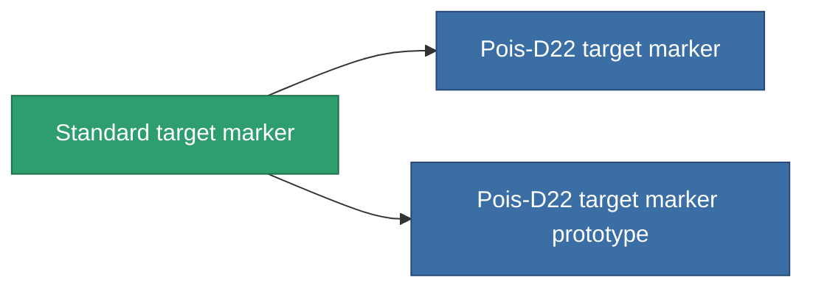

<!-- Generated by tools/generate from the live database (source: entitydefaults definition 2898, aggregatevalues via aggregatefields).
     Do not edit by hand; regenerate instead. -->

# Standard target marker

|  |  |
|---|---|
| Definition | `def_standard_target_painter` |
| Stufe | T1 |
| Häufigkeit | 100 |
| Volumen | 0.5 |
| Masse | 500 |
| Kategorie | Modules / Enhancements |
| Tier line | **Standard target marker** (T1) → [Pois-D22 target marker](/de/content/items/named1-target-painter/) (T2) → [Colqual target marker](/de/content/items/named2-target-painter/) (T3) → [Pulsus target marker](/de/content/items/named3-target-painter/) (T4) |

## Statistiken

| Feld | Wert |
|---|---|
| core_usage | 125 |
| cpu_usage | 55 |
| cycle_time | 10k |
| effect_stealth_strength_modifier | -70 |
| optimal_range | 75 |
| powergrid_usage | 20 |

<!-- production:generated -->
## Produktion

**Hergestellt aus 3 Komponenten, Forschungsebene 4** — baue die Komponenten zusammen, um es herzustellen (vollständige Liste in [Rezepte](/de/content/recipes/)):

**Bauplan:** [Standard target marker CT](/content/items/standard-target-painter-cprg/)

<svg class="prod-card-icon" aria-hidden="true"><use href="#mi-grid"/></svg><a class="prod-card-name" href="/de/content/items/axicol/">Cryoperine</a>

benötigt: <b>450</b>

<svg class="prod-card-icon" aria-hidden="true"><use href="#mi-grid"/></svg><a class="prod-card-name" href="/de/content/items/axicoline/">Axicoline</a>

benötigt: <b>50</b>

<svg class="prod-card-icon" aria-hidden="true"><use href="#mi-grid"/></svg><a class="prod-card-name" href="/de/content/items/titanium/">Titanium</a>

benötigt: <b>200</b>

## Verwendet in Produktion

**Komponente von 2 Artikeln** — alles, was es in der Produktion verwendet:

