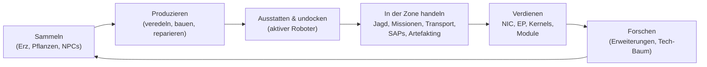

# Was man im Spiel tun kann

Jede Spieleraktion, organisiert nach System. Der Befehlsname ist der serverseitige
Identifikator — der Client stellt diese Aktionen in seiner eigenen UI dar. Die
Prosa pro Aktion liegt auf den Systemseiten.

Das Spiel in einer Schleife: verdiene und gib aus, um eine Tier-Laufbahn hochzuklimmen.

## Systeme

| System | Seite | Abgedeckt |
|---|---|---|
| Einstieg | [getting-started](/de/features/getting-started/) | Charaktere erstellen/wählen, erster Roboter, Kontogrundlagen |
| Bewegung | [movement](/de/features/movement/) | Zonen, Docking, Warteschlange, Teleporter, Funken-Sprünge, Gates |
| Sammeln | [gathering](/de/features/gathering/) | Scannen, Ernten, Ressourcensammlung |
| Kampf | [combat](/de/features/combat/) | Kämpfen, Schadensarten, Störfeuer, Alarme, Kill-Reports, SOS |
| NPCs & PVE-Jagd | [npcs](/de/features/npcs/) | NPC-Ränge & Fraktionen, Schwächen, Spawn-Typen, TAPs, Taktiken |
| Erkundung | [exploration](/de/features/exploration/) | Artefakte und Relikte |
| Roboter & Ausstattung | [robots](/de/features/robots/) | Roboter wählen, Module, Munition, Presets, Tönungen |
| Module & Ausstattung | [modules](/de/features/modules/) | die Modulfamilien und Ausstattungs-Grundregeln |
| Funken | [sparks](/de/features/sparks/) | Funken-Freischaltung, Wechsel, Fähigkeitsboni |
| Forschung | [research](/de/features/research/) | Erweiterungen (Skill-Baum), EP, Tech-Baum |
| Charakter | [character](/de/features/character/) | das Charakterfenster: Erweiterungs-Tab (Skill-Baum) und Funken |
| Produktion | [production](/de/features/production/) | Produktionslinien, Veredeln, Reparieren, Reprozessieren, Prototypen, CPRG |
| Markt & Handel | [market](/de/features/market/) | Marktaufträge, Direkthandel, Item-Shop, Credits |
| Gruppen | [groups](/de/features/groups/) | Korporationen, Allianzen, Gangs (Flotten) |
| Power-Stationen (PBS) | [pbs](/de/features/pbs/) | PBS-Strukturen, Territorien, Verbindungen |
| Missionen | [missions](/de/features/missions/) | Feldmissionen, Agenten, Terminals |
| Transport | [transport](/de/features/transport/) | Items zwischen Basen verschiffen |
| Items & Inventar | [items](/de/features/items/) | Container, Stapeln, Itemnamen, Einlösbares, Goodie-Packs |
| Sozial | [social](/de/features/social/) | Mail, Kanäle, Freunde, Standing, Gelbe Seiten, Nachrichten, Umfragen |
| Invasion | [intrusion](/de/features/intrusion/) | der NPC-Stellen-Angriffsmodus |
| Außenposten & SAP | [outposts](/de/features/outposts/) | Außenposten-Besitz, Stabilität, die vier SAP-Typen |
| Proximitäts-Sonden | [probes](/de/features/probes/) | Zonenüberwachungs-Sonden |
| Server & Referenz | [server](/de/features/server/) | Serverinfo, Highscores, Referenzdaten, Käufe |
| FAQ | [faq](/de/features/faq/) | das Tutorial, Fraktionswahl, erste Schritte, der Fachjargon |
| Lore | [lore](/de/features/lore/) | das Setting: Nia, die Nians, das Syndikat |
| Client & PC-Setup | [client-setup](/de/features/client-setup/) | Client starten, Multi-Boxing, UI-Scaling |

### Referenz

| Seite | Abgedeckt |
|---|---|
| [Client-UI-Überblick](/de/features/ui/) | Die EVE-artige Oberfläche: Leiste oben, Deploy/Dock-Knopf, Aktionskategorien, undocked-Statuspanel und die Konventionen in diesem Wiki |

Entitätsstatistik-Tabellen liegen in der generierten [Content](/content/)-Sektion.

## Komplettes Aktionsinventar

### Einstieg & Konto

| Aktion | Befehl |
|---|---|
| Charakter erstellen | `characterCreate` |
| Charakter auswählen (als ihn spielen) | `characterSelect` |
| Charakter löschen | `characterDelete` |
| Charakter umbenennen | `characterRename` |
| Prüfen, ob ein Name frei ist | `characterCheckNick` |
| Startroboter anfordern | `requestStarterRobot` |
| Startbox anfordern | `requestInfiniteBox` |
| Neueinrichtung-Daten für den Charakter | `characterWizardData` |
| Mein Profil ansehen | `characterGetMyProfile` |
| Profile anderer Charaktere ansehen | `characterGetProfiles` |
| Nach Charakteren suchen | `characterSearch` |
| Charaktere auflisten | `characterList` |
| Charaktereinstellungen holen/setzen | `characterSettingsGet`, `characterSettingsSet` |
| Avatar setzen | `characterSetAvatar` |
| Stimmungs-Nachricht setzen | `characterSetMoodmessage` |
| Privaten Notiz auf einem Charakter setzen | `characterSetNote` / `characterGetNote` |
| Heimatbasis setzen / löschen | `characterSetHomeBase`, `characterClearHomeBase` |
| Credits zwischen eigenen Charakteren übertragen | `characterTransferCredit` |
| Handel auf einem Charakter blockieren/erlauben | `characterSetBlockTrades` |
| Konto-E-Mail / Passwort ändern | `changeSessionEmail`, `changeSessionPassword` |
| EP-für-Aktivität-Verlauf ansehen | `accountEpForActivityHistory` |
| Konto-Transaktionsverlauf ansehen | `accountGetTransactionHistory` |
| Abmelden / Verbindungs-Housekeeping | `signOut`, `connectionStart`, `connectionEnd`, `ping`, `quit`, `isOnline`, `transferData`, `welcome` |
| Wer ist online | `getCharactersOnline`, `getAccountsWithCharacters` |
| Charakterverläufe | `characterNickHistory`, `characterCorporationHistory`, `characterTransactionHistory`, `characterListNpcDeath` |

### Bewegung & Zonen

| Aktion | Befehl |
|---|---|
| An einer Basis / PBS andocken | `dock` |
| Undocken | `undock` |
| Zwangs-Dock (Notfall) | `forceDock` |
| Zonen-Eintrittswarteschlange prüfen | `zoneGetQueueInfo` |
| Warteschlangen-Längeneinstellung setzen | `zoneSetQueueLength` |
| Warten in der Warteschlange abbrechen | `zoneCancelEnterQueue` |
| Zoneninfo holen | `getZoneInfo` |
| Sektoren einer Zone auflisten | `zoneSectorList` |
| Zonen-Gebäude auflisten | `zoneGetBuildings` |
| SOS senden (Hilfe anfordern) | `zoneSOS` |
| Verfügbare Teleporter auflisten | `teleportList` |
| Teleporter nutzen | `teleportUse` |
| Zu einem Zonenobjekt teleportieren | `teleportToZoneObject` |
| Teleport-Kanäle auflisten | `teleportGetChannelList` |
| Weltweite Teleport-Kanäle abfragen | `teleportQueryWorldChannels` |
| Funken-Ladungen auflisten | `sparkList` |
| Aktiven Funken ändern | `sparkChange` |
| Funken entfernen | `sparkRemove` |
| Funken freischalten | `sparkUnlock` |
| Funken-Teleporter auflisten / setzen / nutzen / löschen | `sparkTeleportList`, `sparkTeleportSet`, `sparkTeleportUse`, `sparkTeleportDelete` |
| Gate umbenennen | `gateSetName` |
| Basisinfo / -eigentum / -einrichtungen / meine Items an der Basis | `baseGetInfo`, `baseGetOwnershipInfo`, `baseListFacilities`, `baseGetMyItems` |
| Basis-Dockrechte setzen | `baseSetDockingRights` |

### Sammeln & Scannen

| Aktion | Befehl |
|---|---|
| Zone scannen (Erz/Pflanzen/Deployable-Scan) | `zoneUploadScanResult` |
| Meine Mineral-Scanergebnisse auflisten | `mineralScanResultList` |
| Item aus einem Scanergebnis erstellen | `mineralScanResultCreateItem` |
| Scanergebnis löschen | `mineralScanResultDelete` |
| Scanergebnisse zwischen Containern verschieben | `mineralScanResultMove` |
| Scan-Daten aus einem Item hochladen | `mineralScanResultUploadFromItem` |
| Items auf einer Zone zählen (Sichtbarkeitsprüfung) | `itemCountOnZone`, `itemCount` |
| Kiosk: Items ansehen / einreichen | `kioskInfo`, `kioskSubmitItem` |
| Item nutzen (allgemein — inkl. Erntbares) | `useItem` |

### Kampf

| Aktion | Befehl |
|---|---|
| Kampfalarm starten / stoppen | `alarmStart` (Alarmende ist servergesteuert) |
| Meine Kill-Reports ansehen | `getMyKillReports` |
| Meine Highscores ansehen | `getMyHighScores` |
| Server-Highscores ansehen | `getHighScores` |

### Roboter & Ausstattung

| Aktion | Befehl |
|---|---|
| Aktiven Roboter wählen | `selectActiveRobot` |
| Roboter leeren (alles entladen) | `robotEmpty` |
| Roboterinfo holen | `getRobotInfo` |
| Roboter-Ausstattungsinfo holen | `getRobotFittingInfo` |
| Modul ausrüsten | `equipModule` |
| Modul entfernen | `removeModule` |
| Module tauschen | `changeModule` |
| Munition ausrüsten | `equipAmmo` |
| Munition tauschen | `changeAmmo` |
| Munition entwaffnen | `unEquipAmmo` |
| Roboter-Tönung setzen | `setRobotTint` |
| Ausstattungs-Presets speichern / auflisten / anwenden / löschen | `fittingPresetSave`, `fittingPresetList`, `fittingPresetApply`, `fittingPresetDelete` |

### Forschung (Erweiterungen & Tech-Baum)

| Aktion | Befehl |
|---|---|
| Erweiterungskategorien auflisten | `extensionCategoryList` |
| Alle Erweiterungen holen | `extensionGetAll` |
| Gelernte Erweiterungen auflisten | `extensionLearntList` |
| Voraussetzungen auflisten | `extensionPrerequireList` |
| Erweiterung mit Punkten kaufen | `extensionBuyForPoints` |
| EP-Boost kaufen | `extensionBuyEpBoost` |
| Verfügbare Punkte holen | `extensionGetAvailablePoints` |
| Punkt-Parameter holen | `extensionGetPointParameters` |
| Erweiterungsverlauf | `extensionHistory` |
| Ein Erweiterungs-Level entfernen | `extensionRemoveLevel` |
| Charakter-Erweiterungen zurücksetzen | `extensionResetCharacter` |
| Gebundene EP freigeben | `extensionFreeLockedEp` |
| EP-für-Aktivität-Tagesprotokoll ansehen | `epForActivityDailyLog` |
| Forschungslevel holen | `getResearchLevels` |
| Tech-Baum: Knoten forschen | `techTreeResearch` |
| Tech-Baum: Knoten freischalten | `techTreeUnlock` |
| Tech-Baum: spenden | `techTreeDonate` |
| Tech-Baum: Info / Protokolle | `techTreeInfo`, `techTreeGetLogs` |

### Produktion

| Aktion | Befehl |
|---|---|
| Produktionslinien auflisten | `productionLineList` |
| Linie starten | `productionLineStart` |
| Linie kalibrieren | `productionLineCalibrate` |
| Runden auf einer Linie setzen | `productionLineSetRounds` |
| Linie löschen | `productionLineDelete` |
| Nächste Runde einer Linie abfragen | `productionQueryLineNextRound` |
| Produktion abbrechen | `productionCancel` |
| Veredeln (abfragen + ausführen) | `productionRefine`, `productionRefineQuery` |
| Reparieren (abfragen + ausführen) | `productionRepair`, `productionRepairQuery` |
| Reprozessieren (abfragen + ausführen) | `productionReprocess`, `productionReprocessQuery` |
| Forschungskomponenten (abfragen + ausführen) | `productionResearch`, `productionResearchQuery` |
| Prototyp (starten + abfragen) | `productionPrototypeStart`, `productionPrototypeQuery` |
| Forschungs-Kits zusammenführen (ausführen + abfragen) | `productionMergeResearchKitsMulti`, `productionMergeResearchKitsMultiQuery` |
| CPRG schmieden (ausführen + abfragen) | `productionCPRGForge`, `productionCPRGForgeQuery` |
| CPRG-Info | `productionCPRGInfo` |
| CPRG von einer Linie holen (holen + abfragen) | `productionGetCPRGFromLine`, `productionGetCPRGFromLineQuery` |
| Produktionsversicherung: kaufen / auflisten / abfragen / löschen | `productionInsuranceBuy`, `productionInsuranceList`, `productionInsuranceQuery`, `productionInsuranceDelete` |
| Produktionskomponenten auflisten | `productionComponentsList` |
| Anlageninfo / -beschreibung | `productionFacilityInfo`, `productionFacilityDescription` |
| Was in Arbeit ist (meine / Korporation) | `productionInProgress`, `productionInProgressCorporation` |
| Produktionsverlauf | `productionHistory` |
| Produktions-Serverinfo | `productionServerInfo` |

### Markt & Handel

| Aktion | Befehl |
|---|---|
| Verkaufsauftrag erstellen | `marketCreateSellOrder` |
| Kaufauftrag erstellen | `marketCreateBuyOrder` |
| Auftrag ändern | `marketModifyOrder` |
| Item / Auftrag stornieren | `marketCancelItem` |
| Item direkt kaufen | `marketBuyItem` |
| Markt-Items auflisten | `marketItemList` |
| Für mich verfügbare Items auflisten | `marketAvailableItems` |
| Items in einem Bereich auflisten | `marketItemsInRange` |
| Meine Markt-Items auflisten | `marketGetMyItems` |
| Marktinfo | `marketGetInfo` |
| Durchschnittspreise (Markt / Definition / global) | `marketGetAveragePrices`, `marketGetDefinitionAveragePrice`, `marketGlobalAveragePrices` |
| Marktsteuer ändern / Steuerprotokoll ansehen | `marketTaxChange`, `marketTaxLogList` |
| Handel beginnen | `tradeBegin` |
| Meines Angebot setzen / zurückziehen | `tradeSetOffer`, `tradeRetractOffer` |
| Handel annehmen | `tradeAccept` |
| Handel stornieren | `tradeCancel` |
| Handel beendet / Zustand | `tradeFinished`, `tradeState` |
| Item-Shop: auflisten / kaufen | `itemShopList`, `itemShopBuy` |
| Credits an einen anderen Charakter übertragen | `characterTransferCredit` |

### Gruppen (Korporationen, Allianzen, Gangs)

| Aktion | Befehl |
|---|---|
| Korporation erstellen | `corporationCreate` |
| Um Korporation bewerben / in Korporation einladen | `corporationApply`, `corporationCharacterInvite` |
| Bewerbung annehmen / Bewerbungen auflisten | `corporationAcceptApplication`, `corporationListApplications` |
| Meine Bewerbungen: auflisten / löschen | `corporationListMyApplications`, `corporationDeleteMyApplication` |
| Bewerbung löschen (Offizier) | `corporationDeleteApplication` |
| Auf Einladung antworten | `corporationInviteReply` |
| Verlassen / Verlassen abbrechen | `corporationLeave`, `corporationCancelLeave` |
| Mitglied entfernen / Mitglied-Rolle setzen | `corporationRemoveMember`, `corporationSetMemberRole` |
| Alle meine Rollen ablegen | `corporationDropRoles` |
| Mitglieder neutral setzen | `corporationSetMembersNeutral` |
| Korporationsinfo / meine Info / Suche | `corporationInfo`, `corporationGetMyInfo`, `corporationSearch` |
| Korporations-Standing / -reputation | `corporationGetMyStandings`, `corporationGetReputation` |
| In Korporation spenden / aus Korporation auszahlen | `corporationDonate`, `corporationPayOut` |
| Korporations-Credits übertragen | `corporationTransfer` |
| Umbenennen / Farbe setzen / Info setzen | `corporationRename`, `corporationSetColor`, `corporationSetInfo` |
| Delegierte holen | `corporationGetDelegates` |
| CEO-Übernahme-Status / für CEO bewerben | `corporationCEOTakeOverStatus`, `corporationVolunteerForCEO` |
| Korporationsabstimmungen: starten / Thema setzen / auflisten / abstimmen / löschen | `corporationVoteStart`, `corporationVoteSetTopic`, `corporationVoteList`, `corporationVoteCast`, `corporationVoteDelete` |
| Schwarzes Brett: starten / auflisten / neue Einträge / posten / moderieren / löschen | `corporationBulletinStart`, `corporationBulletinList`, `corporationBulletinNewEntries`, `corporationBulletinEntry`, `corporationBulletinModerate`, `corporationBulletinDelete`, `corporationBulletinEntryDelete`, `corporationBulletinDetails` |
| Hangar: mieten / Miete zahlen / Mietpreis / schließen | `corporationRentHangar`, `corporationHangarPayRent`, `corporationHangarRentPrice`, `corporationHangarClose` |
| Hangar: auflisten (alle / an Basis) | `corporationHangarListAll`, `corporationHangarListOnBase` |
| Hangar: Ordner (erstellen / löschen) | `corporationHangarFolderCreate`, `corporationHangarFolderDelete` |
| Hangar: Zugriff setzen / Namen setzen | `corporationHangarSetAccess`, `corporationHangarSetName` |
| Hangar-Protokolle: auflisten / setzen / leeren | `corporationHangarLogList`, `corporationHangarLogSet`, `corporationHangarLogClear` |
| Korporationsdokumente: Config / erstellen / auflisten / öffnen / löschen / übertragen / mieten / überwachen / Überwachung aufheben / Inhalt aktualisieren / Registerliste / Registersatz | `corporationDocumentConfig`, `corporationDocumentCreate`, `corporationDocumentList`, `corporationDocumentOpen`, `corporationDocumentDelete`, `corporationDocumentTransfer`, `corporationDocumentRent`, `corporationDocumentMonitor`, `corporationDocumentUnmonitor`, `corporationDocumentUpdateBody`, `corporationDocumentRegisterList`, `corporationDocumentRegisterSet` |
| Verläufe: Protokoll / Mitgliederrollen / Korporationsrollen / Rollen / Name / Transaktionen | `corporationLogHistory`, `corporationMemberRoleHistory`, `corporationRoleHistory`, `corporationNameHistory`, `corporationTransactionHistory` |
| Allianzinfo / -standardwerte / Rollenverlauf | `allianceGetMyInfo`, `allianceGetDefaults`, `allianceRoleHistory` |
| Gang (Flotte): erstellen / löschen / Info | `gangCreate`, `gangDelete`, `gangInfo` |
| Gang: einladen / antworten / rauswerfen / verlassen | `gangInvite`, `gangInviteReply`, `gangKick`, `gangLeave` |
| Gang: Anführer setzen / Rolle setzen | `gangSetLeader`, `gangSetRole` |

### Power-Stationen (PBS) & Territorien

| Aktion | Befehl |
|---|---|
| PBS-Netz holen | `PBSGetNetwork` |
| PBS-Knoteninfo | `PBSNodeInfo` |
| PBS-Knoten umbenennen | `PBSRenameNode` |
| PBS-Verbindung herstellen / trennen | `PBSMakeConnection`, `PBSBreakConnection` |
| Verbindungsgewicht setzen | `PBSSetConnectionWeight` |
| PBS-Onlinezustand setzen | `PBSSetOnline` |
| PBS-Effekt setzen | `PBSSetEffect` |
| Deployment prüfen (kann ich hier deployen?) | `PBSCheckDeployment` |
| Meine Territorien auflisten | `PBSGetTerritories` |
| Territorium-Sichtbarkeit setzen | `PBSSetTerritoryVisibility` |
| Standing-Limit setzen | `PBSSetStandingLimit` |
| Verstärkungs-Versatz setzen | `PBSSetReinforceOffset` |
| Erstattungs-Info holen / setzen | `PBSGetReimburseInfo`, `PBSSetReimburseInfo` |
| Items in eine PBS füttern | `PBSFeedableInfo`, `PBSFeedItems` |
| Basis-Demontage setzen | `PBSSetBaseDeconstruct` |
| PBS-Protokolle | `PBSGetLog` |

### Missionen

| Aktion | Befehl |
|---|---|
| Mission starten | `missionStart` |
| Mission aus einer Zone starten | `missionStartFromZone` |
| Mission abbrechen | `missionAbort` |
| Liefern (Missionslieferung) | `missionDeliver` |
| Missionsdaten / -optionen / -versorgung | `missionData`, `missionGetOptions`, `missionGetSupply` |
| Missionsagenten auflisten | `missionListAgents` |
| Meine laufenden Missionen auflisten | `missionListRunning` |
| Missionsprotokoll | `missionLogList` |
| Teilnehmer zu einer Mission hinzufügen | `missionPlayerAddsParticipant` |
| Feldterminal-Info | `fieldTerminalInfo` |

### Transport (Item-Verschiffung)

| Aktion | Befehl |
|---|---|
| Transport einreichen | `transportAssignmentSubmit` |
| Transport übernehmen (als Träger) | `transportAssignmentTake` |
| Transporte auflisten | `transportAssignmentList` |
| Transport-Inhalt auflisten | `transportAssignmentListContent` |
| Containerinfo für einen Transport | `transportAssignmentContainerInfo` |
| Transport liefern | `transportAssignmentDeliver` |
| Meinen Transport abholen | `transportAssignmentRetrieve` |
| Transport stornieren / aufgeben | `transportAssignmentCancel`, `transportAssignmentGiveUp` |
| Läuft ein Transport? | `transportAssignmentRunning` |
| Transportprotokoll | `transportAssignmentLog` |

### Items & Inventar

| Aktion | Befehl |
|---|---|
| Container auflisten | `listContainer` |
| Items packen (in Beutel/Box) | `packItems` |
| Items entpacken | `unpackItems` |
| Items zu Stapeln zusammenlegen | `stackItems`, `stackTo`, `stackSelection` |
| Menge abstapeln | `unStackAmount` |
| Items zwischen Containern verlagern | `relocateItems` |
| Items entsorgen | `trashItems` |
| Item umbenennen | `setItemName` |
| Item nutzen | `useItem` |
| Lotterien-Item nutzen | `useLotteryItem` |
| Einlösbares: auflisten / einlösen / aktivieren | `redeemableItemList`, `redeemableItemRedeem`, `redeemableItemActivate` |
| Goodie-Packs: auflisten / einlösen | `goodiePackList`, `goodiePackRedeem` |
| Geschenk öffnen | `giftOpen` |
| Item erstatten | `ReimburseItem` |

### Sozial

| Aktion | Befehl |
|---|---|
| Mail: auflisten / öffnen / senden / löschen / neue Anzahl / verwendete Ordner / in Ordner verschieben / Ordner löschen | `mailList`, `mailOpen`, `mailSend`, `mailDelete`, `mailNewCount`, `mailUsedFolders`, `mailMoveToFolder`, `mailDeleteFolder` |
| Massenmail (Korporation): senden / auflisten / öffnen / löschen / neue Anzahl | `massMailSend`, `massMailList`, `massMailOpen`, `massMailDelete`, `massMailNewCount` |
| Freunde: senden / antworten / bestätigen / löschen / blockieren / auflisten | `socialFriendRequest`, `socialFriendRequestReply`, `socialConfirmPendingFriendRequest`, `socialDeleteFriend`, `socialBlockFriend`, `socialGetMyList` |
| Chat-Kanäle: erstellen / beitreten / verlassen / sprechen | `channelCreate`, `channelJoin`, `channelLeave`, `channelTalk` |
| Kanäle: auflisten (alle / meine) | `channelList`, `channelMyList`, `channelListAll` |
| Kanäle: rauswerfen / Bannen / Bann aufheben / Rollen / stummschalten / Passwort / Thema / Benachrichtigung | `channelKick`, `channelBan`, `channelRemoveBan`, `channelModifyMemberRole`, `channelGlobalMute`, `channelGetMutedCharacters`, `channelGetBannedMembers`, `channelSetPassword`, `channelSetTopic`, `channelNotification` |
| Direktnachricht | `chat` |
| Standing: auflisten / Verlauf | `standingList`, `standingHistory` |
| Standing setzen (wo erlaubt) | `setStanding` |
| Standard-Standings (Allianzen / Korporationen) | `getStandingForDefaultAlliances`, `getStandingForDefaultCorporations` |
| Gelbe Seiten: holen / einreichen / löschen / suchen | `yellowPagesGet`, `yellowPagesSubmit`, `yellowPagesDelete`, `yellowPagesSearch` |
| Nachrichten: Kategorien / auflisten / neue Anzahl | `newsCategory`, `getNews`, `freshNewsCount` |
| Umfragen: ansehen / beantworten | `pollGet`, `pollAnswer` |

### Invasion

| Aktion | Befehl |
|---|---|
| SAP-Item einreichen | `intrusionSAPSubmitItem` |
| SAP-Item-Info holen | `intrusionSAPGetItemInfo`, `intrusionSAPItemInfo` |
| Verteidigungsschwelle setzen | `intrusionSetDefenseThreshold` |
| Stellen-Effektbonus setzen | `intrusionSiteSetEffectBonus` |
| Anlage upgraden | `intrusionUpgradeFacility` |
| Stelleninfo | `getIntrusionSiteInfo` |
| Protokolle: meine / öffentlich / meine Stellungen / Stabilität | `getIntrusionLog`, `getIntrusionPublicLog`, `getIntrusionMySitesLog`, `getIntrusionStabilityLog` |
| Stabilitätsbonus-Schwellen | `getStabilityBonusThresholds` |
| Stellen-Nachricht setzen | `setIntrusionSiteMessage` |

### Proximitäts-Sonden

| Aktion | Befehl |
|---|---|
| Meine Sonden auflisten | `proximityProbeList` |
| Sonden-Registrierungsinfo | `proximityProbeGetRegistrationInfo` |
| Registrierung auf einer Sonde setzen | `proximityProbeRegisterSet` |
| Sonden-Registrierung entfernen | `proximityProbeRemove` |
| Sonde benennen | `proximityProbeSetName` |

### Server & Referenz

| Aktion | Befehl |
|---|---|
| Serverinfo | `serverInfoGet`, `systemInfo` |
| Highscores (Server / meine) | `getHighScores`, `getMyHighScores` |
| Rissliste | `getRifts` |
| Referenzdaten: Effekte / Enums / Entitäts-Standardwerte / Aggregatfelder / Definitionsconfig / Distanzen | `getEffects`, `getEnums`, `getEntityDefaults`, `getAggregateFields`, `getDefinitionConfigUnits`, `getDistances` |
| Item-Zusammenfassung (Client-Referenzdaten) | `getItemSummary` |
| Serverbefehle auflisten (Client-Referenz) | `getCommands` |
| Store: Produkte auflisten / Transaktion starten / beenden | `steamGetProducts`, `steamStartTransaction`, `steamFinishTransaction` |
