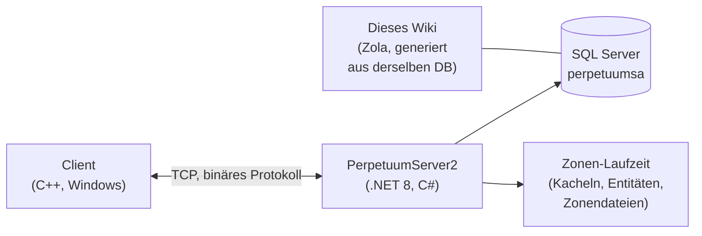

# Entwickler-Übersicht

Ein übergeordneter Überblick über die Funktionsweise des Spiels aus Entwickler- und DevOps-Perspektive.
Detaillierte Einblicke sind in Vorbereitung — dies dient vorerst als Orientierung.

## Die Bausteine

- **Client** — der Perpetuum-Spielclient (Windows; siehe [Client- & PC-Einrichtung](/de/features/client-setup/) für die Ausführung, einschl. Linux). Er kommuniziert über ein binäres TCP-Protokoll mit dem Server; jede Spieleraktion ist ein benannter *Befehl* (*Command*, dieselben Namen, die dieses Wiki im [Aktionsinventar](/de/features/#complete-action-inventory) verwendet).
- **Server (PerpetuumServer2)** — eine C#/.NET 8-Codebasis. Ein einziger Prozess führt den gesamten Server aus: die Verbindungsschicht, die Spiellogik (Roboter, Zonen, Missionen, Markt, Produktion, Forschung) sowie die Zonen-Laufzeitumgebung, die die Kachelwelt jeder Zone aktualisiert (Terrain, Entitäten, Teleporter).
- **Datenbank** — SQL Server, Datenbank `perpetuumsa`. Statischer Spielinhalt (Standardwerte von Entitäten, Baupläne, Erweiterungen, Technologiebaum, Shop, Teleporter-Beschreibungen) und alle dynamischen Zustände (Charaktere, Roboter, Container, Markt, Zonenzustand).
- **Zonendateien** — Zonen sind Kachelgitter (Höhen- und Kontrollschichten, 2 Bytes pro Kachel), die in `.gbf`-Archiven vorliegen und pro Zone editierbar sind; siehe das [Zonendateiformat](/de/formats/zone-files/).
- **Referenzdaten** — der Client lädt beim Start Stat-Tabellen vom Server herunter (siehe [Server & Referenz](/de/features/server/)).

## Ausführung

- Der Server läuft in Docker Compose zusammen mit SQL Server (das `perpetuumserver2`-Projekt); der DB-Container wird vom Generator dieses Wikis ausgelesen.
- Statischer Inhalt wird gegen **plantrules**-Regeldateien validiert; der C#-Generator des Wikis (`make generate`) läuft im selben Ökosystem und liest dieselbe Datenbank, sodass jede generierte Tabelle auf dieser Website die Live-Serverdaten widerspiegelt.
- Die Zonen-Teleport-Karten auf diesem Wiki werden aus denselben Höhenschichten gerendert, die auch das Spiel selbst nutzt.

## Weitere Themen

- **[Formate](/de/formats/)** — Entwickler-Feldreferenz: wie jedes Statistikfeld gespeichert (DB-Spalte, Regeldatei-Schlüssel, binäres Schicht-Byte) und verarbeitet wird, inklusive Rechenbeispielen.
- **[Server & Referenz](/de/features/server/)** — die Meta-Systeme: Server-Info, Highscores, die vom Client geladenen Referenzdaten und der Ingame-Shop.

> Weitere Entwicklerseiten (Protokoll, Zonen-Lebenszyklus, Deployment) sind geplant — diese Seite dient als Einstiegspunkt dafür.
