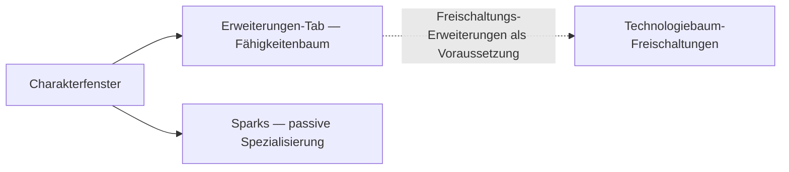

# Charakter

Im **Charakterfenster** (obere Leiste → **Charakter**, oben links) befindet sich der
Fortschritt deines Charakters: Profil, Credits, die **Erweiterungen** (Fähigkeiten) und Einstellungen.
Alles auf dieser Seite gilt pro Charakter — Accounts können mehrere Charaktere besitzen, jeder mit seinem
eigenen Fähigkeitenbaum. UI-Positionen richten sich nach der [Client-UI-Übersicht](/de/features/ui/).

## Erweiterungen

Der **Erweiterungen-Tab** ist der Fähigkeitenbaum des Charakters: Fähigkeitenstufen pro Charakter,
die Gameplay freischalten und Attribute optimieren — allen voran die **Befähigungs-Erweiterungen**
(Enabler Extensions), die zum Steuern einer Roboterklasse erforderlich sind. Stufe 1 kostet Credits, jede weitere
Stufe kostet Erweiterungspunkte (EP), und Voraussetzungen bestimmen den Pfad.

- [Hauptkategorien](/de/content/extensions/#categories) — die 15 Kategorien auf einen Blick:
  welche Kategorien welche anderen eröffnen (Klicke auf eine Box, um zu ihren Karten zu springen)
- [Erweiterungen nach Kategorie](/de/content/extensions/#table) — jede Erweiterung: Rang,
  Preis, Bonus, Voraussetzungen
- Wie EP und der Technologiebaum funktionieren: [Forschung](/de/features/research/)

## Sparks

Dein **Spark** ist die auf dem Charakter installierte Nanobot-Spezialisierung — solange er
aktiv ist, gelten seine Boni für jeden Roboter, den du steuerst. Das Wechseln von Sparks kostet etwas;
Autorisierungen schalten die höheren Stufen frei. Details unter [Sparks](/de/features/sparks/).
