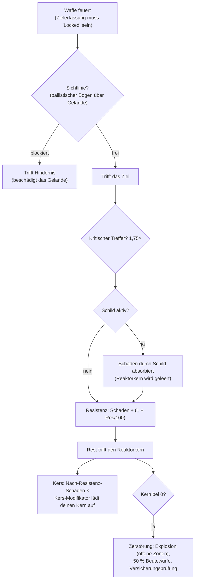

# Kampf

Kämpfe finden **in Zonen** mit deinem aktiven Roboter statt. Du kämpfst gegen andere Spieler (PvP),
NPCs und feindliche Strukturen. Diese Seite beschreibt die serverseitig bestätigten Mechaniken;
detaillierte Wechselwirkungen zwischen Schaden und Ausrüstung befinden sich unter [Roboter & Ausrüstung](/de/features/robots/).

> UI-Positionen richten sich nach der [Client-UI-Übersicht](/de/features/ui/): **Schild/Panzerung/Struktur und
> Energie** deines Roboters werden auf der Statusanzeige im Einsatz dargestellt. Zielerfassung und
> Waffensteuerung im Kampf sind noch nicht detailliert dokumentiert.

## Den Kampf aufnehmen

- Du kannst nur kämpfen, während du **ungedockt (im Einsatz)** bist — du bist dein aktiver Roboter.
- Das Abfeuern einer Offensivwaffe auf einen anderen Spieler in einer offenen (PvP-)Zone löst die
  **PvP-Markierung (Flag)** auf dem Angreifer aus. Das Zurückschießen oder der Einsatz eines Unterstützungsmoduls
  auf einen bereits markierten Spieler aktiviert sie auch bei dir. Die Markierung hält **5 Minuten** an
  (die Definition `effect_pvp`, 300.000 ms) und wird mit jedem neuen Aggressionsakt erneuert.
- Solange die Markierung aktiv ist:
  - kannst du **keine Teleporter nutzen** (einschließlich mobiler Teleporter), und
  - kannst du **nicht regulär andocken** — der einzige Ausweg ist das **Not-Andocken (Force Dock)**,
    welches durch die Markierung bewusst nicht blockiert wird.

## Was du bekämpfen kannst

- **Roboter anderer Spieler** (PvP).
- **NPCs** — Zonen-NPCs sind in **Schwärmen** (Gruppen mit geteiltem Verhalten) organisiert.
- **Feindliche Strukturen / Deployables** in der Zone.

## Wenn dein Roboter zerstört wird

Dein Roboter wird **zerstört** und an der Stelle seines Todes erscheint ein **Beutecontainer**. Die Beute
wird pro Gegenstand mit einer Chance von jeweils 50 % ausgewürfelt:

| Was | Schicksal |
|---|---|
| Jedes ausgerüstete **Modul** | 50 % Chance, **beschädigt** fallengelassen zu werden (reparierbar); andernfalls zerstört |
| Geladene **Munition** jedes Moduls | 50 % Chance fallengelassen zu werden (nur wenn auch das Modul gedroppt ist) |
| **Fracht** (Pakete/Kisten) | Inhalte fallen als Beute heraus, das Paket selbst wird zerstört |
| Andere **stapelbare Gegenstände** im Frachtraum | 50 % Chance fallengelassen zu werden, mit zufällig reduzierter Menge (der Rest ist zerstört) |
| Deine **Lackierung** | 50 % Chance, als Lackierungsgegenstand fallengelassen zu werden |
| Der **Roboter selbst** | Zerstört — es sei denn, er besaß eine aktive **Versicherung**, in welchem Fall die Summe in Credits an dich ausgezahlt wird (der Roboter ist dennoch verloren) |

Eine **Versicherung** (abgeschlossen in der Versicherungseinrichtung einer Basis im gedockten Zustand — siehe
[Produktion → Versicherung](/de/features/production/)) deckt einen Roboter für **15 Tage** ab (plus
Erweiterungs-Bonustage). Jeder Roboter hat eine inhaltsdefinierte **Gebühr** und **Auszahlung** (die
Tabelle `insuranceprices` — 67 Roboterdefinitionen); die Gebühr kann durch einen Erweiterungsbonus gesenkt
und aus deinem Konzern-Geldbeutel bezahlt werden. Starter-Bots können nicht versichert werden. Du kannst
eine Versicherung für 1 + (Erweiterungsbonus) Roboter gleichzeitig halten.

Nach einem Abschuss verbleibst du **ohne aktiven Roboter**. Um wieder ins Spiel einzusteigen, kannst du:

- **einen anderen Roboter auswählen**, den du besitzt und für den du die erforderlichen Freischaltungs-Erweiterungen hast, oder
- an einer Basis im gedockten Zustand **einen Starter-Roboter anfordern** — nach einem Abschuss gilt jedoch eine kurze Sperre:
  **3 Minuten bei Tötung durch einen Spieler, 1 Minute durch einen NPC**. Wurdest du von einem **NPC** getötet,
  händigt dir die Basis bei der Rückkehr automatisch einen **kostenlosen Starter-Roboter** aus.

## Flucht

Wenn ein Kampf schlecht läuft:

- **Not-Andocken (Force Dock)** — der Notausgang. Zieht dich sofort aus der Zone und dockt dich
  unverzüglich an der Hauptbasis (TMA) an, selbst mitten im Gefecht.
- **SOS** — ein alternativer Ausweg: Dockt dich nach der regulären Abdock-Verzögerung (7 Sekunden)
  an der aktuellen Basis an.

Beide dienen als Sicherheitsnetz; das Not-Andocken ist die Taste für „Ich stehe kurz vor dem Tod“.

## Zielerfassung, Reichweite und Treffer

- **Erst aufschalten.** Waffen feuern nur auf *erfasste* Ziele (Lock) — und erst, sobald die Aufschaltung
  abgeschlossen ist. Das Erfassen eines Ziels benötigt die **Zielerfassungszeit** deines Roboters (ein Wert in ms);
  ein Schussversuch während des Vorgangs wird abgelehnt. Du kannst mehrere Aufschaltungen gleichzeitig halten
  (begrenzt durch das Attribut **Maximale Zielerfassungen**), aber nur eine ist das *Primärziel*, und manche
  Waffen feuern ausschließlich auf das Primärziel.
- **Optimale Reichweite + Falloff.** Innerhalb der **optimalen Reichweite** einer Waffe richtest du vollen
  Schaden an. Darüber hinaus nimmt der Schaden über die **Falloff-Distanz** stetig ab — ungefähr halber
  Schaden in der Mitte des Falloffs, null an dessen äußerer Grenze. Jenseits von Optimal + Falloff richtest du
  keinerlei Schaden mehr an.
- **Explosionsradius vs. Zielgröße.** Projektilwaffen und Kanonen „verfehlen“ nicht: Der Wert **Genauigkeit**
  fungiert als Explosionsradius, und ein Ziel, dessen **Signatur** kleiner als dieser Radius ist, nimmt
  proportional weniger Schaden. Raketen *können* gänzlich verfehlen (die Fehlschusschance ergibt sich aus
  dem Raketengenauigkeitswert des Roboters), doch bei einem Treffer detonieren sie mit ihrem **Explosionsradius** —
  und wie bei Kanonen erleidet ein kleines Ziel weniger Schaden durch die Detonation.
- **Kritische Treffer.** Jeder Schuss würfelt deine **Chance auf kritische Treffer**; ein Crit multipliziert
  den gesamten Treffer mit 1,75×, und jeder Treffer variiert zusätzlich zufällig um ±10 %.
- **Sichtlinie (Line of Sight).** Schüsse bewegen sich geradlinig; Gelände, Hindernisse und Pflanzen blockieren sie.
  Raketen fliegen in einem Bogen und können niedrige Deckung überwinden — der Bogen ist jedoch begrenzt, sodass
  hohes Gelände dennoch die Flugbahn sperrt.
- **Dein eigener Schild blockiert deine eigenen Waffen.** Solange dein Schild aktiv ist, feuern deine Waffen nicht.

### Schadensarten

Munition trägt den Schaden: Jede Munition besitzt Werte für eine oder mehrere Schadensarten — üblicherweise
eine dominante Schadensart plus eine geringere sekundäre (Raketenmunition ist explosiv plus kinetisch oder
chemisch, Laserkristalle thermal plus chemisch, Railgun-Geschosse kinetisch plus thermal). Die Arten:

| Typ | Hinweise |
|---|---|
| **Chemisch** | Die übliche Komponente von Kanonen- und Lasermunition |
| **Kinetisch** | Railgun-, Projektil- und Raketenmunition |
| **Thermal** | Laser, manche Projektilmunition |
| **Explosiv** | Raketen |
| **Toxisch** | Manche Kanonenmunition; beschädigt nur Pflanzen und Gelände |
| **Elektrisch** | Spezielle Effekte (z. B. der Scorcher) — **durchdringt Schilde** |

Eingehender Schaden wird pro Typ durch die **Resistenz** des Ziels gegen diesen Typ verringert: Eine Resistenz
von 50 % mindert den Schaden um 50/(50+100) ≈ 33 %. Resistenzen gelten nur für Schaden, der den Schild *durchdringt* —
der Schild absorbiert zuerst, was aus der Reaktor-Energie des Schildes bezahlt wird: Je härter der Treffer,
desto mehr Energie kostet er. **Kers**-Module lassen einen Teil einer Schadensart selbst nach Resistenz direkt
die Schildenergie verbrennen bzw. den Kern speisen. [Adaptive Legierung](/de/features/modules/#the-module-families)
verteilt deine Resistenzen dynamisch auf das um, was dich tatsächlich trifft.

## Ortung, Tarnung und Geschwindigkeit

- **Ortung vs. Tarnung.** Du kannst eine Einheit innerhalb einer Reichweite sehen, die mit deinem
  **Ortungswert** wächst und mit dem **Tarnungswert** des Ziels schrumpft — grob 100 m × Ortung ÷ Tarnung.
  Eine Einheit, die dich erfasst hat, ist für dich immer sichtbar, ungeachtet ihrer Tarnung. Tarnmodule erhöhen
  deine eigene Tarnung temporär (siehe [Module](/de/features/modules/)); Minen nutzen stattdessen eine eigene
  Erfassungsreichweite.
- **Blob.** Einige Einheiten und Strukturen strahlen ein *Blob*-Feld aus. Wenn du dich im Radius eines
  Emitters aufhältst, steigt der Blob-Wert auf deiner Einheit; zwischen den beiden Blob-Schwellenwerten
  **erhöht es deine Zielerfassungszeit** (bis zu 6× des Basiswerts) und **halbiert deine Erfassungsreichweite
  sowie Sensorstärke**.
- **Geschwindigkeit.** Die Höchstgeschwindigkeit sinkt mit der Masse: Geschwindigkeit = Basis × (Konstruktionsmasse ÷ tatsächliche Masse) —
  jede Tonne zusätzlicher Module, Panzerung und Fracht macht dich langsamer.
- **Demobilisierung („Demob“).** Der Webber-Effekt bremst die Höchstgeschwindigkeit eines Ziels ab. Wie stark
  er anschlägt, skaliert mit der **Massivität** des Ziels — schwerere Einheiten werden stärker demobilisiert,
  sodass große, langsame Ziele ihn am deutlichsten spüren.

## Alarme

Ein **Alarm** wird in einer Zone durch einen **Alarmschalter** (eine missionsbezogene Struktur) ausgelöst.
Sobald gestartet:

- Läuft er für eine feste **Alarmdauer** (von der Mission vorgegeben; standardmäßig kurz).
- Musst du für die gesamte Dauer **in Reichweite des Schalters bleiben** — dies wird alle paar Sekunden
  überprüft; entfernst du dich zu weit, bricht der Alarm ab.
- Du kannst immer nur **einen aktiven Alarm gleichzeitig** haben.

Alarme sind an Missionsinhalte gekoppelt — siehe [Missionen](/de/features/missions/).

## Abschussberichte

Deine Kampfhistorie ist als **Abschussberichte** (Kill Reports) einsehbar:

- Filtern nach **Zeitfenster**.
- Filtern nach **Rolle**: Als **Opfer**, **Angreifer** oder **Vollstrecker**.

Nutze sie, um zu analysieren, wie du gestorben bist oder wen du zerstört hast.

## Bestenlisten

- **Server-Bestenlisten** — Spitzenergebnisse auf dem gesamten Server.
- **Meine Bestenlisten** — deine persönlichen Rekorde.

## Praktische Hinweise

- **Stirb nicht leichtfertig** — ein zerstörter Roboter bedeutet Ausfallzeit beim Neuausrüsten oder Neuanfordern.
- **Not-Andocken funktioniert sofort** — bist du unterlegen, bringe dich umgehend zur TMA in Sicherheit; umrüsten kannst du später.
- **PvP sperrt Teleporter** — plane deine Fluchtwege; du kannst dich nicht aus einem Kampf herausblinzeln.
- **Alarme sind ein Signal** — ein aktiver Alarm bedeutet, dass in diesem Gebiet ein Missionsereignis läuft.

<!--
Developer notes: rewritten 2026 from backend sources; no community-wiki text reused.
Verified against:
- Locking: Zones/Locking/LockHandler.cs (locking time in ms from
  AggregateField.locking_time; MaxLockedTargetsProperty; one primary lock;
  lock states Inprogress -> Locked), Zones/Locking/Locks/Lock.cs,
  Zones/Locking/LockValidator.cs (dead/not-lockable/out-of-range validation);
  ZoneSession.cs (weapons take an existing lock id; firing a weapon whose lock is
  not fully Locked raises LockIsInProgress — there is NO auto-lock on fire).
- Damage: Modules/Weapons/Damage.cs (CalculateDamages: crit = attacker.
  CriticalHitChance, CRITICALHIT_MOD 1.75, random 0.9-1.1; falloff =
  cos(x*PI)/2+0.5 with x=(distance-optimal)/falloff; zero beyond optimal+falloff;
  explosion modifier = target.SignatureRadius/explosionRadius clamped 0..1;
  toxic excluded from unit damage), Modules/Weapons/WeaponAmmo.cs (damage values
  per type live on the ammo: damage_chemical/thermal/kinetic/explosive/toxic;
  firearm adds damage_toxic to plants).
- Weapons: Modules/Weapons/FirearmWeaponModule.cs (CheckAccuracy always false —
  firearms never miss; WithExplosionRadius(Accuracy) — accuracy IS the blast
  radius), Modules/Weapons/MissileWeaponModule.cs (miss when rnd >
  robot.MissileHitChance; missile_miss property), WeaponModule.cs (shield active
  => ShieldIsActive error; LOS check before firing).
- Resistances: Units/Unit.cs GetResistByDamageType = resist/(resist+100);
  Zones/DamageProcessors/DamageProcessor.cs (shield absorbs first, paid from
  core: coreDamage = damage * AbsorbtionModifier; Electric damage penetrates as
  coreDamage; kers = damage * type kers modifier, scaled by
  (sin(core/coreMax*PI)/2)+0.5, added to target core);
  EffectModules/ShieldGeneratorModule.cs (AbsorbtionModifier =
  max(SigRadius/shieldRadius,1)/shieldAbsorbtion).
- Damage types: Modules/Weapons/DamageType.cs — Chemical, Kinetic, Thermal,
  Explosive, Toxic, Electric (no "seismic"; missile damage is Explosive).
  Electric is only produced by ScorcherModule.cs in this backend.
- Detection: Units/Unit.Visibility.cs (IsDetected: range = 100/max(1,
  target.StealthStrength)*max(1, DetectionStrength); locked-on-you always
  visible; mine detection range separate); stealth_strength property includes
  effect_stealth_strength_modifier (stealth modules raise masking).
- Speed: Units/UnitProperties/SpeedMaxProperty.cs (speed_max * Mass/ActualMass;
  dreadnought => 0.05; massiveness/drone/highway effect modifiers).
- Demob: Modules/EffectModules/WebberModule.cs (effect_demobilizer; effect
  property = module value + target.Massiveness, clamped at 1.0 — heavier targets
  get the full effect; longrange webbers additionally require LOS; accuracy
  check via optimal-range modifier).
- Blob: Zones/Blobs/BlobHandler.cs (emitters raise blob level inside
  BlobEmissionRadius; between blob_level_low/high the multiplier scales:
  locking_time modifier -5, i.e. lock time x(1+5*m) — up to 6x base at full blob, max_targeting_range *0.5,
  sensor_strength *0.5).
- LOS: Zones/LineOfSight.cs (raycast vs terrain blocks incl. Plant flag;
  ballistic arc for missiles: max amplitude 16 m over 40 m);
  Zones/Terrains/BlockingFlags.cs (Obstacle/Plant/Decor/Island block).
Corrections vs ingested page: "seismic" damage type does not exist (explosive
does); "firearms lose damage instead of missing" verified (accuracy = explosion
radius); auto-lock on fire NOT in backend (lock must be created and completed
first); "interference" (emission/minimum/peak, emitters, anomaly degradation)
has NO equivalent in this backend — only a comment in Services/RiftSystem/Rift.cs
— section removed; shield "absorbs" is core-energy based, and Electric damage
penetrates it.
Developer files: Zones/Locking/*; Zones/Locks via Zones/Locking/Locks/*;
Modules/Weapons/*.cs; Zones/DamageProcessors/*.cs; Units/Unit.Visibility.cs;
Units/Unit.cs; Units/UnitProperties/SpeedMaxProperty.cs;
Modules/EffectModules/ShieldGeneratorModule.cs, WebberModule.cs,
StealthModule.cs; Modules/ScorcherModule.cs; Zones/Blobs/*.cs;
Zones/LineOfSight.cs; Zones/ZoneSession.cs (lock/fire packet handling).
Previously verified (kept as-is): PvP flag = effect_pvp 300000 ms
(effect_pvp definition), raised by attack/aggro/support (Player.cs
ApplyPvPEffect); blocks teleport + normal dock (CantDockThisState), ForceDock.cs
has no PvP check; death loot 50% rolls (Player.cs OnUnitDeath,
Services/Looting/LootHelper.cs DROP_CHANCE 0.5); insurance (InsuraceFacility.cs,
InsuranceHelper.cs, insuranceprices 67 defs); starter-robot lock 3 min PvP /
1 min NPC; alarms (Zone/AlarmStart.cs, AlarmSwitch.cs); kill reports
(GetMyKillReports.cs); high scores (GetHighScores.cs / GetMyHighScores.cs).
-->
