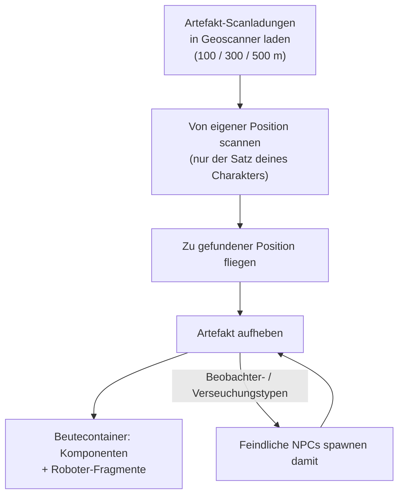

# Erkundung (Artefakte & Relikte)

Erkundung bedeutet, verborgene Schätze im Gelände aufzuspüren — eine lohnenswerte Solo-Aktivität auf
jeder Stufe. Sie existiert in zwei Formen: **Artefakte**, die persönlich und verborgen sind,
sowie **Relikte**, die für alle offen und umkämpft sind.

## Artefaktbergung

Artefakte sind Punkte, die **pro Charakter** existieren: Der Server führt für jeden Charakter auf jeder
Insel ein eigenes Artefakt-Set, sodass deine Funde ganz allein dir gehören. Sie sind unsichtbar, bis du gezielt
nach ihnen scannst.

1. Lade **Artefakt-Scanladungen** in ein Geoscanner-Modul. Es gibt drei Ladungsstufen mit unterschiedlichen
   Scanreichweiten (100 / 300 / 500 m).
2. Scanne von der Position deines Roboters aus — der Scanner meldet die Artefaktpositionen innerhalb
   der Reichweite (der Genauigkeitswert des Geoscanners grenzt die gemeldete Position ein).
3. Fliege zur gefundenen Position und hebe das Artefakt auf; an Ort und Stelle spawnt ein **Beutecontainer**.

Zwei Umstände machen die Artefaktbergung zu einer Kampf- ebenso wie zu einer Sammelaktivität:

- Einige Artefakttypen **spawnen NPCs bei dir** — die Varianten „Beobachter“ (Observer) und
  „Verseuchung“ (Infestation) rufen in dem Moment feindliche Einheiten herbei, in dem das Artefakt entdeckt wird;
  steuere daher einen kampffähigen Roboter.
- Die Beute ist zufällig je nach Artefakttyp: Modulkomponenten (Panzerplatten, Härter,
  Generatoren, Reparierer…) und **Roboter-Fragmente** — die fraktionsspezifischen Zutaten für
  Forschung und Produktion, was Artefakte zu einer zentralen industriellen Karriere macht.

Artefakttypen sind gestaffelt (Stufe 1–3, mehr Beute auf höheren Stufen) und existieren in neutralen
sowie fraktionsspezifischen Varianten.

## Reliktejagd

Relikte sind **Open-World**: Die Zone spawnt sie an zufälligen Positionen (in einem Respawn-Zyklus von
ungefähr 90 Minuten mit zufälliger Streuung). Sie sind sichtbare Objekte mit einem Lichtstrahl, und wer
eines zuerst aufhebt, erhält die Beute. Die Beute besteht aus einem Wurf auf NIC plus **Roboter-Fragmenten**,
skaliert nach der Stufe des Relikts und der Wertigkeitsstufe der Insel — dieselben Fragmente wie bei Artefakten.

Relikttypen sind pro Insel gestaffelt (Stufen 1–3 mit unterschiedlichen EP-Werten je Stufe) und kommen in
neutralen, fraktionsspezifischen und industriellen Varianten vor. Einige Relikte sind an
[Außenposten](/de/features/outposts/) gebunden — die SAP-Aktivität spawnt eigene Relikte, die bis zu 12 Stunden
überdauern — und auf offenen PvP-Inseln liegen die Spawnpunkte in umkämpftem Gebiet; rechne also mit anderen Jägern.

## Auch Missionen belohnen es

[Missionen](/de/features/missions/) können dir ebenfalls Artefakt-Aufgaben stellen, bei denen du direkt
bezahlt wirst und die Güter an den Auftraggeber statt in dein Inventar wandern.

<!--
Written from scratch against the server backend, 2026-09-27:
Zones/Artifacts/Repositories/ZoneArtifactRepository.cs (per-character artifact
rows), Zones/Scanning/Scanners/Scanner.Artifact.cs (scan range + accuracy),
Zones/Artifacts/Generators/Loot/ (random loot per type),
Services/Relics/RelicManagers/ZoneRelicManager.cs (~1.5 h respawn + random
window) and SAPRelic.cs (12 h lifespan),
artifacttypes/artifactloot/relictypes/relicloot tables,
ammo_artifact_scan_a/b/c (scan ranges 100/300/500).
An earlier version of this page was adapted from the Open Perpetuum
community wiki (perpetuum.miraheze.org) and has been fully rewritten from
backend sources; no text was reused.
-->
