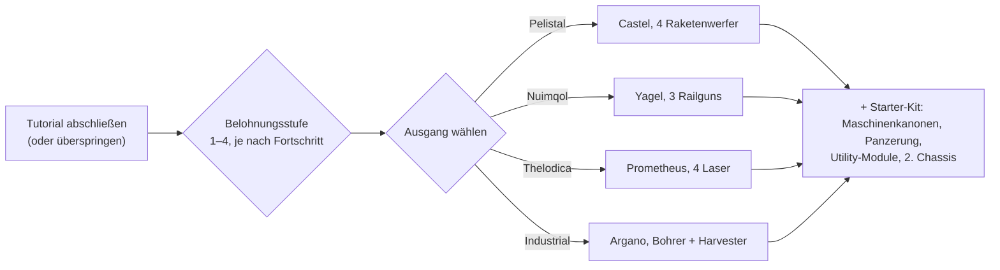

# FAQ

## Kann ich das Tutorial überspringen?

Du kannst die Trainingszone vorzeitig verlassen, verzichtest dann jedoch auf die Belohnungen,
die du durch das Abschließen verdienen würdest. Wenn ein Charakter das Tutorial verlässt:

- zahlt der Server das **Start-NIC** plus einen Bonus **pro Belohnungsstufe**, die du im
  Tutorial erreicht hast (es gibt vier Belohnungsstufen),
- wirst du in den **Standard-Konzern** für das von dir gewählte Volk und die Schule eingeteilt,
- erhältst du deine **Start-Erweiterungen** (Fähigkeiten) und deinen **Spark**,
- wird dein **Starter-Roboter** erstellt, du wirst an der Docking-Basis New Virginia angedockt und
  sie wird als deine **Hauptbasis** festgelegt — der Ort, an dem du wiedererscheinst, wenn dein Roboter
  zerstört wird,
- werden deine **Belohnungsgegenstände** in einem öffentlichen Container an dieser Docking-Basis hinterlegt
  und du erhältst eine Willkommens-Mail.

## Wie schließe ich das Tutorial ab?

Arbeite die Aufgaben der Reihe nach ab; die **Rookie-Checkliste** des Clients (Hilfe-Menü in der
oberen Leiste) verfolgt sie und kann an die untere Leiste angeheftet werden. Wie weit du kommst,
bestimmt deine Belohnungsstufe, welche darüber entscheidet, welche Belohnungsstufen du beim Verlassen
erhältst — ein Abschluss auf Stufe 1 bringt nur die erste Stufe, ein vollständiger Abschluss alle vier.

## Was bringt mir jeder Ausgang?

Deine Wahl bestimmt drei Dinge: Den **Starter-Roboter**, den du steuerst, die **Belohnungsgegenstände**,
die du erhältst, sowie den **Standard-Konzern und die Startfähigkeiten**, die du bekommst.
Alles andere — jede Fähigkeit, jeder Roboter, die Ausrüstung jeder Fraktion — kann später mit
EP und NIC erlernt und gekauft werden; die Wahl ist also nur ein Startpaket, keine bindende Festlegung.

| Ausgang | Starter-Roboter (ausgerüstet) | Belohnungsthema |
|---|---|---|
| **Pelistal** | Castel — vier Raketenwerfer | Raketen + Maschinenkanonen |
| **Nuimqol** | Yagel — drei Railguns | Railgun-Munition + Maschinenkanonen |
| **Thelodica** | Prometheus — vier Laser | Laserkristalle + Maschinenkanonen |
| **Industrial** | Argano — zwei Bohrer, ein Harvester, eine Bergbausonde | Bergbau-, Ernte- und Artefaktscan-Munition |

Jeder Ausgang enthält außerdem ein Set kleiner Maschinenkanonen mit Munition, Panzerung und
Utility-Module (Panzerungsreparatur, Sensor-Booster oder Massenreduzierer, Reaktor-Nachlader, Schadensmodifikatoren),
ein zweites (leeres) Chassis und eine Wandbomben-Kapsel auf den höchsten Belohnungsstufen.

## Was mache ich, wenn ich draußen bin?

Nahezu jede Aktivität bringt EP für Fähigkeiten und NIC für Ausrüstung ein:

- Baue Erze ab, ernte Pflanzen, suche Artefakte — und verkaufe den Ertrag auf den [Märkten](/de/features/market/).
- Schieße NPCs ab und verkaufe die [Beute](/de/features/npcs/).
- Sammle oder kaufe Materialien und [baue](/de/features/production/) Gegenstände.
- Fliege [Missionen](/de/features/missions/) — alles, was an einem Terminal oder
  Außenposten angeboten wird, kann von dir allein in der Welt absolviert werden.

Neu im Open-World-PvP? Lies zuerst die [Überlebenshinweise in Erste Schritte](/de/features/getting-started/#überleben).

## Kann ich die Trainingszone erneut besuchen?

Nein. Die Trainingszone ist neuen Charakteren vorbehalten und nach dem Verlassen gibt es kein Zurück.
Die Rookie-Checkliste bleibt im Hilfe-Menü verfügbar, falls du die Ziele nachlesen möchtest, und du
kannst jederzeit einen weiteren Charakter erstellen und ihn als Test-Sandbox im Tutorial belassen.

## Abkürzungen

Häufige Abkürzungen im Chat, bei Marktangeboten und Ausrüstungen. Die meisten Begriffe haben eine eigene
Seite (wo sinnvoll verlinkt) — die Gegenstandsnamen lassen sich über die Websuche finden.

| Begriff | Bedeutung |
|---|---|
| **EP** | [Erweiterungspunkte](/de/features/research/#ep-sources) — die kontoweite Fähigkeitswährung zum Aufwerten von [Erweiterungen](/de/features/character/#extensions) (die Verdienstregeln stehen auf der [Forschungsseite](/de/features/research/#ep-sources)). |
| **NIC** | Nian Credit — die Spielwährung (das `credit`-Guthaben auf deinem Charakter). |
| **CT** | [KPRG — Kalibrierungsprogramm](/de/features/production/#cprg-calibration-programs) — das Programm, mit dem eine Fertigungslinie kalibriert wird, bevor sie produziert (eines pro Gegenstand, mit Material-/Zeiteffizienz). |
| **Proto** | Ein Prototyp-Gegenstand — die hochstufige Variante eines Moduls/Roboters, hergestellt in der [Prototyp-Einrichtung](/de/features/production/#the-item-lifecycle-the-circular-process) (verbraucht ein Exemplar der vorherigen Stufe; siehe [Stufenfortschritt](/de/features/production/#tier-progression)). |
| **LWF** | Lightweight Frame — ein gewichtsreduzierendes Panzerungsmodul (im Client als „… lightweight frame“ benannt, z. B. *Niani lightweight frame*). Macht einen Roboter leichter auf Kosten der Panzerung. |
| **TP / Tele** | [Teleport](/de/features/movement/) — Schnellreise zwischen festen Punkten oder zu einem aufgestellten mobilen Teleporter. |
| **SAP** | Service Access Point — die Außenposten-[Stabilitätsaktivität](/de/features/outposts/). |
| **Stab** | Weapon Stabilizer — erhöht die Treffergenauigkeit einer Waffe. |
| **Demob** | Demobilizer — ein Modul, das einen anderen Roboter (und dessen Module) verlangsamt. |
| **EWar** | Elektronische Kampfführungsmodule (Jamming, Sensorunterdrückung, Tarnung). |
| **EnWar** | Energiekampfführungsmodule (Reaktoreinspritzung, Energieabsauger, Neutralisierer, Energieüberträger). |
| **Tuning** | Die Client-Bezeichnung für Upgrade-Module, die andere Module verstärken — Schadensmodifikatoren für Waffen, *industrielles Tuning* für Bohrer und Harvester, Panzerungsreparatur-Tuning und so weiter. |
| **MK2** | Eine aufgewertete Variante eines Roboters (`_mk2`-Chassis) — höhere Kapazitäten, eigene Forschungslinie. |

Roboterklassen folgen den Gruppierungen im Client — siehe den Hinweis unter
[Roboterklassen](/de/content/robots/#robot-classes).

<!--
Written from scratch against the server backend, 2026-09-27:
Zones/Teleporting/Strategies/TrainingExitStrategy.cs (exit rewards, NIC,
corporation, extensions, spark, starter robot, home base, reward items),
Zones/Training/Reward/TrainingReward*.cs + trainingrewards/robottemplates
(reward levels 1-4, per-race starter packs and items),
Robots/Robot.Properties.cs (race ids 1=Pelistal, 2=Nuimqol, 3=Thelodica, 5=industrial).
An earlier version of this page was adapted from the Open Perpetuum
community wiki (perpetuum.miraheze.org) and has been fully rewritten from
backend sources; no text was reused.
-->
