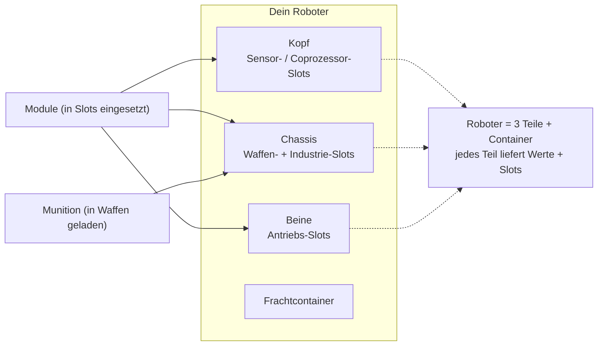

# Ausrüstung

Ausrüsten (Fitting) bedeutet das Einsetzen von **Modulen** in die Komponentenslots des Roboters und das Laden
von **Munition** in deine Waffen. Sämtliches Ausrüsten ist **nur im gedockten Zustand** möglich — du kannst
nicht im Einsatz in einer Zone ausrüsten.

> UI-Positionen richten sich nach der [Client-UI-Übersicht](/de/features/ui/) (die Kategorie **Ausrüsten** in
> der oberen Leiste). Die folgenden Mechaniken sind anhand des Servers bestätigt.

## Module ausrüsten

Ein Roboter verfügt über mehrere **Komponenten** (Waffe, Schild, Panzerung, Antrieb, Sensor usw.), jede
mit einer Reihe von **Slots**.

- **Ein Modul ausrüsten** — nimm ein Modul aus einem Container und lade es in einen bestimmten
  Komponentenslot. Der Modultyp muss für diesen Slot auf dieser Roboterklasse zulässig sein.
  Ist der Slot bereits belegt, wird das vorhandene Modul in den Container zurückgelegt.
- **Module tauschen** — bewege ein Modul zwischen zwei Slots derselben Komponente.
- **Ein Modul entfernen** — nimm ein Modul aus einem Slot zurück in einen Container.

Der Server berechnet die Werte des Roboters nach jeder Änderung neu (Module beeinflussen die auf der
Statusanzeige im Einsatz sichtbaren Werte — siehe [Kampf](/de/features/combat/)).

## Munition laden

- **Munition ausrüsten** — lade einen kompatiblen Munitionsgegenstand in ein aktives (Waffen-)Modul. Das Modul
  muss **diesen Munitionstyp akzeptieren** und lädt bis zur **Munitionskapazität** des Moduls nach.
  Zuvor geladene Munition wird zuerst in den Container zurückgelegt.
- **Munition wechseln** — tausche die geladene Munition gegen einen anderen kompatiblen Typ aus.
- **Munition entladen** — lege die geladene Munition zurück in einen Container.

## Ausrüstungs-Voreinstellungen

Ein **Preset** (Voreinstellung) ist eine gespeicherte Ausrüstungskonfiguration, die du schnell wieder anwenden kannst:

- **Speichern** — speichere die aktuelle Ausrüstung eines Roboters unter einem Namen ab.
- **Auflisten** — sieh deine gespeicherten Voreinstellungen ein.
- **Anwenden** — lade eine Voreinstellung aus einem Container auf einen (anderen) Roboter.
- **Löschen** — entferne eine gespeicherte Voreinstellung.

Voreinstellungen sind praktisch für das schnelle Neuausrüsten nach einer Schlacht oder beim Wechsel zwischen Rollen.

## Praktische Hinweise

- **Du kannst nicht in einer Zone ausrüsten** — alles hier erfordert, dass du angedockt bist.
- **Befähigungs-Erweiterung zuerst** — ohne erforschte Roboterklasse kannst du sie weder auswählen noch steuern.
- **Munition muss zur Waffe passen** — inkompatible Munitionsdefinitionen werden abgelehnt.
- **Umverpackte Roboter können nicht genutzt werden** — packe einen Roboter aus, bevor du ihn auswählst oder ausrüstest.
- **Nutze Voreinstellungen zum schnellen Nachrüsten** — speichere eine bewährte Konfiguration und wende sie nach Verlusten direkt an.

## Slot-Kategorien

Die Komponenten eines Roboters (Kopf, Chassis, Beine) stellen **Slots** bereit, und jeder Slot verfügt über eine Reihe
von Kategorie-Flags. Ein Modul passt nur dann in einen Slot, wenn die Flags des Moduls eine **Teilmenge** der
Flags des Slots sind. Die Flag-Kategorien lauten:

`small`, `medium`, `large`, `turret`, `missile`, `melee`, `industrial`,
`ew_and_engineering`, `specialized` (ein spezialisierter Slot akzeptiert nur spezialisierte
Module), plus die strukturellen Slots `head` / `chassis` / `leg`.

Module können auch auf bestimmte Roboter beschränkt sein, und einige tragen ein **unique**-Flag, sodass
jeweils nur eines dieses Typs ausgerüstet werden kann. Modulspezifische Werteffekte befinden sich in der
generierten [Robotertabelle](/de/content/robots/).
