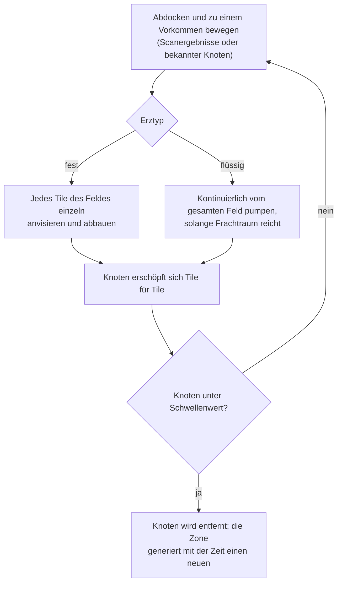
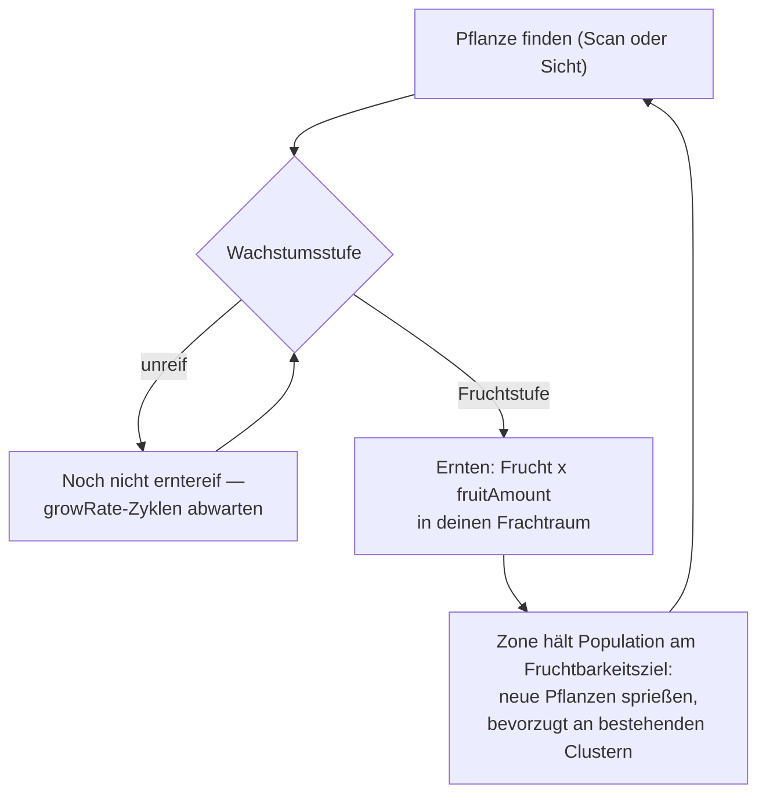
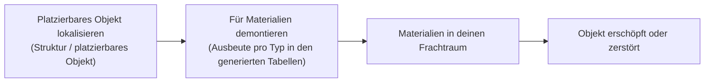

# Sammeln & Scannen

Ressourcen im Spiel stammen aus drei Quellen in einer Zone: **Erzvorkommen**, **Pflanzen**
und **platzierbaren Objekten** (Deployables). Diese Seite erklärt, wie jede Quelle funktioniert und wie der Sammelkreislauf abläuft.

> UI-Positionen richten sich nach der [Client-UI-Übersicht](/de/features/ui/): Scan- und Ernteaktionen befinden sich
> in der Liste der **Zonenaktionen** (oben rechts während des Einsatzes in einer Zone). Ertragszahlen pro Ressourcentyp
> stehen in den generierten Tabellen: [Inhalt → Erze](/de/content/ores/) und
> [Inhalt → Pflanzen](/de/content/plants/). Die folgenden Mechaniken sind anhand der Server-Implementierung bestätigt.

## Der grundlegende Ablauf

1. **Abdocken** und in eine Zone vorstoßen (siehe [Bewegung](/de/features/movement/)).
2. Das Gebiet mit dem Scannermodul deines Roboters **scannen**.
3. **Sammeln** — Erz abbauen, Pflanzenfrüchte ernten oder platzierbare Objekte demontieren.
4. **Andocken** und deine Fracht in einen Container der Basis entladen.

## Erzvorkommen

- Erz liegt im Boden in Form von **Vorkommen (Knoten)**, die über die gesamte Zone verstreut sind.
- Um sie zu finden und aufzuzeichnen, benötigst du ein **Geo-Scanner-Modul** auf deinem aktiven Roboter.
  Ein Scan liefert ein **Scan-Ergebnis**; dieses kannst du anschließend **hochladen**, wodurch es in deiner
  persönlichen Mineral-Scan-Liste gespeichert wird.
- Deine gespeicherten Scan-Ergebnisse können **aufgelistet, verschoben, gelöscht oder in Gegenstände umgewandelt** werden
  (die "Mineralien-Scan"-Gegenstände für Verarbeitung/Produktion).

- Vorkommen sind **endlich**: Jeder Knoten enthält eine begrenzte Gesamtmenge. Wird ein Knoten unter seinen Schwellenwert
  abgebaut, wird er entfernt und die Zone **regeneriert mit der Zeit neue Knoten** bis zu ihrem konfigurierten Maximum.
  Wie Knoten platziert und Pflanzenpopulationen gepflegt werden — mit realen Zonen als Rechenbeispielen — steht unter
  [Zonen → Generierung](/zones/generation/).
- **Feste vs. flüssige Erze.** Feste Erze erschöpfen sich Tile für Tile — du visierst jedes Tile des Feldes an
  und baust es ab, bis es leer ist. Flüssige Erze speisen sich aus dem gesamten Feld, sodass dein Bohrer/Pumpe kontinuierlich
  laufen kann, solange du Frachtraum hast. Diese Bequemlichkeit ist genau der Grund, warum flüssige Erze meist weniger wert sind:
  Sie erfordern weniger Aufmerksamkeit und Geschick beim Abbau.

### Pflanzen- & Erzwerte auf einen Blick

Das Verhalten von Erzen und Pflanzen wird durch typspezifische Regeldaten gesteuert. Die für Spieler relevanten Felder:

| Feld | Bedeutung im Spiel |
|---|---|
| `fertility` | Wie häufig der Typ ist — höherer Wert = die Zone versucht, mehr davon aufrechtzuerhalten |
| `growRate` | Wie viele Wachstumszyklen eine Pflanze in jedem Stadium verweilen muss, bevor sie voranschreitet (höher = langsamer) |
| `spreading` | Ob der Typ in Clustern (Gruppen) oder verstreut wächst |
| `killDistance` | Mindestabstand zwischen zwei Pflanzen desselben Typs |
| `slope` / `minSlope` | Die Geländesteigung, auf der die Pflanze wachsen kann |
| `allowedAltitudeLow/High` | Der Höhenbereich, in dem die Pflanze wachsen kann |
| `allowedWaterLevelLow/High` | Küstenabstandsbereich (erzeugt Küstenvegetation) |
| `fruitingState` | Welches Wachstumsstadium die Pflanze erreichen muss, bevor sie Früchte trägt (erntereif ist) |
| `fruitDefinition` / `fruitAmount` | Was die Pflanze abwirft und die Basismenge |
| `maxAmount` | Obergrenze, wie viele Exemplare dieses Typs in einem Verarbeitungsgebiet existieren dürfen |
| `health` | Trefferpunkte pro Wachstumsstadium (höhere Stadien können widerstandsfähiger sein) |
| `damageScale` | Schadensresistenz der Pflanze |
| `playerSeeded` | Die Pflanze existiert nur dort, wo ein Spieler sie gepflanzt hat |
| `onlyOnUnprotectedZone` | Wächst nur in ungeschützten Zonen (Beta-/Gamma-Klasse) |

Die vollständige feldweise Referenz (Typen, Standardwerte, Speicherung und wie der Zonentick sie nutzt)
steht unter [Formate → Pflanzenfelder](/de/formats/plant-fields/).

## Pflanzen

- Pflanzen **wachsen mit der Zeit** durch eine Abfolge von Stadien. Jedes Stadium erfordert eine Anzahl von
  Wachstumszyklen (`growRate`), bevor die Pflanze zufällig voranschreitet.
- Eine Pflanze **bringt erst Früchte hervor, wenn sie ihr Fruchtstadium erreicht** — unreife Pflanzen
  können nicht geerntet werden.
- Die Zone hält die Pflanzenpopulation in Richtung eines **Fruchtbarkeitsziels**: Ist ein Geländestück
  für sein Fruchtbarkeitsniveau unterbepflanzt, sprießen neue Pflanzen; die gewählte Art gewichtet die `fertility`
  jeder Spezies, und `spreading` begünstigt neues Wachstum in der Nähe bestehender Cluster.

- Einige Pflanzen sind **von Spielern gesät** (sie existieren nur in Gärten von Spielern) und manche wachsen
  **nur in ungeschützten Zonen**.
- Pflanzen können **beschädigt und zerstört** werden; ihre Werte `health` und `damageScale` bestimmen,
  wie widerstandsfähig sie sind.

## Platzierbare Objekte

Platzierbare Objekte (Deployables) sind in einer Zone aufgestellte Objekte (siehe [Power Base Stations](/de/features/pbs/)
für Strukturen). Einige können zur Materialgewinnung **demontiert (gestrippt)** werden. Demontageregeln und
Erträge pro Typ stehen in den generierten Tabellen: [Inhalt → Erze](/de/content/ores/) und [Inhalt → Pflanzen](/de/content/plants/).

## Kioske

Ein **Kiosk** ist eine missionsbezogene Struktur: Du **reichst Gegenstände** (in Reichweite) im Rahmen einer
Mission an ihm ein. Er ist keine eigenständige Sammelquelle — siehe [Missionen](/de/features/missions/).

## Praktische Hinweise

- **Scannen erfordert das Modul** — kein Geo-Scanner ausgerüstet, keine Scan-Ergebnisse.
- **Scan-Ergebnisse gehören dir** — sie existieren pro Charakter und werden nicht geteilt.
- **Erzknoten respawnen langsam** — ist ein Gebiet kahl, ist das Vorkommen erschöpft, nicht verborgen.
  Die Regeneration stellt die Knotenanzahl allmählich wieder her, nicht sofort.
- **Ernte nur Reifes** — Pflanzen im Fruchtstadium liefern den vollen Ertrag; jüngere Stadien bringen gar nichts.

<!-- TODO: only the client UI flow remains (scan screen, harvest interaction, cargo UI) —
     needs a running client. Per-type ore yields are at /content/ores/ and plant fruit
     definitions at /content/plants/ (generated from the live DB).
     Developer notes: Zone/ZoneUploadScanResult.cs (GeoScannerModule required);
     MineralScanResult*.cs (per-character repository);
     Zones/Terrains/Materials/Plants/PlantRule.cs (all plant rule fields);
     Zones/Terrains/NatureCube.cs (GrowPlants, fertility/spreading/killDistance logic);
     Zones/Terrains/Materials/Minerals/MineralLayer.cs (ore node lifecycle);
     Zone/UseItem.cs + UseItemVisitor.cs (IUsableItem harvest path);
     Zone/KioskSubmitItem.cs (mission item submission, range-limited). -->
