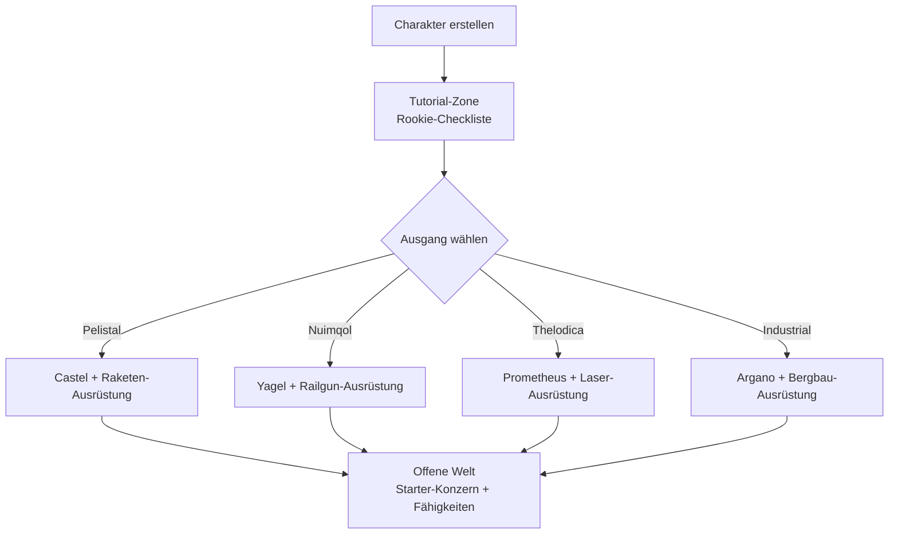

# Erste Schritte

Diese Seite beschreibt die ersten Schritte: Einen Charakter erstellen, deinen ersten Roboter erhalten
und die Einstellungen auf Charakterebene, mit denen du früh in Berührung kommst.

> UI-Positionen richten sich nach der [Client-UI-Übersicht](/de/features/ui/). Die folgenden Mechaniken sind
> anhand der Server-Implementierung bestätigt.

## Spiel holen

Perpetuum ist kostenlos auf [Steam](https://store.steampowered.com/app/223410/Perpetuum/) erhältlich.

  <a class="steam-card-link" href="https://store.steampowered.com/app/223410/Perpetuum/" target="_blank" rel="noopener">
    
    Perpetuum auf Steam — kostenlos spielbar
  </a>

## Zuerst ansehen

Leitfäden des Open Perpetuum Projekts. Klicke auf eine Karte, um das Video hier abzuspielen.

  

    
    &#9654;
    
Perpetuum Online Tutorial Walkthrough. + Extension Advice and lots more.

  

  

    
    &#9654;
    
Syndicate Careers Help — Artifacting

  

  

    
    &#9654;
    
Open Perpetuum Tutorial — How to run multiple clients

  

## Charakter erstellen

- Du kannst **vorab prüfen, ob ein Name frei ist** (`characterCheckNick`).
- **Erstelle den Charakter** — er ist mit deinem Konto verknüpft. Ein Konto kann mehrere
  Charaktere enthalten; du spielst jeweils einen zur Zeit.
- **Wähle einen Charakter aus**, um ihn zu spielen. Das Wechseln des Charakters wählt den aktuellen ab.
- Du kannst einen Charakter später **umbenennen** (Name muss verfügbar sein).
- Du kannst einen nicht mehr genutzten Charakter **löschen**.

## Dein erster Roboter

- Während du **an einer Basis angedockt** bist, kannst du den **Starter-Roboter anfordern** (Basiseinrichtungen —
  siehe die [Client-UI-Übersicht](/de/features/ui/) für die Positionen von Basisaktionen).
  - Die Basis muss noch Starter-Roboter vorrätig haben — an beliebten Basen können diese ausgehen,
    in diesem Fall schlägt die Anfrage fehl.
  - Zwischen den Anfragen nach einem Starter-Roboter besteht eine **5-minütige Abklingzeit** pro Charakter.
  - Der neue Roboter wird in den öffentlichen Container der Basis geliefert.

- Im gedockten Zustand kannst du außerdem eine **"Unendliche Kiste" anfordern**: Ein spezieller Container,
  der deinem Inventar gegen eine **Gebühr von 5.000 Credits** hinzugefügt wird. Dies ist ein Komfort-Container,
  keine Quelle kostenloser Ressourcen.

## Charaktereinstellungen

- **Avatar** — wie dein Charakter aussieht.
- **Stimmungsnachricht** — eine kurze Zeile, die anderen Spielern angezeigt wird.
- **Private Notiz** — eine Notiz, die nur du bei einem deiner eigenen Charaktere siehst.
- **Hauptbasis** — deine Hauptbasis festlegen oder löschen; sie ist dein Standard-Dockort, wenn das Spiel
  dich an einen sicheren Ort bringen muss.
- **Einstellungen** — Einstellungen pro Charakter (abrufen/setzen).
- **Handel blockieren** — den Handel für einen Charakter aktivieren oder deaktivieren.
- **Credits** — Credits zwischen deinen eigenen Charakteren übertragen; Transaktionsverlauf einsehen.
- **Kontoebene** — Sitzungs-E-Mail/Passwort ändern, Transaktionsverlauf des Kontos und den EP-Verlauf für Aktivitäten einsehen.

## Verlassen / Erneut betreten

- **Abmelden** beendet die Sitzung; **Charakter auswählen** startet sie erneut.
- Wenn der Server dich trennt (z. B. erzwungenes Zurücksetzen zur Basis), erscheinst du gedockt wieder — siehe [Bewegung](/de/features/movement/).

## Das Tutorial

Neue Charaktere starten in der Trainingszone mit einer **Rookie-Checkliste** — schließe sie ab:
Sie vermittelt die Grundlagen und belohnt dich mit mehreren Robotern inklusive Modulen und Munition. Du kannst
sie überspringen (abdocken und zu einem Fraktionsausgang laufen), verlierst dann jedoch die Belohnungen und
kannst später nicht mehr in die Trainingszone zurückkehren. Was dir die vier Fraktionsausgänge einbringen,
steht in den [FAQ](/de/features/faq/#what-does-each-exit-give-me).

## Überleben

Perpetuum ist eine Sandbox aus Risiko und Belohnung. Wenn dein Roboter stirbt, verlierst du ihn —
ob gedockt oder nicht, ob von einem Spieler oder einem NPC getötet — und erscheinst an deiner [Hauptbasis](#charaktereinstellungen)
wieder (dort kannst du einen kostenlosen Starter-Roboter anfordern, falls du mit leeren Händen dastehst). Ein paar
Regeln, um Verluste verkraftbar zu halten:

- **Setze nur ein, was du ersetzen kannst.** Das Abdocken ist eine Wette: Geht der Roboter
  verloren, sind er und seine ausgerüsteten Module weg (oder Beute). Stelle vor dem Start sicher,
  dass dieser Verlust zu verkraften ist.
- **Kenne die Zonen.** Die geschützten (PvE-)Inseln sind sicher vor Spielern; die
  offenen PvP-Inseln sind frei für Kämpfe ohne Kriminalitäts-/Bestrafungssystem. Siehe
  [Zonen](/de/zones/) für die Karte.
- **Kenne die NPCs.** Orangefarbene Markierungen greifen nur an, wenn sie provoziert werden; rote Markierungen
  greifen bei Annäherung an. Fliehe und brich die Sichtlinie ab, um Aggro abzubauen. Siehe
  [NPCs & PVE-Jagd](/de/features/npcs/).
- **Begrenze Risiken, statt sie nur hinzunehmen.** Mit deinem besten T4-ausgerüsteten Mech auf eine offene PvP-Insel
  zu fliegen, ist die Art, wie Mechs sterben. Günstigere, ersetzbare Ausrüstung, die sich
  in wenigen Ausflügen amortisiert, schlägt den teuren Bot, der dafür zwanzig Einsätze braucht.
- **Baue einen nachhaltigen Kreislauf auf.** Was immer du tust — Missionen, Sammeln, Jagen,
  Produktion, Transportieren — irgendjemand zahlt NIC dafür. Halte Ersatzgüter bereit, damit ein schlechter Tag
  dein Einkommen nicht auf null setzt.

## Was als Nächstes zu tun ist

1. Wähle deinen Starter-Roboter aus und lerne das Fenster [Hangar & Ausrüstung](/de/features/robots/) kennen.
2. Docke ab und bewege dich in die Zone — siehe [Bewegung](/de/features/movement/).
3. Scanne den Boden und beginne mit dem Sammeln von Ressourcen — siehe [Sammeln](/de/features/gathering/).
4. Erforsche deine ersten Erweiterungen — siehe [Forschung](/de/features/research/).
5. Wähle eine Karriere — das Menü dazu findest du in den [FAQ](/de/features/faq/#what-do-i-do-once-i-m-out).

<!-- TODO(Phase 1): verify client UI flow (account creation screen, character wizard).
     UI model: see features/ui.md (EVE-style, project-provided).
     Developer notes: Perpetuum.RequestHandlers.Characters/* (CharacterCreate,
     CharacterSelect, CharacterRename, CharacterSetHomeBase, ...);
     RequestStarterRobot (5-minute cooldown, base stock), RequestInfiniteBox
     (5000 credits, docked-only). -->
