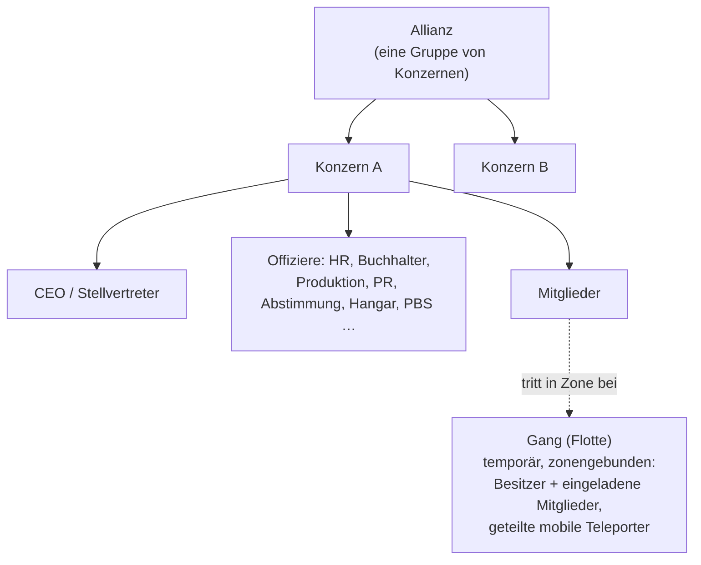

# Gruppen

Es gibt drei Gruppierungsformen: **Konzerne (Corporations)** (deine primäre Organisation),
**Allianzen** (Zusammenschlüsse mehrerer Konzerne) und **Gangs (Flotten)** (temporäre Gruppen für Zoneneinsätze).

> UI-Positionen richten sich nach der [Client-UI-Übersicht](/de/features/ui/) (die Schaltfläche **Konzern** oben links;
> die Kategorie **Konzernlager**; Gangs besitzen ein eigenes Fenster). Die folgenden Mechaniken sind anhand des Servers bestätigt.

## Konzerne

### Beitreten & Verlassen
- Einen Konzern **gründen** — erfordert die grundlegende Konzernmanagement-Erweiterung
  (Stufe 1) und eine Gründungsgebühr von **250.000 NIC**. Du wählst den offiziellen Namen,
  ein **Kürzel (Short ID)** (max. 6 Zeichen, wird auf dem Gelände angezeigt, um deine Mitglieder zu identifizieren)
  sowie den **Steuersatz** — ein Anteil der Einkünfte der Mitglieder (insbesondere Missionsbelohnungen),
  der automatisch auf das Konzernkonto fließt.
- Sich bei einem Konzern **bewerben** oder einen Charakter **einladen**.
- Eine **Bewerbung annehmen** / **Bewerbungen auflisten** (Offiziere).
- Auf eine erhaltene Einladung **antworten**.
- Einen Konzern **verlassen** oder einen ausstehenden Austritt **abbrechen**.
- Ein **Mitglied entfernen**, die **Rolle eines Mitglieds festlegen**, **eigene Rollen ablegen** oder Mitglieder neutral stellen.

### Rollen
Konzerne besitzen eine Rollenhierarchie. Rollen steuern Berechtigungen — z. B. das Freischalten von Knoten im
Konzern-Technologiebaum, das Verwalten des Hangars oder das Bearbeiten der PBS (siehe [PBS](/de/features/pbs/)).
Die vom Server definierten Rollen (`CorporationRole`):

- **CEO** — volle Kontrolle.
- **Stellvertretender CEO (Deputy CEO)** — Stellvertreter der Leitung.
- **Personalmanager (HR Manager)** — Mitgliederverwaltung (Bewerben/Einladen/Entfernen).
- **Konzern-Delegierter / Allianz-Delegierter** — Handeln im Namen der Organisation.
- **Buchhalter (Accountant)** — Konzerngelder verwalten.
- **Produktionsleiter (Production Manager)** — Konzernproduktion.
- **Abstimmungs-Admin (Vote Admin)** — Abstimmungen leiten.
- **PR-Manager** — Öffentlichkeitsarbeit / Schwarzes Brett.
- **Hangar-Zugriff (niedrig / mittel / hoch / sicher)** — gestaffelte Hangar-Berechtigungen mit
  passenden Stufen zum **Entnehmen aus dem Hangar** sowie einer Rolle als **Hangar-Operator**.
- **PBS ansehen / PBS bearbeiten** — PBS-Strukturen des Konzerns einsehen oder modifizieren.
- **Technologiebaum auflisten / freischalten** — den Konzern-Technologiebaum einsehen oder erforschen.

Typische Schwellen: Mitgliederaktionen (Bewerben/Einladen/Entfernen, Rollenvergabe) erfordern
**CEO / Stellvertreter / Personalmanager**; das Schwarze Brett und PR erfordern **CEO / Stellvertreter / PR-Manager**;
Konzerngelder und Einrichtungs-Upgrades erfordern **CEO / Stellvertreter / Buchhalter** (Produktion zusätzlich den
**Produktionsleiter**); das Aufstellen von PBS-Strukturen erfordert **CEO / Stellvertreter / PBS bearbeiten**.

Du kannst das **Rollenprotokoll** für dich und Mitglieder einsehen. Hangarplatz wird gemietet (Standard-Serverkonfiguration:
50.000 Credits pro 7-Tage-Zeitraum).

### Info & Suche
- **Konzern-Info / Meine Info** — Details und deine Mitgliedschaft.
- Konzerne **suchen**.
- **Ansehen / Reputation** — Ansehen und Reputation deines Konzerns.
- **Delegierte** — Charaktere, die im Namen des Konzerns agieren.

### Finanzen
- Auf das Konzernkonto **spenden**.
- Auszahlungen **vornehmen**.
- Zwischen Konten **überweisen**.

### Erscheinungsbild & Profil
- **Umbenennen**, **Farbe festlegen**, **Info festlegen** (öffentliches Profil).
- **Logo** — bis zu 5 Symbole aus einem festen Satz, jedes anpassbar (Größe, Transparenz,
  Ebenenreihenfolge); nur berechtigte Mitglieder dürfen es erstellen oder ändern.
- **Namenshistorie** — frühere Namen.

### CEO
- Sich als **Freiwilliger für den CEO-Posten** melden oder den **Status einer CEO-Übernahme** prüfen.
- **Übernahme in der Praxis**: Ist ein CEO für **30 Tage** offline gewesen, kann ein Stellvertreter
  eine Übernahme einleiten — ein **48-Stunden-Countdown** beginnt, der im Konzernfenster angekündigt wird.
  Der CEO oder jeder andere Stellvertreter kann sofort ein **Veto** einlegen (ein Veto verhindert jedoch
  nicht den nächsten Versuch, falls der CEO sich weiterhin nicht anmeldet). Erreicht der Countdown null,
  wird der Stellvertreter zum CEO mit allen Rechten ernannt.

### Abstimmungen
Konzerne können **Abstimmungen** abhalten:
- Eine Abstimmung **starten**, ihr **Thema festlegen**, Abstimmungen **auflisten**, eine Stimme **abgeben**,
  eine Abstimmung **löschen**.

## Das Schwarze Brett
Ein vom Konzern betriebenes Schwarzes Brett:
- **Eröffnen**, Einträge **auflisten**, **neue Einträge** ansehen, einen Eintrag **verfassen**, **moderieren**
  (Einträge anderer bearbeiten/löschen) und **Details** einsehen.

## Konzern-Hangar (Lager)
Ein geteilter Lagerbereich des Konzerns an Basen:
- Einen Hangarbereich **mieten**, **Miete zahlen**, **Mietpreis** prüfen, Bereich **schließen**.
- Inhalte **auflisten** (alle oder an einer bestimmten Basis).
- **Ordner** — Unterordner erstellen/löschen.
- **Zugriff festlegen** (wer ihn nutzen darf) und **Namen festlegen**.
- **Protokolle** — das Zugriffsprotokoll des Hangars einsehen, konfigurieren und leeren.

Hinweis: Du kannst **keinen Roboter aus dem Konzernhangar** als deinen aktiven Roboter auswählen
(siehe [Roboter](/de/features/robots/)).

## Konzern-Dokumente
Ein gemeinsames, versioniertes Textdokument-System für den Konzern. Es gibt zwei Dokumenttypen:

- **PBS-Plan** — ein Entwurf/Bauplan für das PBS-Netzwerk des Konzerns.
- **Terraform-Projekt** — eine Dokumentation für Geländemodifikations-Projekte.

Operationen: **Erstellen**, **auflisten**, **öffnen**, **Inhalt aktualisieren** (versioniert), **löschen**,
Besitz **übertragen**, **Miete zahlen** (Gültigkeitsdauer verlängern), **überwachen** / **Überwachung aufheben**
(Benachrichtigungen bei Änderungen erhalten) und eine **Registrierungsliste** (bis zu 25 Mitglieder), die regelt,
wer an dem Dokument arbeiten darf.

## Allianzen

Eine Allianz schließt mehrere Konzerne zusammen:
- **Info meiner Allianz**, **Standard-Allianzen** und **Allianz-Rollenhistorie**.
- Ansehen kann auf Allianzen ausgerichtet werden (siehe [Soziales](/de/features/social/)).

## Gangs (Flotten)

Eine **Gang** ist eine temporäre Gruppe für Zoneneinsätze (z. B. um einen mobilen Teleporter zu teilen
oder gemeinsam zu kämpfen):
- **Erstellen**, **löschen**, **Info**.
- **Einladen**, auf Einladung **antworten**, **rauswerfen**, **verlassen**.
- **Anführer festlegen**, **Rolle zuweisen**.

Die Gang-Mitgliedschaft ist entscheidend für **mobile Teleporter** — nur der Besitzer oder ein Gang-Mitglied
darf sie nutzen (siehe [Bewegung](/de/features/movement/)).

## Praktische Hinweise

- **Rollen steuern Macht** — die meisten Offiziersaktionen (Bewerbungen, Hangar, PBS, Abstimmungen) erfordern
  die passende Rolle.
- **Konzernforschung ist geteilt** — das Freischalten für den Konzern nutzt geteilte Punkte und einen
  Multiplikator (siehe [Forschung](/de/features/research/)).
- **Der Hangar ist ein Lager, keine Startrampe** — du kannst daraus nicht in einen Roboter abdocken.
- **Gangs sind kurzlebig** — nutze sie für eine Zonen-Sitzung, nicht als dauerhafte Organisation.
- **Ansehen folgt deinem Konzern** — das Ansehen deines Konzerns beeinflusst, wie das Universum dich behandelt
  (siehe [Soziales](/de/features/social/)).

<!-- TODO: only the corp UI remains (window layout, role picker).
     Confirmed: CorporationRole enum (21 roles incl. hangar access/remove tiers
     low/medium/high/secure, viewPBS/editPBS, TechTreeList/TechTreeUnlock, delegates);
     permission gates sampled from handlers (membership CEO/Deputy/HRManager;
     bulletin CEO/Deputy/PRManager; money+facility upgrades CEO/Deputy/Accountant;
     production +ProductionManager; PBS CEO/Deputy/editPBS); documents = pbsPlan(1) +
     terraformProject(2) (CorporationDocumentType.cs), versioned, rent extends validity,
     monitor for change notifications, register list max 25 (MAX_REGISTERED_MEMBERS).
     Developer notes: Corporations/* (apply/invite/accept, roles, leave, info, money,
     votes, bulletin, hangar, documents, histories, CEO); AllianceGetMyInfo.cs /
     AllianceGetDefaults.cs / AllianceRoleHistory.cs; Gangs/* (create/invite/kick/leave,
     leader/role). SelectActiveRobot.cs forbids corp-hangar robots. -->
