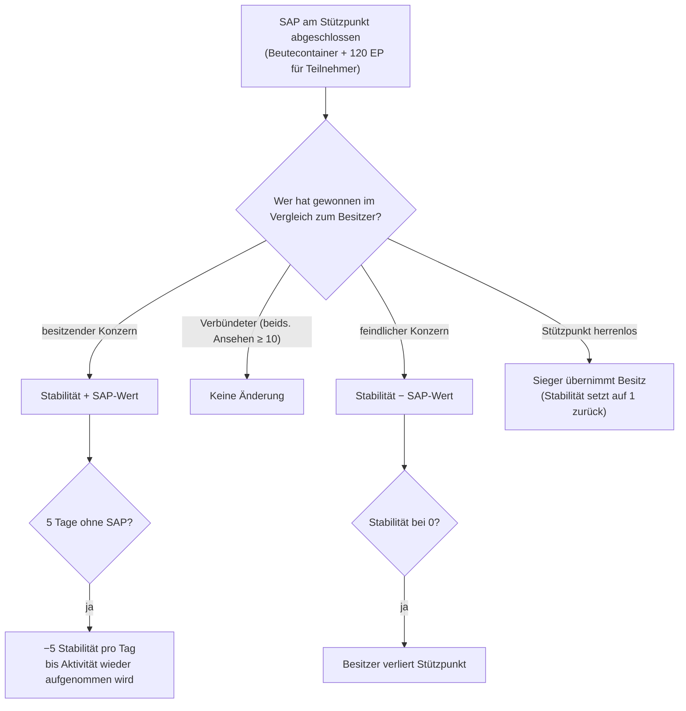

# Intrusion

**Intrusion** ist ein Spielmodus rund um **NPC-Stützpunkte** — von Spielern geführte oder umkämpfte Orte mit
**Stabilität**, **Verteidigung** und **Einrichtungen**. Du investierst Gegenstände, errichtest Verteidigungen und
wertest Einrichtungen auf, um einen Stützpunkt zu kontrollieren und wirtschaftlich zu nutzen.

> Die genaue Bezeichnung im Client für „Intrusion“ sollte bestätigt werden. UI-Positionen richten sich nach der
> [Client-UI-Übersicht](/de/features/ui/). Die folgenden Mechaniken sind anhand des Servers bestätigt.

## Stützpunkte & Stabilität

- **Stützpunkt-Info** — Details eines Intrusion-Stützpunkts.
- **Stabilität** — der zentrale Wert des Stützpunkts, ein Wert von **0 bis 150**. Ein neuer Besitzer startet bei
  **1**. Die Stabilität steuert alles:
  - **Bonus-Schwellenwerte** (Inhalt, `intrusionsitestabilitythreshold`): Einrichtungsboni schalten sich
    bei einer Stabilität von **20 / 60 / 80** frei; eine Reihe von Aura-Effekten (Intrusion Core,
    Erkennung, Geoscan, Harvester, Industrie, Tarnung, Bergbau, Reparatur, Signale — jeweils Stufe 1–3
    plus kombinierte Stufe-4-Effekte) wird stufenweise bei **10, 20, 40, 50, 70, 80 und 100** freigeschaltet;
    **Andockrechte** schalten sich bei **50** frei; das Limit für Verteidigungsknoten steigt bei **40**.
  - **Produktionspunkte** = `Stabilität / 10` (max. 15) — die Währung zum Aufwerten von Einrichtungen
    (ein Punkt pro Stufe).
  - **Verfall (Decay)**: Findet für **5 Tage** kein erfolgreicher SAP statt, verliert der Stützpunkt
    täglich **5 Stabilität**, bis wieder Aktivitäten stattfinden.
  - **Verlust**: Fällt die Stabilität auf **0**, verliert der Besitzer den Stützpunkt (er wird herrenlos).
- **Stabilitätsprotokoll** — Änderungen an der Stabilität eines Stützpunkts einsehen.

### Wer die Stabilität verändert

Stabilitätsänderungen resultieren aus abgeschlossenen **SAPs** (unten) und dem Systemverfall. Die Auswirkung
hängt davon ab, *wer* den SAP im Vergleich zum aktuellen Besitzer gewinnt:

- **Besitzer gewinnt** → Stabilität **steigt** um den Wert des SAP.
- **Ein Verbündeter gewinnt** (gegenseitiges Ansehen ≥ 10) → **keine Änderung**.
- **Ein feindlicher Konzern gewinnt** → Stabilität **sinkt** um den Wert des SAP.
- **Herrenloser Stützpunkt** → der erste siegreiche Spielerkonzern **übernimmt den Besitz** (Stabilität
  setzt auf 1 zurück).

## SAPs (Site Attack Points)

Ein **SAP** ist ein temporäres Ziel, das an einem Stützpunkt spawnt. Sein Abschluss hinterlässt einen
**Beutecontainer** an der Position des SAP, verändert die Stabilität und belohnt jeden teilnehmenden
Charakter mit **120 EP**. **NPC-Kultisten kämpfen ebenfalls um die SAPs** — füllen sie die Wertung
zuerst, zählt der SAP gegen deine Seite. Es gibt vier SAP-Typen:

| SAP | Durchführung | Stabilitätswert |
|---|---|---|
| **Aktives Hacken** | Ein Hackingmodul auf den SAP anwenden (bis zu 120 Modulnutzungen) | +15 |
| **Passives Hacken** | Für **8 Minuten** innerhalb von Reichweite 5 des SAP stehen | +10 |
| **Zerstörung** | Den SAP zerstören (NPC-Schaden zählt ebenfalls) | +15 |
| **Probenverarbeitung** | **5–6 SAP-Proben** einreichen (in Chargen von 2–3, 1,5 Min. Cooldown, Reichweite 7) | +15 |

- **Einen SAP-Gegenstand einreichen** — in einer Zone eine Probe bei einem Probenverarbeitungs-SAP einreichen.
- **SAP-Gegenstandsinfo** — Daten zu SAP-Gegenständen einsehen (eigene und allgemeine).

SAP-Proben sind die Verbrauchsgüter dieses Modus; sie besitzen zudem einen hohen Kernenergie-Wert und dienen
daher auch als [PBS-Reaktortreibstoff](/de/features/pbs/).

## Verteidigung & Effekte

- **Verteidigungsschwelle festlegen** — die Schwelle konfigurieren, ab der die automatische Verteidigung des Stützpunkts eingreift.
- **Effektbonus festlegen** — die Konfiguration der Aura-/Effektboni an einem Stützpunkt wählen (aus den über Stabilität freigeschalteten Auren).
- **Eine Einrichtung aufwerten** — eine Stützpunkteinrichtung verbessern: Kostet **1 Produktionspunkt**
  (d. h. 10 Stabilität), nur für CEO / Stellvertreter / Buchhalter, begrenzt auf eine Maximalstufe.
- **Eine Stützpunktnachricht festlegen** — eine öffentliche Nachricht für den Stützpunkt verfassen.

## Protokolle

- **Mein Intrusion-Protokoll** — deine eigenen Intrusion-Aktivitäten.
- **Öffentliches Protokoll** — der öffentliche Intrusion-Feed.
- **Protokoll meiner Stützpunkte** — Aktivitäten an deinen Stützpunkten.
- **Stabilitätsprotokoll** — Stabilitätsänderungen (siehe oben).

## Praktische Hinweise

- **Stabilität ist der Schlüsselwert** — sie schaltet die Bonusstufen frei, erzeugt die Aufwertungswährung
  und ist das, was feindliche SAPs abbauen.
- **SAPs sind umkämpft** — die NPC-Kultisten liefern sich ein Rennen mit dir; ein verlorener SAP kostet Stabilität.
- **Lass einen Stützpunkt nicht ungenutzt stehen** — 5 Tage ohne erfolgreichen SAP starten den täglichen Punkteverfall.
- **Protokolle liefern den Überblick** — nutze die eigenen, öffentlichen und Stabilitätsprotokolle, um das
  Geschehen an deinen Stützpunkten zu verfolgen.

<!-- TODO: only the in-client name for "intrusion" and the UI remain.
     Confirmed: stability 0-150, start 1 (Outpost.cs constants); bonus thresholds from
     intrusionsitestabilitythreshold (facility 20/60/80; aura effects 50-74 at tiers
     10/20/40/50/70/80/100; docking rights 50; defense nodes 40); production points =
     stability/10, facility upgrade costs 1 point, CEO/Deputy/Accountant; decay -5/day
     after 5 days idle (OutpostDecay.cs); owner-win +, ally (standing>=10) 0,
     hostile -; unowned -> winner takes it; stability 0 -> ownership lost; 120 EP per
     SAP participant (EP_WINNER, EpForActivityType.Intrusion); 4 SAP types: active
     hacking (120 module uses, +15), passive (8 min in range 5, +10), destruction
     (kill it, +15), specimen processing (5-6 specimens in 2-3 batches, 1.5 min cd,
     range 7, +15; siegeitems table: def_specimen_sap_item 2-3); SAP increase values
     from entitydefaults #increase option; NPC sap guard/invade units contest SAPs.
     Developer notes: Intrusion/IntrusionSAPSubmitItem.cs (SpecimenProcessingSAP,
     zone submit), IntrusionSAPGetItemInfo.cs / IntrusionSapItemInfo.cs,
     IntrusionSetDefenseThreshold.cs, IntrusionSiteSetEffectBonus.cs,
     IntrusionUpgradeFacility.cs, SetIntrusionSiteMessage.cs; GetIntrusionSiteInfo.cs,
     GetIntrusionLog.cs / GetIntrusionPublicLog.cs / GetIntrusionMySitesLog.cs /
     GetIntrusionStabilityLog.cs, GetStabilityBonusThresholds.cs;
     EventProcessors/AffectOutpostStability.cs; Zones/Intrusion/Outpost.cs,
     OutpostDecay.cs, SAP.cs + *SAP.cs subclasses. -->